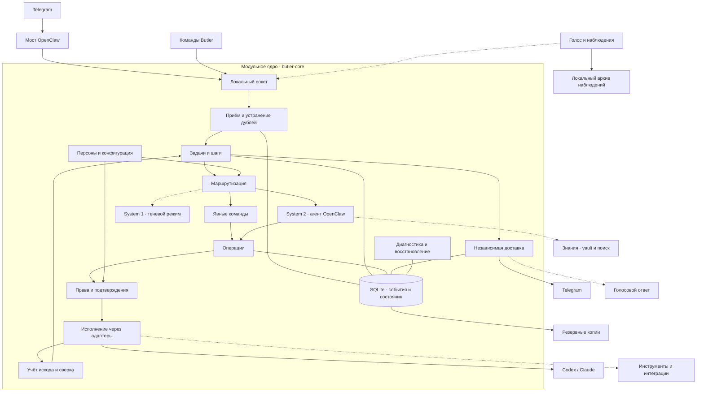

# Расскажи мне больше, покажи мне архитектуру приложения остального того, что мы сейчас пишем в ModularCore архитектуре.

*Discussion: Architecture*

В ModularCore центр приложения — **единый учёт поручений, прав и результатов**. Ниже — схема по текущему коду; пунктиром показаны связи, перенос которых в ядро ещё продолжается.

Главное разделение: **задача хранит намерение и прогресс, операция — конкретное действие, доставка — передачу результата**. Поэтому сбой отправки ответа не должен запускать работу повторно, а неизвестный исход действия требует сверки.

В [коде ядра](/Users/boris/Projects/MacStudioButler/implementation/butler-core/butler_core/service.py) эти модули уже собраны вместе. По [журналу изменений](/Users/boris/Projects/MacStudioButler/implementation/butler-core/CHANGELOG.md) подключён учёт запусков Codex/Claude; голосовые задачи ещё выключены до переноса запускающего компонента. System 1 пока только записывает предположения. Полный перенос остальных интеграций и подтверждение работы установленного приложения из прочитанных файлов не следуют.
