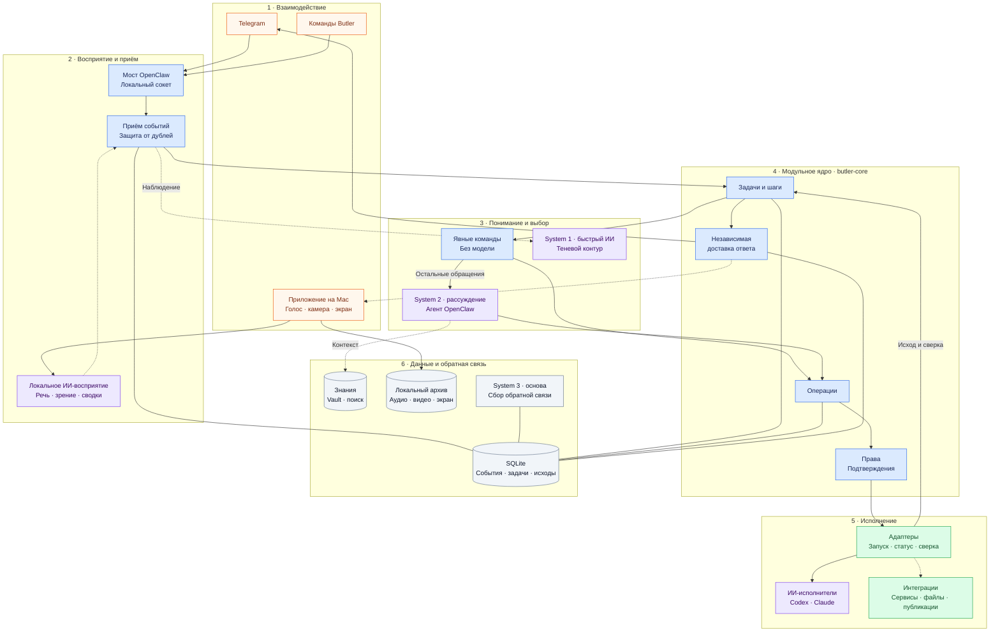

# Покажи мне по уровням, а особенно с точки зрения AI внедрения цветовыми, можешь выделять вещами, то есть покажи мне вот такую знаешь общую архитектуру, лейерную, модульную архитектуру, как она у нас устроена.

*Discussion: Architecture*

Вот слои по текущему коду и архитектурному плану: **фиолетовый — ИИ, синий — управление, зелёный — исполнение, серый — данные**. Пунктир обозначает связи, перенос которых в модульное ядро ещё не завершён.

ИИ здесь находится в трёх местах: **восприятие, рассуждение и выполнение специализированной работы**. [Ядро](implementation/butler-core/butler_core/service.py) связывает их через задачи, права и учёт результата.

По [маршрутизации](implementation/butler-core/butler_core/routing.py), System 1 пока не управляет действиями; подключённую модель в запуске ядра я не нашёл. Для System 3 подтверждён [сбор обратной связи](implementation/butler-core/butler_core/feedback.py), но полноценное самообучение из прочитанного не следует.
