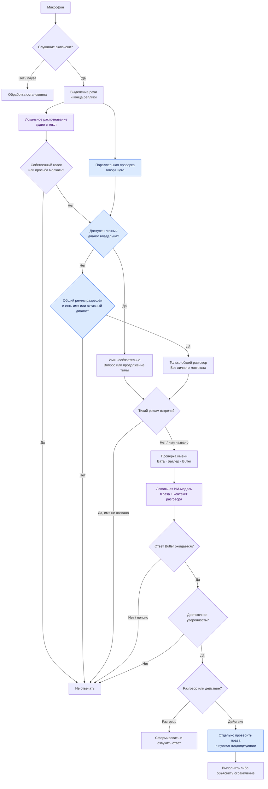

# Расскажи как butler понимает что обращаются к нему - весь процесс

*Discussion: Architecture*

Butler разделяет два вопроса: **«Эта фраза обращена ко мне?» и «Что этому человеку разрешено?»** Для голоса процесс устроен так — по текущему коду:

**Имя — подсказка, а не обязательное слово активации.** В личном диалоге модель получает последние пять минут разговора и до двух минут окружающих реплик. Поэтому «Почему именно так?» может продолжать предыдущий ответ. «Света, выключи свет», цитата или телевизор должны оставлять Butler молчащим. В [проверке обращения](implementation/ambient-awareness/butler_ambient/conversation.py:843) порог оценки модели — **0,75 с именем и 0,90 без имени**; это внутренняя оценка, а не измеренная вероятность правильного решения.

**Узнать владельца недостаточно для исполнения команды.** Для личного ответа проверяется свежесть допуска, а для команд — отдельно голос говорящего и необходимые подтверждения. В общем режиме неподтверждённый собеседник может начать разговор с имени помощника, затем продолжать без имени, но личные данные и инструменты ему недоступны. Точная проверка «Батлер, ты меня слышишь?» имеет отдельный короткий путь ответа и не выдаёт никаких прав.

Это реализованная логика, но **надёжность живого общения пока не подтверждена**: в [описании текущего ограничения](implementation/ambient-awareness/README.md) зафиксировано, что вопросы без имени и продолжения разговора всё ещё пропускаются. В Telegram другой вход: сообщение поступает через OpenClaw и [мост ядра](implementation/butler-core/bridge/lib/bridge.js); описанная выше голосовая проверка к нему не применяется.
