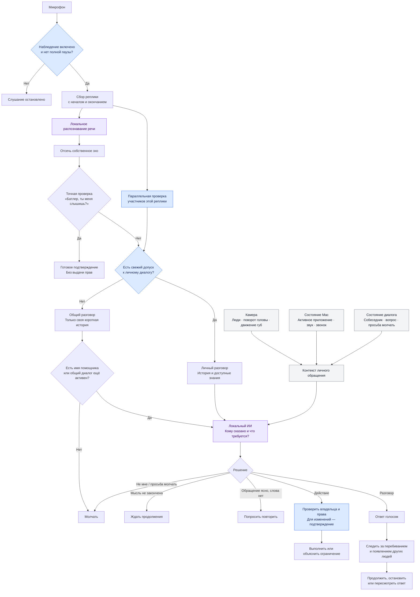

# Ну а теперь мне тогда расскажи, как сейчас устроено. То же самое вопрос, но сейчас мы поменяли кое-что, передумай заново и нарисуй мне новую картину.

*Discussion: Architecture*

Теперь картина такая: **Butler слышит речь независимо от узнавания владельца, а затем отдельно решает: кому отвечать, какой контекст использовать и можно ли действовать.** Схема по текущему коду:

**Главное изменение — два режима разговора.** Если биометрия не подтвердила владельца, обычный разговор всё равно возможен: начать нужно с имени помощника, затем можно продолжать без имени в течение пяти минут после последнего обмена. Личные знания, файлы и инструменты этому режиму недоступны. Это уже реализовано в [маршрутизации услышанной речи](/Users/boris/Projects/MacStudioButler/implementation/ambient-awareness/butler_ambient/listening.py:193).

**В личном режиме появилась презумпция обращения:** если владелец один, на Mac ничего не играет и нет приложения звонка на переднем плане, Butler по умолчанию считает речь обращённой к нему — кроме явного чтения вслух, телефонного разговора или разговора с собой. Камера добавляет признаки присутствия других людей и направления лица; состояние диалога помогает понять ответ на собственный вопрос Butler. Эти правила находятся в [обработке реплики](/Users/boris/Projects/MacStudioButler/implementation/ambient-awareness/butler_ambient/conversation.py:1058).

Старое утверждение «живой диалог пока не подтверждён» уже устарело: [последняя запись от 24 октября](/Users/boris/Projects/MacStudioButler/docs/features/butler-vision-and-ambient-awareness/discussion.md:463) отмечает реальные голосовые диалоги и установленную версию `0.3.3`. Я сверил код и записи проекта; сам живое общение сейчас не проверял.
