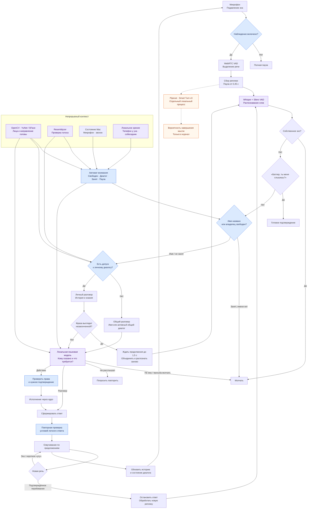

# Опять были изменения, были добавлены дополнительные third-party libraries. Пересмотри еще раз это заново и нарисуй мне новый цикл, новый flow.

*Discussion: Architecture*

Сейчас главное изменение — **появился отдельный контур внимания: Butler отслеживает, разговариваешь ли ты с ним или занят другим.** Новые Pipecat и Smart Turn уже подключены, но Smart Turn пока оценивает завершённость мысли в фоне; момент ответа всё ещё определяет прежний механизм.

Фиолетовый — модели, синий — управление, оранжевый и пунктир — фоновая оценка. Схема по исходникам версии `0.3.9`; установленный процесс я сейчас не проверял.

В [автомате внимания](/Users/boris/Projects/MacStudioButler/implementation/ambient-awareness/butler_ambient/attention.py) занятость удерживается 30 секунд после сигнала, диалог — пять минут. Имя снимает занятость, но доступ к личным данным проверяется отдельно. Для обращения без имени по умолчанию теперь нужны **одиночество, тихий Mac и лицо владельца, направленное к Mac**; одно неузнанное лицо в темноте больше не считается вторым человеком.

[Pipecat подключён отдельной зависимостью](/Users/boris/Projects/MacStudioButler/implementation/ambient-awareness/pyproject.toml), а [Smart Turn работает в теневом режиме](/Users/boris/Projects/MacStudioButler/implementation/ambient-awareness/butler_ambient/endpointing.py). Полный переход на его управление очередностью речи и перебиванием описан в плане, но в текущем коде ещё не завершён.
