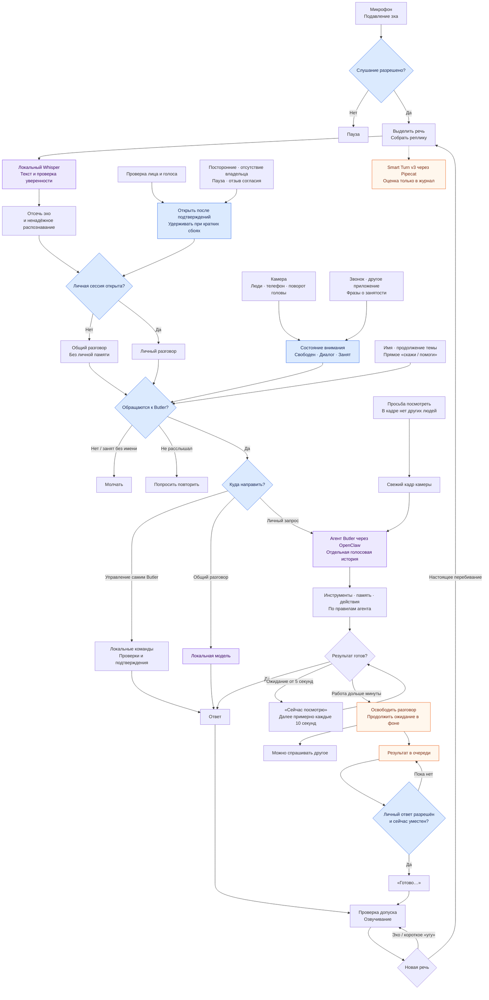

# Скажи теперь, как все происходит после последних изменений.

*Discussion: Architecture*

Сейчас главное изменение — **голос стал входом к агенту Butler, тому же, что работает в Telegram**. Локальные модели распознают речь и определяют обращение; личный запрос затем получает агент со своими инструментами и памятью. Ниже — по текущим исходникам `0.3.21`; установленный процесс я не проверял.

**Продолжение разговора теперь общее для личного и общего режима:** переключение между ними само по себе не должно заставлять снова произносить имя. Одиночный кадр с одним человеком больше не считается достаточным доказательством разговора с кем-то другим. Открытая личная сессия также переживает краткие провалы узнавания.

**Долгая задача освобождает голосовой канал через минуту**, но ожидание ответа агента продолжается до 30 минут. Полноценного механизма, через который агент сам присылает голосовой результат спустя часы, я пока не нашёл. И Smart Turn ещё не управляет концом реплики: рабочий механизм по-прежнему использует паузы и ожидание продолжения незаконченной фразы.
