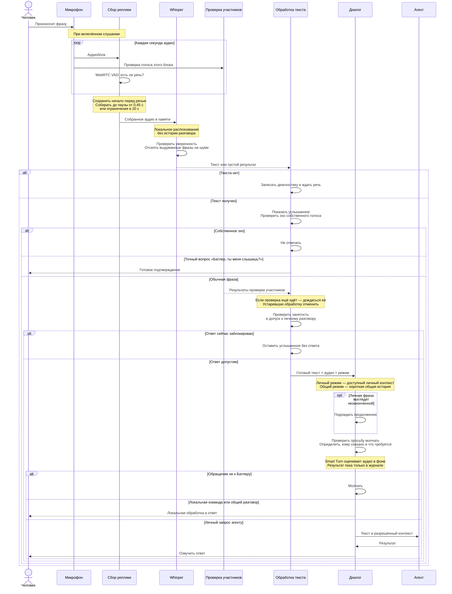

# Нарисуй мне секундс-диаграмму для аудио-входа. Что происходит с разговором, то есть с фразой, когда она расшифровывается.

*Discussion: Architecture*

По текущему коду фраза **сначала собирается целиком, затем расшифровывается локально**. Проверка говорящего идёт параллельно; готовый текст передаётся в диалог без повторного распознавания.

Схема основана на [listening.py](/Users/boris/Projects/MacStudioButler/implementation/ambient-awareness/butler_ambient/listening.py:201), [transcriber.py](/Users/boris/Projects/MacStudioButler/implementation/ambient-awareness/butler_ambient/transcriber.py:159) и [conversation.py](/Users/boris/Projects/MacStudioButler/implementation/ambient-awareness/butler_ambient/conversation.py:1311). Пауза в 0,45 секунды — порог выделения реплики; из-за обработки секундными блоками она не означает ответ ровно через 0,45 секунды.
