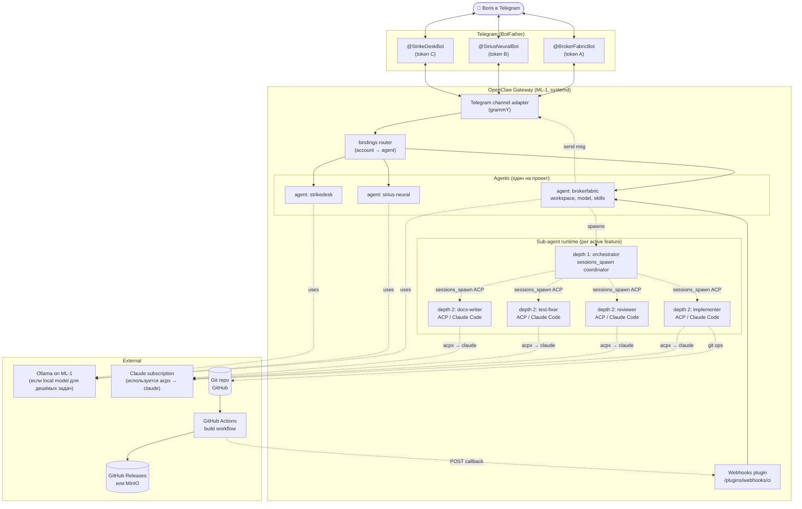
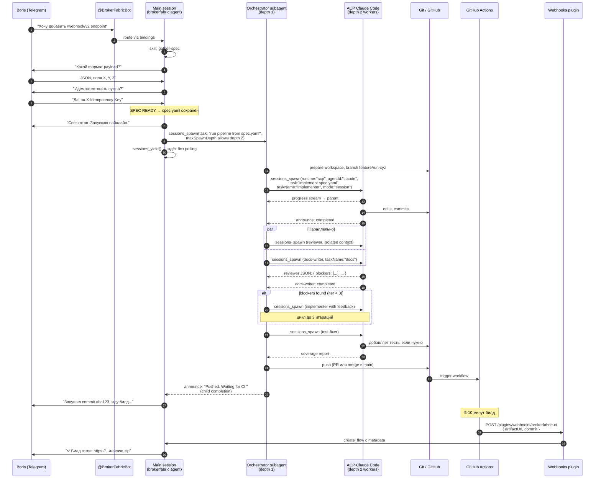

# OpenClaw-native Multi-Agent Coding Pipeline

**Архитектура автоматизированной разработки через Telegram: один бот = один проект, requirement → implement → review → test → docs → deploy → notify, всё внутри OpenClaw Gateway.**

Версия: 0.2 (полная пересборка с учётом реальных примитивов OpenClaw).

> **Примечание по точности**: документ основан на чтении docs.openclaw.ai (страницы Architecture, Multi-agent routing, Sub-agents, ACP agents, Skills, Webhooks plugin, Lobster) на момент написания. По мере знакомства с реальной системой какие-то детали могут меняться — там, где есть неуверенность, явно отмечено `[проверить: <команда>]`.

---

## 0. TL;DR

Вся «оркестрация» строится на четырёх примитивах OpenClaw:

1. **Multi-agent routing** — один Gateway, по агенту на проект, каждый со своим workspace, бот-токеном Telegram, моделью.
2. **`sessions_spawn` с `maxSpawnDepth: 2`** — паттерн main → orchestrator-subagent → workers; рабочие шаги (implement/review/test/docs) идут как Claude Code ACP workers на Opus.
3. **ACP runtime** через `sessions_spawn({ runtime: "acp", agentId: "claude", model: "opus" })` — это и есть запуск Claude Code на тяжёлые задачи. OpenClaw уже умеет это «из коробки» через acpx plugin.
4. **Webhooks plugin** — приём callback'а от CI с URL артефакта, поднимает paused TaskFlow и продолжает работу агента.

Кастомного кода (Go-сервиса, своих state machines, своих Telegram-bridge) — **ноль**. Всё это уже встроено. Работа = редактирование `~/.openclaw/openclaw.json`, создание skills под `~/.openclaw/workspace-<project>/skills/`, и пара GitHub Actions workflow'ов.

---

## 1. Картирование задач на примитивы OpenClaw

| Что хотел Boris | Что в OpenClaw |
|---|---|
| Один бот = один проект | `agents.list[]` + `bindings[]` + `channels.telegram.accounts[]` |
| Бот по Telegram собирает требования | Main session агента + skill `gather-spec` (slash-command или часть system prompt) |
| Когда спек готов, запускается отдельный агент в Claude Code | `sessions_spawn({ runtime: "acp", agentId: "claude", model: "opus", task: <spec>, mode: "session", thread: true })` |
| Code review | `sessions_spawn({ runtime: "acp", agentId: "claude", model: "opus", task: <review prompt> })` |
| Тесты + coverage + автофикс | `sessions_spawn({ runtime: "acp", agentId: "claude", model: "opus", task: "run tests, check coverage..." })` |
| Параллельно обновляется документация | ещё один sub-agent с `taskName: "docs"`, `task: "update docs based on diff"` |
| Деплой в main | sub-agent с git операциями (либо детерминистический step через Lobster) |
| После CI ссылка возвращается в Telegram | Webhooks plugin принимает POST от GitHub Actions → `resume_flow` → агент отправляет URL в исходный Telegram-тред |

---

## 2. Высокоуровневая архитектура



**Ключевая вещь**: Pipeline не «живёт» где-то отдельно. Он живёт *внутри* агентской сессии. Когда юзер пишет фичу — это одна сессия `agent:brokerfabric:main:<chat>`. Когда в этой сессии main-агент решает «спек готов, делаем», он вызывает `sessions_spawn` — рождается дочерняя orchestrator-сессия `agent:brokerfabric:subagent:<uuid>`, которая в свою очередь спавнит ACP-сессии для Claude Code.

---

## 3. Компоненты подробно

### 3.1 Per-project agents (один agent = один проект)

Каждый проект — это отдельный agent в OpenClaw с собственным:
- **Workspace**: `~/.openclaw/workspace-<project>/` — там лежат `AGENTS.md`, `SOUL.md`, `skills/`, и (обычно) git clone проекта в подпапке либо сам workspace и есть checkout.
- **agentDir**: `~/.openclaw/agents/<project>/agent/` — auth-профили, model registry, session store.
- **Bound Telegram bot**: через `bindings[]`.
- **Default model**: тот, что используется для main-сессии (диалог с пользователем). Может быть локальной моделью через OpenAI-compat endpoint (Ollama) или Anthropic Sonnet.
- **Subagent model**: дешевая модель для оркестраторного sub-agent'а. Через `agents.list[].subagents.model`.

Создаются командой:
```bash
openclaw agents add brokerfabric
openclaw agents add sirius-neural
openclaw agents add strikedesk
```

Это создаёт workspace и agentDir, после чего нужно отредактировать `~/.openclaw/openclaw.json`.

### 3.2 Telegram-боты

Один бот на проект. Через BotFather получаешь токен, добавляешь его как `account` в Telegram channel:

```bash
# Создал бота в BotFather, получил token "123:ABC..."
# Сохранил в ~/.openclaw/.env как BROKERFABRIC_BOT_TOKEN=123:ABC...
```

В `~/.openclaw/openclaw.json`:
```json5
{
  channels: {
    telegram: {
      accounts: {
        brokerfabric: {
          botToken: "BROKERFABRIC_BOT_TOKEN",  // referencing env
          dmPolicy: "allowlist",
          allowFrom: ["tg:<твой telegram user id>"]
        },
        "sirius-neural": {
          botToken: "SIRIUS_NEURAL_BOT_TOKEN",
          dmPolicy: "allowlist",
          allowFrom: ["tg:<твой telegram user id>"]
        }
      }
    }
  }
}
```

`dmPolicy: "allowlist"` + `allowFrom: ["tg:<your_user_id>"]` — критичная защита, чтобы никто другой не мог писать твоим ботам и тратить твои токены/деньги.

### 3.3 Bindings (маршрутизация бот → agent)

```json5
{
  bindings: [
    {
      type: "route",
      agentId: "brokerfabric",
      match: { channel: "telegram", accountId: "brokerfabric" }
    },
    {
      type: "route",
      agentId: "sirius-neural",
      match: { channel: "telegram", accountId: "sirius-neural" }
    },
    {
      type: "route",
      agentId: "strikedesk",
      match: { channel: "telegram", accountId: "strikedesk" }
    }
  ]
}
```

Bindings deterministic, most-specific wins. Так как каждый бот = свой `accountId`, конфликтов нет.

### 3.4 Sub-agent orchestrator pattern (`maxSpawnDepth: 2`)

По умолчанию sub-agents не могут спавнить детей (`maxSpawnDepth: 1`). Нам нужен паттерн main → orchestrator → workers, что требует **депт 2**:

```json5
{
  agents: {
    defaults: {
      subagents: {
        maxSpawnDepth: 2,         // главное — разрешаем уровень оркестратор → воркер
        maxChildrenPerAgent: 5,   // лимит активных детей на сессию
        maxConcurrent: 8,         // глобальный лимит lane'а
        runTimeoutSeconds: 1800,  // 30 минут таймаут на дочерний run по умолчанию
        delegationMode: "prefer", // main-агенту нудят делегировать тяжёлое
        model: "anthropic/claude-haiku-4-5"  // дешёвая модель для sub-agent'ов
      }
    }
  }
}
```

**Что это даёт:**
- **depth 0 (main)**: разговор с пользователем в Telegram. Собирает спек, в нужный момент вызывает `sessions_spawn` для orchestrator'а.
- **depth 1 (orchestrator)**: получает спек, проверяет, валидирует, потом сам делает `sessions_spawn` × N для воркеров (с `runtime: "acp"`).
- **depth 2 (workers)**: implementer, reviewer, test-fixer, docs-writer. Это ACP-сессии (Claude Code), `sessions_spawn` для них недоступен (как и должно быть — депт 2 это «листья»).
- **Cascade stop**: если юзер пишет `/stop` или `/subagents kill all` — оркестратор и все воркеры останавливаются.
- **Auto-archive**: воркер-сессии архивируются через `agents.defaults.subagents.archiveAfterMinutes` (default 60).

### 3.5 ACP runtime для Claude Code

Это самый важный кусок и причина, по которой я был неправ в первом доке. **OpenClaw уже умеет запускать Claude Code через ACP (Agent Client Protocol).** Никаких subprocess-обвязок, никаких `os/exec` — это встроено через bundled `acpx` plugin.

Базовая конфигурация:
```json5
{
  acp: {
    enabled: true,
    backend: "acpx",
    defaultAgent: "claude",          // или "codex" — на выбор
    allowedAgents: ["claude", "codex", "opencode"],
    maxConcurrentSessions: 4,
    runtime: { ttlMinutes: 120 }
  },

  // Permissions для non-interactive ACP — критично!
  plugins: {
    entries: {
      acpx: {
        enabled: true,
        config: {
          permissionMode: "approve-all",         // или "approve-reads" + явные approvals
          nonInteractivePermissions: "deny",     // graceful degradation вместо crash
          timeoutSeconds: 600                    // 10 минут на ACP-startup
        }
      }
    }
  }
}
```

> **Внимание про permissions**: default OpenClaw — `approve-reads` + `nonInteractivePermissions: fail`. В non-interactive ACP-сессии любая запись/exec, требующая prompt'а — крашит сессию с `AcpRuntimeError`. Для нашего pipeline implementer'у нужно писать файлы и запускать тесты, поэтому либо `approve-all` (проще), либо tightly-scoped allowed list с hooks (безопаснее, но больше работы).

После этого первый smoke test:
```bash
/acp doctor                 # должно показать healthy backend
/acp spawn claude --mode oneshot   # пробный one-shot запуск Claude Code
```

И программный запуск из агента — это просто tool call в его сессии:
```json
{
  "task": "Implement feature according to spec. Spec is in workspace/specs/<run-id>.yaml. Follow conventions in CLAUDE.md.",
  "runtime": "acp",
  "agentId": "claude",
  "model": "opus",
  "mode": "session",
  "thread": true,
  "cwd": "/home/boris/code/brokerfabric",
  "taskName": "implementer",
  "label": "implement feature <run-id>",
  "streamTo": "parent"
}
```

`streamTo: "parent"` важно — promo-апдейты ACP-runtime ("работаю над handler/webhook.go...") стримятся в parent (orchestrator) сессию, который может репортить их в Telegram через main.

### 3.6 Skills как «процедуры» pipeline'а

Boris уже понимает skills (у него лежат свои в `~/.agents/skills/reflection-psychologist/`). OpenClaw skills совместимы с AgentSkills spec — `SKILL.md` с YAML frontmatter и инструкциями.

Под наш pipeline в `~/.openclaw/workspace-<project>/skills/` будут лежать:

```
skills/
├── gather-spec/
│   └── SKILL.md           # как собирать requirements: какие поля, в каком порядке
├── orchestrate-pipeline/
│   └── SKILL.md           # как должен работать orchestrator-subagent
├── review-feature/
│   └── SKILL.md           # промпт ревьюера + JSON-schema вывода
├── test-and-coverage/
│   └── SKILL.md           # как запускать тесты, считать coverage, что считать регрессом
├── update-docs/
│   └── SKILL.md           # whitelisted paths для docs, стиль
└── deploy-to-main/
    └── SKILL.md           # git стратегия (PR vs trunk), CI триггер
```

**Пример: `gather-spec/SKILL.md`**:
```markdown
---
name: gather-spec
description: Collect a complete, unambiguous feature spec from the user via Q&A
metadata: { "openclaw": { "always": true } }
user-invocable: true
---

# Gather Spec

When the user describes a feature, ask clarifying questions (ONE at a time)
until all fields of the spec template are unambiguous. Then write the spec to
`{baseDir}/../specs/<short-slug>-<date>.yaml` and announce SPEC READY.

## Required fields
- title
- type: feature | bugfix | refactor | chore
- scope.affects_packages
- scope.affects_apis
- scope.breaking_change (true/false)
- intent (2-3 sentences)
- acceptance_criteria (2-5 testable bullets)
- non_goals
- constraints
- test_strategy
- deployment_notes

## Rules
1. ONE focused question at a time. Never machine-gun.
2. If answer ambiguous — restate your understanding, ask to confirm.
3. You can use `read` tool to inspect repo structure to ground questions
   (e.g., to know what packages exist). Don't mention this to the user.
4. When ALL fields determined, write YAML to specs/, then end your message with:
   `SPEC READY: <filename>`
5. Don't write code. You are the analyst.
6. Match user language (Russian by default for Boris).
```

`metadata.openclaw.always: true` — гарантирует, что skill всегда в промпте main-агента.

**Пример: `orchestrate-pipeline/SKILL.md`** — это то, что main-агент вызывает после SPEC READY:
```markdown
---
name: orchestrate-pipeline
description: Run the full implementation pipeline given a ready spec
metadata: { "openclaw": { "always": false } }
user-invocable: false
disable-model-invocation: false
---

# Orchestrate Pipeline

Given a spec file path, run the pipeline by spawning an orchestrator subagent
and yielding. The orchestrator will spawn ACP workers (implementer, reviewer,
test-fixer, docs-writer) and report progress.

## How to invoke

Call `sessions_spawn` with:
- task: "Read spec at <path> and run the full implementation pipeline.
         Use the orchestrate-pipeline-runner skill."
- agentId: <same project>
- taskName: "pipeline-<short-slug>"
- runTimeoutSeconds: 7200  (2 hours)

Then call `sessions_yield`.

The orchestrator subagent will use the `pipeline-runner` skill (lives in
{baseDir}/../pipeline-runner/) to:
1. ACP spawn implementer
2. wait, then ACP spawn reviewer
3. if blockers — re-spawn implementer with feedback (max 3 iters)
4. ACP spawn test-fixer
5. in parallel — ACP spawn docs-writer
6. when both done — git push to main
7. set TaskFlow status=waiting, return to main agent with: "Pushed. Waiting for CI."

CI callback (Webhooks plugin) resumes the flow and the main agent posts the
artifact URL to the user.
```

> **NB**: Я не уверен на 100% что `pipeline-runner` нужно делать отдельной skill, а не просто инструкцией в orchestrator-промпте. Это деталь, которую можно решить в процессе. Главное — паттерн.

### 3.7 Workspace files: AGENTS.md, SOUL.md

Каждый workspace инжектит `AGENTS.md`, `SOUL.md`, `TOOLS.md`, `USER.md` в системный промпт main-агента. Sub-agents и ACP-сессии тоже получают `AGENTS.md` (плюс ACP добавляет `CLAUDE.md` если он есть).

**`~/.openclaw/workspace-brokerfabric/AGENTS.md`**:
```markdown
# BrokerFabric agent

## Project
Go service, internal Bread Financial repo. Stack: Go 1.24, gokit (shared lib),
Postgres, Kafka.

## Conventions
- All new endpoints must have OpenAPI spec in docs/api/
- Error wrapping: fmt.Errorf with %w
- Logging: structured via gokit/log, no fmt.Println
- Tests: table-driven, mocks via mockgen in internal/mocks
- Branch strategy: PR-based (NOT trunk). Always create feature/<run-id> branch.

## Pipeline behavior
When user describes a feature in Russian or English:
1. Use the `gather-spec` skill to collect requirements via Q&A.
2. When SPEC READY, automatically use the `orchestrate-pipeline` skill.
3. Report progress messages back to the user.
4. When pipeline waits for CI, tell the user "Запушил, жду CI."
5. When CI callback arrives (you'll see a resume signal), post the artifact URL.

## Tool restrictions
Main session: read/exec/write allowed in workspace.
Orchestrator subagents: sessions_spawn/sessions_yield/sessions_history.
Worker ACP sessions: full tools but cwd-restricted to the project checkout.

## Cost
Use sonnet for main session. Use haiku for orchestrator. Use Claude (via ACP) for
heavy work — that uses the Claude subscription, not API tokens.
```

**`~/.openclaw/workspace-brokerfabric/SOUL.md`** — это персоналити-файл:
```markdown
# Soul: BrokerFabric Agent

You are Boris's right hand for BrokerFabric work.
- Reply in Russian by default (Boris is Russian-speaking).
- Tone: technical, direct, concise. No fluff.
- When user is ambiguous — ask, don't guess.
- When you fail or hit a wall — say so plainly. Don't make stuff up.
- For status updates: short ("⚙️ implementer started", not paragraphs).
- For final results: structured ("✅ pushed to main / 🔗 build: <url>").
```

### 3.8 Webhooks plugin для CI callback

Включаем плагин:
```json5
{
  plugins: {
    entries: {
      webhooks: {
        enabled: true,
        config: {
          routes: {
            "brokerfabric-ci": {
              path: "/plugins/webhooks/brokerfabric-ci",
              sessionKey: "agent:brokerfabric:main",
              secret: {
                source: "env",
                provider: "default",
                id: "BROKERFABRIC_CI_SECRET"
              },
              description: "BrokerFabric CI build callback"
            }
            // ... аналогично для каждого проекта
          }
        }
      }
    }
  }
}
```

> **Важная деталь, которую надо проверить**: webhook plugin привязан к конкретному `sessionKey`. Но run у нас живёт в дочерней сессии (`agent:brokerfabric:subagent:<uuid>`), не в `main`. Скорее всего правильный паттерн — webhook callback идёт в main-сессию, а main находит нужный run по `commit_sha` из payload и делает `sessions_history` чтобы понять контекст. Или используется `run_task` / `resume_flow` через managed TaskFlow. **[проверить: реальный паттерн TaskFlow + webhook на свежей версии]**.

#### GitHub Actions workflow (`.github/workflows/build-and-notify.yml`):
```yaml
name: build-and-notify
on:
  push:
    branches: [main]

jobs:
  build:
    runs-on: ubuntu-latest
    steps:
      - uses: actions/checkout@v4
      - uses: actions/setup-go@v5
        with: { go-version: '1.24' }

      - name: Build
        run: |
          mkdir -p dist
          CGO_ENABLED=0 go build -o dist/brokerfabric ./cmd/brokerfabric

      - name: Upload to GitHub Release
        id: release
        uses: softprops/action-gh-release@v2
        with:
          tag_name: build-${{ github.sha }}
          files: dist/*
          generate_release_notes: true

      - name: Notify OpenClaw
        run: |
          ARTIFACT_URL=$(echo '${{ steps.release.outputs.assets }}' | jq -r '.[0].browser_download_url')
          curl -X POST $OPENCLAW_WEBHOOK_URL \
            -H 'Content-Type: application/json' \
            -H "Authorization: Bearer $OPENCLAW_WEBHOOK_SECRET" \
            -d @- <<EOF
          {
            "action": "create_flow",
            "goal": "CI build complete",
            "metadata": {
              "project": "brokerfabric",
              "commit": "${{ github.sha }}",
              "branch": "${{ github.ref_name }}",
              "artifactUrl": "$ARTIFACT_URL",
              "status": "success"
            }
          }
          EOF
        env:
          OPENCLAW_WEBHOOK_URL: ${{ secrets.OPENCLAW_WEBHOOK_URL }}
          OPENCLAW_WEBHOOK_SECRET: ${{ secrets.OPENCLAW_WEBHOOK_SECRET }}
```

`OPENCLAW_WEBHOOK_URL` будет вида `https://<твой gateway>/plugins/webhooks/brokerfabric-ci`. Чтобы наружу пробросить — Tailscale Funnel или ngrok, или reverse-proxy на ML-1.

### 3.9 Sandbox для ACP-воркеров

ACP-сессии по умолчанию **бегут на хосте, не в sandbox** — это важная деталь, прямо написана в доке:

> "ACP sessions currently run on the host runtime, not inside the OpenClaw sandbox."

Это значит, что Claude Code, спавненный через ACP, имеет доступ к хосту (с permission'ами что мы выставили в `permissionMode`). Альтернатив несколько:

1. **Принять риск** — Claude Code и так нужен доступ к репо. Можно работать в выделенном workspace-чекауте.
2. **Запускать Claude Code в Docker через `cwd` указывая на bind-mounted чекаут**. Не sandbox в смысле OpenClaw, но изоляция файловой системы.
3. **Использовать native sub-agents (без ACP) для review и docs** — они могут бежать в OpenClaw sandbox через `agents.list[].sandbox` с Docker backend. Implementer всё равно через ACP — иначе теряется смысл.

Для main session и для orchestrator subagents лучше включить sandbox для non-main scope:
```json5
{
  agents: {
    list: [
      {
        id: "brokerfabric",
        sandbox: {
          mode: "non-main",       // main bare, остальное в Docker
          scope: "agent",         // один контейнер на агента
          docker: {
            setupCommand: "apk add --no-cache git go bash curl"
          }
        }
      }
    ]
  }
}
```

### 3.10 Cost-оптимизация: какая модель где

Под Boris'a:

| Слой | Модель | Зачем |
|---|---|---|
| Main session (разговор с юзером, gather-spec) | **Sonnet** через подписку или местный Qwen3-Coder | Лёгкие задачи, важна скорость; локальная модель = free |
| Orchestrator subagent (depth 1) | **Haiku** (`agents.defaults.subagents.model`) | Просто координирует, не пишет код |
| ACP implementer (Claude Code) | **Opus** через подписку | Топовое качество для написания кода |
| ACP reviewer | **Opus** через подписку | Ревью кода тоже programming worker, не native subagent |
| ACP test-fixer | **Opus** через подписку | Фиксит код и тесты |
| ACP docs-writer | **Opus** через подписку | Идёт тем же Claude Code ACP worker-путём |

ACP sessions используют твою Claude-подписку через `claude` CLI (acpx → claude). Для programming workers всегда передаём `model: "opus"`. Если подписки нет — будут API тарифы, что дороже.

---

## 4. End-to-end поток



Ключевые механики:
- `sessions_yield()` в main означает «верни управление, дождись событий от детей» — главный антидот от polling-loops.
- Параллельность review + docs реализуется двумя последовательными `sessions_spawn` без yield между ними; yield идёт после спавна всех нужных детей.
- `streamTo: "parent"` позволяет orchestrator'у получать промежуточные прогресс-апдейты от ACP, которые он переадресует в main → Telegram.

---

## 5. Полный пример `openclaw.json`

Тут собранный воедино конфиг для одного проекта; масштабирование на N проектов — клонирование секций.

```json5
{
  agent: {
    // Default model для всего, что не переопределено per-agent
    // Current OpenClaw 2026.5.18 workaround: use legacy claude-cli/* refs.
    // Canonical anthropic/* + agentRuntime.id:"claude-cli" can be misread as a harness id.
    model: "claude-cli/claude-sonnet-5"
  },

  agents: {
    defaults: {
      // Дешёвая модель для всех sub-agents'ов глобально
      subagents: {
        maxSpawnDepth: 2,
        maxChildrenPerAgent: 5,
        maxConcurrent: 8,
        runTimeoutSeconds: 1800,
        delegationMode: "prefer",
        model: "anthropic/claude-haiku-4-5",
        archiveAfterMinutes: 120,
        allowAgents: ["*"]  // или конкретные id, если нужно ограничить
      },
      sandbox: {
        mode: "non-main",
        scope: "agent",
        docker: {
          setupCommand: "apk add --no-cache git go bash curl jq"
        }
      }
    },

    list: [
      {
        id: "brokerfabric",
        name: "BrokerFabric Agent",
        workspace: "~/.openclaw/workspace-brokerfabric",
        agentDir: "~/.openclaw/agents/brokerfabric/agent",
        model: "claude-cli/claude-sonnet-5",
        // Можно переопределить subagent model для этого проекта:
        // subagents: { model: "anthropic/claude-haiku-4-5" }
        groupChat: {
          mentionPatterns: []  // в DM не нужно
        },
        tools: {
          // Главное — sessions_spawn должен быть доступен для делегирования
          alsoAllow: ["sessions_spawn", "sessions_yield", "subagents", "lobster"]
        }
      },
      {
        id: "sirius-neural",
        name: "Sirius Neural Agent",
        workspace: "~/.openclaw/workspace-sirius-neural",
        agentDir: "~/.openclaw/agents/sirius-neural/agent",
        model: "claude-cli/claude-sonnet-5",
        tools: {
          alsoAllow: ["sessions_spawn", "sessions_yield", "subagents"]
        }
      },
      // ... другие проекты
    ]
  },

  bindings: [
    {
      type: "route",
      agentId: "brokerfabric",
      match: { channel: "telegram", accountId: "brokerfabric" }
    },
    {
      type: "route",
      agentId: "sirius-neural",
      match: { channel: "telegram", accountId: "sirius-neural" }
    }
  ],

  channels: {
    telegram: {
      defaultAccount: "brokerfabric",
      accounts: {
        brokerfabric: {
          botToken: "BROKERFABRIC_BOT_TOKEN",
          dmPolicy: "allowlist",
          allowFrom: ["tg:<твой telegram user id>"]
        },
        "sirius-neural": {
          botToken: "SIRIUS_NEURAL_BOT_TOKEN",
          dmPolicy: "allowlist",
          allowFrom: ["tg:<твой telegram user id>"]
        }
      },
      threadBindings: {
        spawnAcpSessions: true   // позволяет /acp spawn с --thread
      }
    }
  },

  acp: {
    enabled: true,
    backend: "acpx",
    defaultAgent: "claude",
    allowedAgents: ["claude", "codex", "opencode"],
    maxConcurrentSessions: 4,
    stream: { coalesceIdleMs: 300, maxChunkChars: 1200 },
    runtime: { ttlMinutes: 120 }
  },

  plugins: {
    entries: {
      acpx: {
        enabled: true,
        config: {
          permissionMode: "approve-all",
          nonInteractivePermissions: "deny",
          timeoutSeconds: 600
        }
      },
      webhooks: {
        enabled: true,
        config: {
          routes: {
            "brokerfabric-ci": {
              path: "/plugins/webhooks/brokerfabric-ci",
              sessionKey: "agent:brokerfabric:main",
              secret: { source: "env", provider: "default", id: "BROKERFABRIC_CI_SECRET" }
            },
            "sirius-neural-ci": {
              path: "/plugins/webhooks/sirius-neural-ci",
              sessionKey: "agent:sirius-neural:main",
              secret: { source: "env", provider: "default", id: "SIRIUS_NEURAL_CI_SECRET" }
            }
          }
        }
      }
    }
  },

  session: {
    threadBindings: { enabled: true, idleHours: 24, maxAgeHours: 0 }
  }
}
```

`.env` рядом:
```bash
BROKERFABRIC_BOT_TOKEN=123456789:AAAA...
SIRIUS_NEURAL_BOT_TOKEN=987654321:BBBB...
BROKERFABRIC_CI_SECRET=<openssl rand -hex 32>
SIRIUS_NEURAL_CI_SECRET=<openssl rand -hex 32>
```

---

## 6. Структура per-project workspace

```
~/.openclaw/workspace-brokerfabric/
├── AGENTS.md                     # project conventions, pipeline behavior
├── SOUL.md                       # personality (Russian, technical, etc.)
├── USER.md                       # optional, info about you
├── skills/
│   ├── gather-spec/SKILL.md
│   ├── orchestrate-pipeline/SKILL.md
│   ├── review-feature/SKILL.md
│   ├── test-and-coverage/SKILL.md
│   ├── update-docs/SKILL.md
│   └── deploy-to-main/SKILL.md
├── specs/                         # сюда gather-spec пишет YAML'ы
│   └── webhook-v2-2026-05-19.yaml
├── runs/                          # эфемерные данные по runs (опционально)
└── checkout/                      # git checkout проекта
    └── ...                        # содержимое репозитория BrokerFabric
```

Workspace это **default cwd** для агента — не жёсткий sandbox. Поэтому ACP-сессии могут получить `cwd: "~/.openclaw/workspace-brokerfabric/checkout"` или абсолютный путь к репо, если репо лежит где-то ещё.

---

## 7. Безопасность

OpenClaw имеет хорошие defaults — нужно их использовать правильно.

| Угроза | Митигация |
|---|---|
| Чужой пишет твоему боту | `dmPolicy: "allowlist"` + конкретный `tg:<your id>` в `allowFrom` |
| ACP-implementer удаляет файлы вне репо | Cwd-restriction на конкретный `~/.openclaw/workspace-<project>/checkout`. На уровне Claude — настройка `permissionMode: "approve-all"` опасна; для prod — `approve-reads` + tight exec approval list |
| Утечка токенов | `.env` файл с правами 0600, через `source: "env"` в конфиге |
| Webhook spoof | Bearer secret, ротация через `openssl rand`, желательно за reverse-proxy с дополнительным IP-allowlist |
| Runaway loops в Claude (бесконечный spawn) | `maxConcurrent: 8`, `maxSpawnDepth: 2`, `maxChildrenPerAgent: 5`, `runTimeoutSeconds: 1800` |
| Bot-токен в репо | Никогда не в репо, env только, ротация через BotFather по необходимости |
| Force-push в main | В `deploy-to-main/SKILL.md` явно: «никогда `--force`, никогда `--force-with-lease` без подтверждения в Telegram» |
| Сессии прорастают между проектами | `agentId` изоляция: каждый agent → свой `agentDir` → свой session store |

Особое внимание к `permissionMode`. Для personal use можно `approve-all` (Boris доверяет своему Claude'у в своей сети), но это включает «yolo mode». Безопаснее:
- `permissionMode: "approve-reads"`
- `nonInteractivePermissions: "deny"` (а не fail)
- Tight `tools.allow` per-agent

---

## 8. Пошаговый план развёртывания

OpenClaw уже стоит, поэтому план короткий.

### Фаза 0 — Проверка инфры (15 минут)
```bash
openclaw doctor                           # общая проверка
/acp doctor                               # ACP backend готов?
openclaw channels status --probe          # каналы видят свои аккаунты?
openclaw agents list --bindings           # текущая bindings конфигурация
```

Установи Claude если ещё не:
```bash
# Если ACP doctor показал что claude harness adapter не найден:
# adapter будет fetched on demand при первом /acp spawn claude, через npx
# но Claude CLI и Claude auth должны быть на хосте
which claude || npm install -g @anthropic-ai/claude-code
claude /login    # OAuth с Claude
```

### Фаза 1 — Один проект, MVP (1-2 вечера)

1. **Создай первого бота в BotFather**, сохрани токен в `~/.openclaw/.env`.
2. **Добавь agent**:
   ```bash
   openclaw agents add brokerfabric
   ```
3. **Положи в workspace base files**:
   ```bash
   cd ~/.openclaw/workspace-brokerfabric
   # Создай AGENTS.md, SOUL.md по шаблонам из раздела 3.7
   git clone git@github.com:boris/brokerfabric.git checkout
   ```
4. **Отредактируй `~/.openclaw/openclaw.json`** — добавь секции из раздела 5 для одного проекта.
5. **Перезапусти Gateway**:
   ```bash
   openclaw gateway restart
   openclaw agents list --bindings    # проверка
   ```
6. **Smoke test в Telegram**: напиши боту «привет», убедись что отвечает.
7. **Smoke ACP**: напиши боту «запусти Claude Code one-shot скажи привет», агент должен сделать `/acp spawn claude --mode oneshot` (или через `sessions_spawn runtime:acp mode:run`).

**Готово, когда**: бот отвечает в Telegram + ACP Claude может быть запущен через бота.

### Фаза 2 — Skill gather-spec (1 вечер)

1. Создай `~/.openclaw/workspace-brokerfabric/skills/gather-spec/SKILL.md` (см. 3.6).
2. В `AGENTS.md` явно укажи «при новой фиче сначала gather-spec, потом дальше».
3. Тест: напиши фичу боту → бот должен начать задавать уточняющие вопросы → в итоге создать `specs/<name>.yaml`.

**Готово, когда**: цикл Q&A работает, спек на диске.

### Фаза 3 — Pipeline orchestrator (2-3 вечера)

1. Создай skills: `orchestrate-pipeline`, `review-feature`, `test-and-coverage`, `update-docs`, `deploy-to-main`.
2. В `orchestrate-pipeline` пропиши последовательность `sessions_spawn` (см. секцию 4 — sequence diagram как шпаргалка по порядку).
3. Тест: после готового спека агент должен запустить orchestrator subagent, который спавнит implementer ACP, потом reviewer, потом test-fixer и docs параллельно.

**Готово, когда**: на тестовой фиче в тестовом репо проходит implementer → review → tests, и итог пушится в feature-branch.

### Фаза 4 — CI integration (1-2 вечера)

1. Прокинь Gateway наружу — Tailscale Funnel, ngrok, или Cloudflare Tunnel:
   ```bash
   # Tailscale Funnel пример:
   tailscale funnel 18789
   # Получишь https://<host>.<tailnet>.ts.net — это и есть OPENCLAW_WEBHOOK_URL base
   ```
2. Включи `plugins.entries.webhooks` в конфиге.
3. Создай GitHub Actions workflow из раздела 3.8.
4. Добавь `OPENCLAW_WEBHOOK_URL` и `OPENCLAW_WEBHOOK_SECRET` в GitHub repo secrets.
5. Тест: push в main → CI билдит → callback приходит → агент отправляет ссылку в Telegram.

**Готово, когда**: end-to-end проходит на маленьком pet-проекте.

### Фаза 5 — Multi-project (полдня)

Клонируй секции `agents.list[]`, `bindings[]`, `channels.telegram.accounts[]`, `plugins.entries.webhooks.config.routes[]` для каждого проекта (Sirius, StrikeDesk, ...). Каждому проекту — свой бот в BotFather.

### Фаза 6 — Hardening (по необходимости)

- Cost dashboards (через стандартный `openclaw stats` или OTEL экспорт).
- Sandbox tightening: уйти с `approve-all` на более жёсткие permissions с явными hook'ами.
- Backup для `~/.openclaw/` (state dir).
- Token budget per-project: `agents.list[].subagents.maxConcurrent` per agent.

**Итоговая оценка**: при работе по 1-2 вечера — реальный MVP за неделю, полный мульти-проектный сетап с CI — за 2-3 недели.

---

## 9. Команды для повседневной операции

```bash
# Статус
openclaw doctor
openclaw agents list --bindings
openclaw channels status --probe
/acp status                           # внутри сессии — стейт текущих ACP
/subagents list                       # активные sub-agents в текущем чате
/acp sessions                         # история ACP-сессий

# Управление пайплайном (из Telegram-чата)
/new                                  # новый тред для новой фичи
/stop                                 # остановить текущий run + всех детей
/subagents kill all                   # убить всех детей текущей сессии
/acp close                            # закрыть ACP-сессию

# Конфиг
openclaw config get plugins.entries.acpx.config
openclaw config set plugins.entries.acpx.config.timeoutSeconds 900
openclaw gateway restart              # после изменений в openclaw.json

# Логи
journalctl --user -u openclaw -f      # если systemd
# или просто stdout если openclaw gateway --verbose
```

---

## 10. Что осталось «на потом»

Эти вещи в этой документации не раскрыты подробно, оставляю их как будущие итерации:

1. **TaskFlow + Lobster для детерминистических pipeline-шагов**. Coverage gate, git-операции, валидация спека — это можно описать как `.lobster` workflow files, и тогда они становятся идемпотентными deterministic шагами вне LLM. Доку по TaskFlow я не дочитал, не хочу выдумывать.
2. **Voice input через Talk Mode**. У OpenClaw есть Voice Wake на iOS/macOS — можно диктовать фичи голосом. Просто включается, не часть pipeline.
3. **Canvas для визуализации pipeline'а**. OpenClaw Live Canvas — агент-driven HTML/CSS workspace. Можно сделать dashboard с прогрессом активных runs.
4. **Cron jobs** для periodic'ов (daily coverage report, weekly dependency scan).
5. **Memory wiki plugin** — если хочешь long-term память между runs (типа «вспомни, какой стиль логирования в этом проекте»).
6. **Multi-platform deploy** — для desktop приложений (StrikeDesk, Sirius Neural) — matrix-build в GH Actions под Windows/macOS/Linux, и Webhook plugin может принять `artifactUrls.<platform>` чтобы агент отправил релевантный.

---

## 11. Где я НЕ уверен и что надо проверить

Честно отмечаю места, где у меня есть пробелы в понимании OpenClaw — стоит проверить на реальной системе перед тем как зашиваться в подход:

1. **TaskFlow vs прямой sessions_spawn**: Webhooks plugin документация говорит про `create_flow` / `resume_flow` для managed TaskFlows. Я предположил, что main-сессия примет callback и сам найдёт run, но возможно правильнее использовать TaskFlow и `bind` к конкретному `flowId`. **Проверить**: попробуй `openclaw tasks` (или из docs `automation/taskflow`) — там должен быть pattern.
2. **`taskName` namespacing**: «active/recent target window» — есть нюансы с тем, что произойдёт если два разных feature-pipeline'а оба используют `taskName: "implementer"`. **Проверить**: возможно надо суффиксить `taskName` чем-то уникальным per-run (например хэш спека).
3. **ACP permissions без crash'а**: `approve-all` работает, но небезопасно. `approve-reads` + `nonInteractivePermissions: deny` — теоретически правильно, но в реальности implementer почти всё время пишет файлы, и это может задушить любую полезную работу. **Проверить**: какие именно операции триггерят prompt; возможно нужны hooks для tight allowlist.
4. **Sandbox для ACP**: дока явно говорит что ACP-сессии бегут на хосте. Если очень хочется sandbox для implementer'а — это требует custom hooks или использовать native sub-agents вместо ACP (теряя Claude Code).
5. **CI callback authentication**: webhook secret в `Authorization: Bearer` — это всё, или OpenClaw также проверяет HMAC body signature? **Проверить**: docs.openclaw.ai/plugins/webhooks глубже или попробуй неверный secret и посмотри ошибку.

---

_Конец документа. По мере того, как разворачиваешь систему — отмечай где документация расходится с реальностью, обновим._
