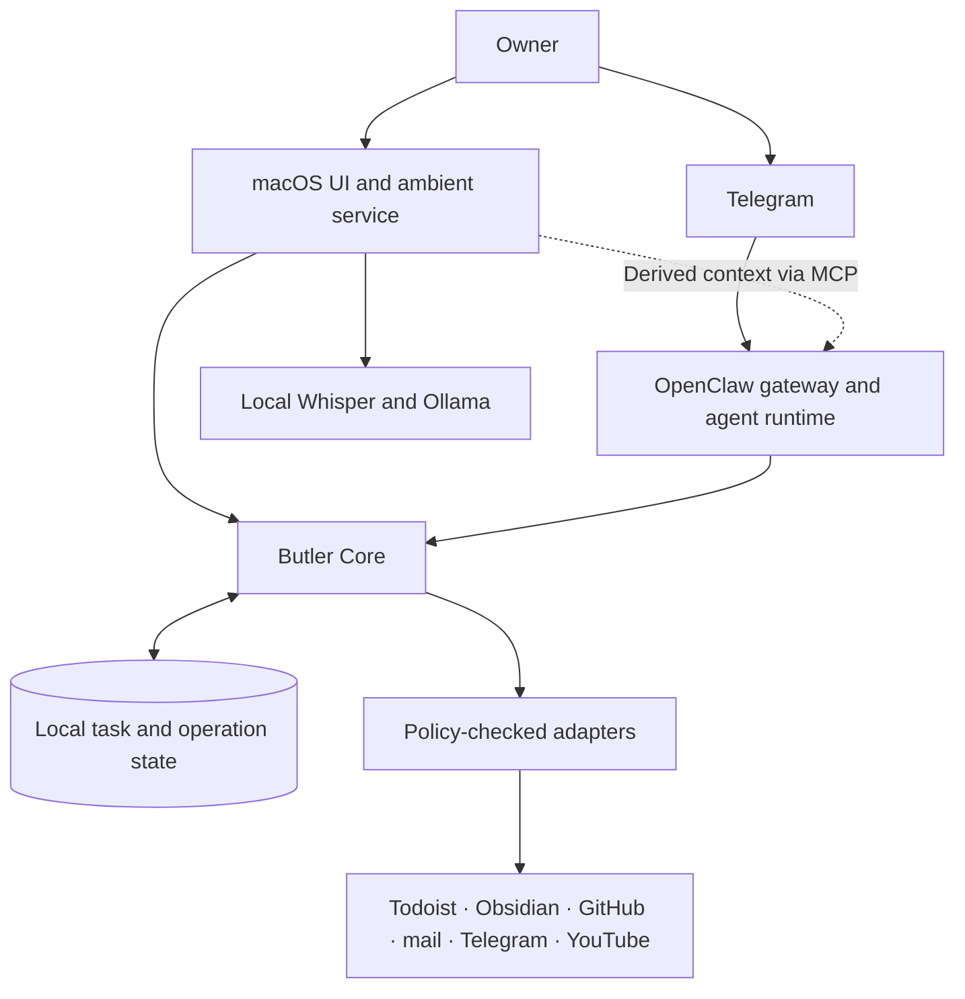

# iButler

**A personal AI assistant for macOS: conversation, local awareness, durable tasks and everyday automation.**


[Get started](#get-started) · [Components](#components) · [Architecture](docs/README.md) · [Development](#development)

iButler brings a personal assistant to a Mac Studio. It combines Telegram conversations
through OpenClaw, a native macOS interface, local voice and visual context, and a shared
execution core for tasks, permissions and delivery. The same system connects project work,
knowledge, reminders and media workflows.

This repository contains the application modules, tests and design documents. A complete
deployment also uses a separately configured OpenClaw installation and private workspaces.

## What it does

- **Conversation and local awareness.** Native macOS controls, voice interaction, camera,
  microphone and screen context, with local Whisper and Ollama processing.
- **Durable task execution.** Persisted tasks and operations, duplicate protection, bounded
  retries, cancellation and recovery after interruptions.
- **Controlled integrations.** Shared policy and approval checks for actions involving
  Todoist, Obsidian, GitHub, mail, Telegram and YouTube.
- **Reliable delivery.** Delivery receipts, quiet hours and explicit handling of uncertain
  outcomes.
- **Knowledge and project work.** Provenance-aware recall, workspace tools and delegation
  to coding or research agents through the configured runtime.
- **News and video.** A reusable video renderer and an isolated Bamberg News workflow with
  source validation and a dedicated publication destination.
- **Passive WhatsApp ingestion.** Incoming messages enter the local inbox through a
  dedicated ingestion path.

## Components

| Component | Responsibility | Guide |
| --- | --- | --- |
| **Butler Core** | Durable tasks, operations, approvals, configuration, delivery and integration adapters | [Core README](implementation/butler-core/README.md) |
| **Ambient Awareness** | Native macOS UI, sensing, local analysis, voice interaction and MCP context | [Ambient README](implementation/ambient-awareness/README.md) |
| **News Video** | Evidence-linked episodes, narration, captions, cards and FFmpeg rendering | [Video README](implementation/news-video/README.md) |
| **Bamberg News** | Separate news agent, source policy, schedules and YouTube destination checks | [Bamberg README](implementation/bamberg-news/README.md) |
| **WhatsApp Ingestion** | Passive inbox integration and installation checks | [Ingestion README](implementation/whatsapp-ingest/README.md) |

## How the pieces fit



OpenClaw provides channels and agent sessions. Butler Core manages durable execution,
authorization and delivery. Ambient Awareness supplies the desktop experience and local
observations. News workflows use their own validation and publication controls.

The [architecture index](docs/README.md) separates the current source modules from the
broader design and migration plans.

## Get started

### Requirements

| Dependency | Used for |
| --- | --- |
| Python **3.11+** | Core and ambient Python packages |
| macOS **14+** and Xcode command-line tools | Native desktop, capture helpers and application builds |
| OpenClaw and its Node.js runtime | Channels, agent sessions and deployed integrations |
| FFmpeg | Media processing and video rendering |
| Local Ollama models and `whisper-cli` | Ambient vision, dialogue and speech recognition |

The core CLI and its Python tests can be explored before configuring the full runtime.
Optional sensing and model dependencies are listed in each module's guide.

### Install the source packages

```sh
git clone https://github.com/t-boris/iButler.git
cd iButler

python3 -m venv .venv
. .venv/bin/activate
python -m pip install --upgrade pip setuptools wheel
python -m pip install -e ./implementation/butler-core -e ./implementation/ambient-awareness

butler-core --help
butler-ambient --help
```

Continue with the [core setup](implementation/butler-core/README.md) and
[ambient build and configuration guide](implementation/ambient-awareness/README.md).
The ambient guide covers local models, native helpers, device permissions and owner setup.
The media and ingestion modules have separate setup instructions in the component table.

### Local configuration

OpenClaw patches such as `openclaw.patch.json5` and `openclaw.patch-*.json5` are
machine-specific configuration and are ignored by Git. Prepare them locally for the
workspaces and accounts you intend to use. They are not included in a fresh clone.

Credentials, model files and runtime state belong in the private deployment directories.
Ambient collection starts disabled and is enabled through owner controls. Its raw media
and transcripts are processed locally; export and action boundaries are described in
the [ambient guide](implementation/ambient-awareness/README.md) and the
[core policy modules](implementation/butler-core/README.md#modules).

## Development

After installing the source packages, run the core suite from the repository root:

```sh
PYTHONDONTWRITEBYTECODE=1 python -m unittest discover -s implementation/butler-core/tests -v
```

The OpenClaw bridge has a separate Node.js suite:

```sh
cd implementation/butler-core/bridge
node --test test/*.test.js
```

Use the module guides for ambient, ingestion and media tests. Some compatibility checks
expect the private Butler workspace or optional local models; the
[core verification record](implementation/butler-core/VERIFICATION.md) and
[ambient verification record](implementation/ambient-awareness/VERIFICATION.md)
describe those environments.

Builds, dependency folders, Python caches, rendered episodes and local verification
evidence are ignored. Source code, native assets, configuration examples and test fixtures
remain versioned.

## Repository map

```text
.
├── README.md
├── docs/                         Architecture and documentation index
├── implementation/
│   ├── butler-core/              Shared execution and integration core
│   ├── ambient-awareness/        macOS UI, local sensing and voice
│   ├── news-video/               Reusable video pipeline
│   ├── bamberg-news/             Isolated news workflow
│   └── whatsapp-ingest/          Passive message ingestion
├── todoist-integration/          Integration requirements, design and plan
├── tasks/                        Development plans and engineering notes
├── OpenClaw-first AI Butler Architecture.md
└── OpenClaw-Multi-Agent-Coding-Pipeline.md
```

Start with the [documentation index](docs/README.md) for the architecture, implementation
guides and integration design.
