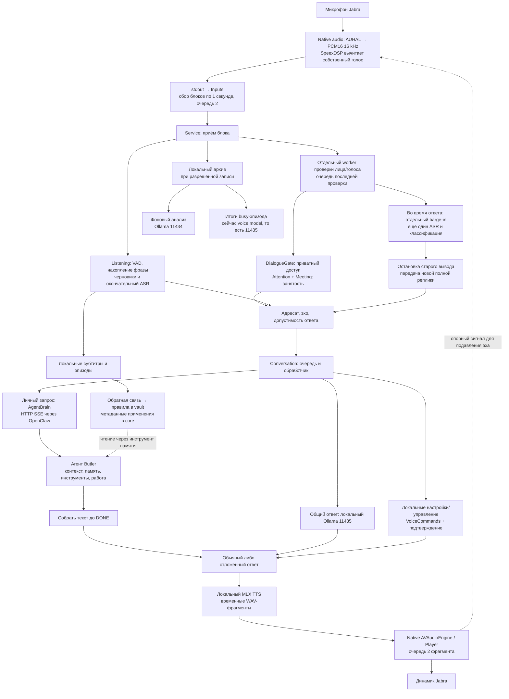
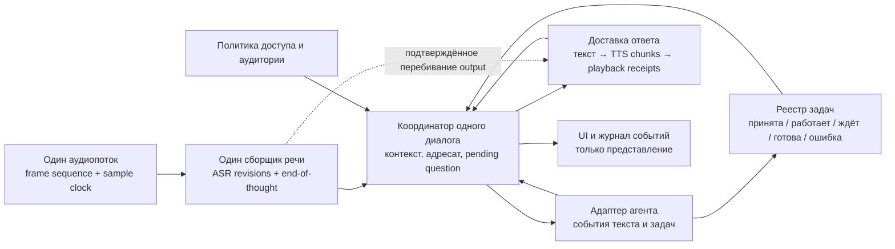

# Как Butler слышит, понимает, действует и отвечает

Срез: 26 октября 2026 года. **Фактически установлен ambient/UI 0.6.3, core 0.15.0. В исходниках — кандидат 0.6.4, не установленный.** Проверка RPC и совпадения исходников с тестовым манифестом — [runtime_evidence.json](runtime_evidence.json). Это описание существующей системы и проект её упрощения, а не заявление о готовности.

## 1. Ответ про таймер

**Таймера, по истечении которого заканчивается ваш разговор с Butler, быть не должно.** Это теперь прямо закреплено в [DEC-086][D86]. Пауза, конец аудиоблока, завершение распознавания и конец работы агента — разные события. Ни одно из них само по себе не означает «забыть разговор».

Технические сроки нужны для обнаружения зависшего процесса, проверки свежести датчика и ограничения памяти. Они должны завершать конкретную техническую операцию с понятной ошибкой. Они не должны забывать вопрос, отменять уже принятую работу, обрывать исправно поступающий звук или убивать обработчик последующих обращений. Это **предложение архитектурного контракта**, вытекающее из DEC-085/086, а не описание уже достигнутого поведения.

**Подтверждённый дефект 0.6.3:** проверка очереди аудиовывода сравнивает текущее время с `turn_started`, включающим ожидание агента. Если агент работал долго, срок 90 секунд может истечь до начала позднего озвучивания. Исключение из `_speak_deferred()` не перехватывается общей обработкой задания и завершает поток `_run`. Микрофон и интерфейс — другие потоки/процессы; они могут продолжать работать. В логе есть именно такой traceback. **Уверенность High.** [Установленный код][INST], [traceback](playback-crash.txt), [граница `_run`][Crun].

Кандидат 0.6.4, подготовленный до остановки изменений ради этого разбора, отсчитывает срок от начала вывода, ловит ошибку отложенного озвучивания и регистрирует его завершающий вопрос. Это устраняет данный путь падения в тестах, но не создаёт целостную архитектуру постоянного разговора. [Текущий `speak`][Cspeak], [отложенный ответ][Cdefer], [64 проверки](../../implementation/ambient-awareness/evidence/attention-implementation/playback-recovery-tests.log).

## 2. Какие понятия сейчас смешиваются

| Понятие | Что это означает | Что из него не следует |
| --- | --- | --- |
| Аудиокадр | Небольшое число отсчётов звука | Человек закончил мысль |
| Транспортный блок | Порция PCM, переданная между процессами; сейчас одна секунда | Начался новый разговор |
| Признак речи, VAD | Звук похож на речь | Слова распознаны; говорит владелец; речь адресована Butler |
| Черновик ASR | Предварительное распознавание, которое может измениться | Можно выполнять команду |
| Завершённая реплика | Достаточно данных для ответа на данную мысль | Предыдущая тема и задача больше не нужны |
| Диалог | Общий контекст владельца, темы, вопросы и работа | Любая фоновая речь адресована Butler |
| Задача | Принятая работа со своим состоянием и результатом | Остановка голоса отменяет работу |
| Подтверждение | Ответ на конкретное предложение действия с конкретными параметрами | Произнесённое где-либо «да» разрешает любое действие |
| Доставка ответа | Подготовка текста, синтез, начало и завершение воспроизведения | Готовый текст уже был слышен человеку |

Эта таблица — предлагаемое разделение ответственности. В существующем коде часть различий уже есть (`utterance ID`, отдельный `export_cancel`, статусы доставки), но общей модели, которая связывает все девять понятий, нет. Это **вывод High** из сопоставления [TranscriptStream][T], [Listening][Lroute], [Conversation][Ccancel], [AgentBrain][B], [VoiceCommands][VC] и [Feedback][FB].

## 3. Вся фактическая цепочка

Схема собрана по [Service][S], [native audio][N], [Listening][L], [Conversation][Cfeed], [AgentBrain][B], [TTS worker][V], [Feedback][FB]. Это фактические пути, а не единый Pipecat pipeline: Pipecat сейчас используется внутри отдельного worker Smart Turn/Silero. [Endpointing][E]. **Уверенность High.**

## 4. От микрофона до текста — по шагам

### 4.1. Захват и эхо

Native helper использует отдельный входной AUHAL и выходной AVAudioEngine. Вход приводится к mono PCM16, 16 kHz: 32 000 байт на секунду. SpeexDSP обрабатывает кадры по 320 отсчётов, то есть 20 мс, используя собственный вывод Butler как опорный сигнал. Фильтрация применяется во время собственного вывода и его хвоста 0,4 с; в обычной тишине со стороны Butler возвращаются исходные входные отсчёты. Системный VPIO отключён, поскольку прежняя реализация приглушала другие приложения. [native audio, 7–81 и 563–618][N]. **Факт, High.**

Наличие AEC не доказывает качество распознавания речи поверх голоса Butler. Это отдельная акустическая проверка. Автотест цифрового подавления эха и callback плеера не измеряют, насколько хорошо устройство слышит владельца в реальной комнате. [README, local voice][README], [требование перебивания][R57]. **Ограничение доказательств, High.**

### 4.2. Передача в Python

`Inputs._audio` читает stdout до полного блока 32 000 байт. Время блока ставится по часам в момент чтения из pipe, а не по номеру аппаратного аудиоотсчёта. Очередь содержит два блока. `batch()` возвращает их по порядку, ждёт вход до 2 с, отвергает слишком старый блок; `Service._capture_loop` больше не добавляет ещё одну секундную задержку. [sensing.py:308–401][I], [service.py:676][Scapture]. **Факт, High.**

До 0.6.2 код оставлял только самый новый накопившийся блок. Это теряло захваченные слова при отставании обработки. Исправление FIFO проверено живым окном: 302 блока за 303,52 с, без зарегистрированных разрывов микрофона. Это доказательство транспорта в конкретном окне, не доказательство понимания речи. [Предыдущая диагностика][EVgap], [живая проверка][EVcapture].

**Вывод High:** секундные блоки остаются ограничением отзывчивости. Работа с 20-мс кадрами внутри модели не делает внешнюю доставку 20-мс. Предлагается единый поток кадров с номером отсчёта/последовательности и явными событиями реального пропуска; wall-clock время использовать для журналов, а не для определения непрерывности PCM.

### 4.3. Разветвление: слышать, сохранять, разрешать

`Service._stage_batch` сначала передаёт звук в `Listening`, затем в локальный архив, а проверка участников выполняется отдельно. Очередь проверки — одна ожидающая запись: устаревшая проверка может быть отброшена, не должна становиться разрешением на действие. Для каждой секунды `MicrophoneCheck` связывает результат с точным временем исходного блока. [Service:202][S], [MicrophoneCheck:18][L]. **Факт, High.**

«Записывать всё» здесь означает несколько разных возможностей: получать PCM, временно хранить разрешённое аудио, распознавать слова, показывать текст и использовать его для ответа. Сейчас наличие PCM в архиве не гарантирует, что фраза попадёт в живые субтитры: до ASR есть VAD, затем фильтр уверенности и сроки очередей. Занятость/адресат должны влиять на ответ, а не стирать сам факт разрешённого локального слышания — это уже записано в discussion. [Архив][A], [Listening:179–307][L], [discussion][DISC]. **Факт и вывод High.**

Архив и обратная связь — разные хранилища. Временные исходные медиа подчиняются политике spool и удаления; отдельные аудиопримеры для обучения обратной связи не сохраняются. Текст обычного эпизода — 24 часа, исправленного/размеченного — 30 дней от исходного эпизода. «Постоянный диалог» не отменяет эти сроки хранения. [discussion Q-003/Q-004][DISC], [LearningStore][LS], [Store.expire][STORE].

### 4.4. Начало и завершение фразы

В `Listening.speech()` WebRTC VAD проверяет кадры по 20 мс. Три положительных кадра образуют окно 60 мс; нужно пять таких окон в секунде — 300 мс. Это **порог допуска к распознаванию**, а не таймер окончания речи. Короткие кандидаты сохраняются в pre-roll до 8 с; для ожидаемого подтверждения локальной команды есть отдельное исключение. [Listening:179–286][L], [DEC-083][D83]. **Факт, High.**

После допуска текущий рабочий конец реплики определяется тишиной в хвосте ≥0,45 с либо полностью неречевым очередным блоком. При достижении 20 с фраза теперь режется на технические сегменты с секундным перекрытием, одним ID и объединением текста; сегмент сам по себе не должен запускать работу. [Listening:281–307][L], [TranscriptStream / join_segments][T]. **Факт, High.**

Но 0,45 с тишины не доказывают завершение мысли. Дополнительная проверка `unfinished()` смотрит на последние слова/пунктуацию и ждёт ещё 1,5 с. Это эвристика. Smart Turn установлен, но `turn_control=false`; он оценивает пример в фоне и пишет диагностику. В текущем рабочем режиме его ответ не управляет завершением реплики. Это соответствует оговорке discussion о необходимости реальной калибровки, но не даёт оснований объявлять REQ-057 выполненным. [Dialogue state][DS], [Conversation:1593][Cturn], [worker][E], [runtime evidence](runtime_evidence.json), [discussion][DISC]. **Факт, High.**

Есть и старый входной путь `Conversation.feed`: при выключенном passive hearing он сам собирает аудио, ограничивает его 20 с и формирует задания. Исправление сегментации в `Listening` не делает этот альтернативный путь эквивалентным. Это кандидат на удаление после перевода его разрешённых режимов на общий сборщик. [Service:350–370][S], [Conversation:673–736][Cfeed]. **Факт High; предложение.**

### 4.5. Распознавание, черновики, фильтры

Речь распознаёт локальный resident `whisper-server` на loopback; текущая конфигурация указывает `ggml-large-v3-turbo-q5_0.bin`, русский язык задаётся клиентом. Запрос содержит WAV в памяти, `verbose_json`, `no_context=true`, нулевую температуру, подсказку с именами Butler. Опциональная модель Silero в whisper.cpp дополнительно отсекает неречевой звук. [Transcriber][W], [runtime evidence](runtime_evidence.json). **Факт, High.**

`no_context` у распознавателя не равно отсутствию диалоговой памяти: он означает отсутствие переноса контекста между декодированиями аудио. Память разговора обслуживается позже. Черновой декодер раз в накопившиеся 2 с передаёт снимок текущей фразы; один запрос выполняется, один последний снимок ожидает. Окончательный ASR и barge-in имеют независимо отменяемые клиенты того же resident-процесса. Это повторное декодирование буферов, не единый непрерывный ASR stream. [DraftDecoder][T], [Listening:254][L], [WhisperClient][W]. **Факт, High.**

Порог среднего `avg_logprob ≥ −1.0`, максимального `no_speech_prob ≤ 0.6` и фильтр известных «фантомных» субтитров могут превратить результат в пустую строку. Важно: если числовых оценок в ответе вообще нет, `confident()` сейчас возвращает `True, None, None`; неизвестное качество не равно подтверждённой уверенности. [Transcriber:64–74 и 185–194][W]. **Факт, High.**

Окончательные задания имеют очередь 3 и срок свежести 8 с от конца блока. Поэтому HTTP timeout Whisper в 30 с не означает, что результат спустя 30 с будет принят: `Listening` может уже признать его истёкшим. Переполнение видно как ошибка, но команда не выполняется. [Listening.valid / _process][Lroute], [Transcriber:171][W]. **Факт, High.**

OpenAI fallback выбран и узко разрешён решениями DEC-079–081, но **не реализован и не подключён**. Текущую проблему нельзя описывать как уже решённую Whisper API. Его добавление может помочь декодировать неразборчивый звук; оно само по себе не исправит потерю контекста, блокировку результата, неверное подтверждение и умерший поток вывода. Последнее — **вывод High** из показанной цепочки. [Проверка спецификации][EVspec], [DEC-080][D80].

## 5. От текста до решения «ответить»

### 5.1. Три независимых вопроса

1. **Кто говорит и можно ли выдавать приватное?** `DialogueGate`: три подтверждающие проверки открывают сессию; обычная тишина/темнота/неуверенный кадр её не закрывают. Подтверждённый посторонний, явная Pause/отзыв или 15 минут отсутствия владельца закрывают приватный доступ. [Policy][P], [DEC-066][D66].
2. **Владелец занят?** `Attention` собирает сигналы лица/голоса, направления взгляда, окна приложения, внешнего микрофона; `Meeting` отдельно ведёт тихий режим. Приложение с активным микрофоном — признак занятости, не доказательство разговора с человеком. [Attention][AT], [Meeting][M].
3. **Эти слова для Butler?** Лексические правила и общая сессия иногда решают сразу, иначе локальная модель классифицирует адресата. В BUSY для нового обращения нужно имя, а продолжение без имени — с положительной атрибуцией; одна лишь открытая сессия не разрешает фоновую речь. [REQ-056][R56], [F-002 Resolution][F2], [Conversation._judge][Cjudge].

Ручные Auto/Busy/Free уже есть. Выбранное состояние хранится до подтверждённого изменения ситуации либо явного Auto, а не до произвольного таймера. При этом старые голосовые фразы «занят/свободен» имеют отдельные 10-минутные правила. Эти два интерфейса пока не полностью одинаковы по срокам; это видимая особенность существующего контракта, не повод тайком менять решение владельца. [DEC-077][D77], [REQ-064][R64], [Attention.manual / spoken_cue][AT].

### 5.2. Почему распознанная строка может не стать ответом

После ASR возможны: эхо; нераспознанная/неуверенная речь; истёкшая проверка; чужой голос; BUSY и нет допустимого обращения; локальный judge отверг адресата; `NO_REPLY` от агента; идёт предыдущий ответ и реплика отдана отдельному barge-in; ошибка очереди/вывода. Все эти исходы различны. Сообщение «не слышит» в интерфейсе не локализует слой неисправности. [Listening:409–561][Lroute], [Conversation._barge][Cbarge], [BrainSilent][B]. **Факт, High.**

`TranscriptStream.claim()` выставляет `dispatched=true` **до** адресатных проверок и передачи агенту. Сейчас это означает «окончательный текст забран обработчиком», а не «работа запущена». Предложение: отдельные события `transcript_final`, `address_accepted`, `request_submitted`, `task_started`, `task_completed`, `playback_completed`; не использовать один неоднозначный флаг. [TranscriptStream:44][T], [Listening:423][Lroute].

## 6. Перебивание — второй параллельный путь

Когда `reply_in_progress` истинен — Butler думает над ответом, синтезирует или говорит — проверенные аудиоблоки также попадают в `Conversation._feed_barge`. Там отдельный скользящий буфер 5 с, отдельный ASR и отдельный judge. Он сравнивает распознанное с собственным голосом, фильтрует короткие «угу», проверяет имя/стоп/владельца и направленность продолжения. [Conversation:550][Cfeed], [barge-in][Cbarge]. **Факт, High.**

В 0.6.3 принятое перебивание сначала останавливает старый ответ, а полный новый запрос берётся у `Listening`. Если окончательный ASR успел раньше judge, используется краткий кеш `interruption_final`, связанный с токеном старого ответа и utterance ID. Это исправляет ранее наблюдавшуюся передачу одного имени вместо всей просьбы, но оставляет сложную гонку между двумя распознавателями. [Listening.take_interruption][Lroute], [Conversation:841–866][Cbarge], [отчёт 0.6.3][EVspec].

Проверка владельца в barge-in накапливается через логическое AND по речевым блокам. Одна неуверенная речевая секунда оставляет `barge_owner=false` до очистки буфера. Имеется основание для пропуска настоящего продолжения владельца, но без акустики конкретного эпизода нельзя объявить это причиной каждого отказа. **Механизм — факт High; вклад в каждую жалобу — неизвестен.** Предлагается одна модель доказательств по целой реплике с сохранением установленных требований к владельцу, а не снятие биометрической защиты. [Conversation:753–811][Cbarge], [DEC-070][D70].

Короткое «да» по умолчанию относится к back-channel: «продолжай». Исключение barge-in знает только о `commands.pending`, то есть локальном подтверждении. Оно не использует общее ожидаемое подтверждение агента. Это прямое архитектурное объяснение возможного игнорирования ответа на вопрос Butler. [DialogueState.BACKCHANNEL][DS], [Conversation:782–800][Cbarge].

## 7. Понимание и выполнение работы

### 7.1. Три маршрута

| Маршрут | Кто отвечает | Контекст и полномочия |
| --- | --- | --- |
| Общий, без владельческого доступа | Локальный Ollama, выделенный endpoint 11435 | Общая история; нет приватной памяти и выполнения действий |
| Локальное управление | `VoiceCommands` и адаптеры | Pause, устройства, настройки и другие разрешённые локальные операции; изменение связано с конкретным подтверждением |
| Приватный агент | OpenClaw Butler, через loopback gateway; провайдер модели может быть облачным | Адресованная речь владельца, разрешённый контекст, собственная история voice session, инструменты и их правила действий |

Источники: [REQ-058][R58], [DEC-067][D67], [brain.py][B], [VoiceCommands][VC], [выделенный inference][EVisolation]. **Факт, High.** 11435 отделяет локальную очередь от фона 11434, но оба процесса используют аппаратные ресурсы одного Mac. Изоляция не даёт гарантии общего времени ответа.

Уточнение границы: доказательство изоляции относится к vision/mail/System3. `Calls.conclude()` берёт `voice.model`, то есть использует диалоговый клиент и может занять его слот. Поэтому формулировка «весь фон всегда на 11434» была бы неверна. Предлагается перенести итоги эпизодов в согласованную фоновую очередь; степень влияния именно этой работы на живую задержку ещё не измерена. [calls.py:115][CALLimpl], [LocalAnalyzer routing][AN].

В текущей конфигурации локальный dialogue и vision выбраны как `qwen3.5:9b`; в README ещё написан прежний vision `gemma3:4b`. Код по умолчанию направляет agent backend на `anthropic/claude-sonnet-5`; это настройка маршрута, не независимая проверка модели каждым runtime-запросом. Voice session в настройках — `agent:butler:voice-20261025b`. [runtime evidence](runtime_evidence.json), [brain.py:26–30][B], [README:77][README].

### 7.2. Почему приходится ждать

`AgentBrain.ask()` запрашивает SSE, однако складывает все строки в список до `[DONE]`, затем склеивает `delta.content`, чистит форматирование и возвращает текст. То есть **частный ответ не идёт в TTS по мере появления**. Локальный `_plan_and_speak` умеет передавать части ответа раньше; эти маршруты устроены по-разному. [AgentBrain:167–238][B], [локальный streaming][Clocal]. **Факт, High.**

После 60 с `_brain_reply` отделяет продолжающуюся работу от текущего ответа и возвращает фиксированное «Это долгая работа…». До этого содержательной или краткой голосовой реакции в данном методе нет. Константы `BRAIN_FILLER_AFTER=3` и старый `_think_aloud` остаются в файле, но текущий метод их не вызывает. Поэтому наличие этих чисел не доказывает реакцию через 3 с. [Conversation:1288–1417][Cbrain]. **Факт, High.**

В журналах есть ожидания и доставки в десятки секунд, а предыдущий аудит отметил запрос агента на 190 с. Часть времени — реальная работа инструментов; часть — последовательная обработка и доставка. По имеющимся записям нельзя честно разложить каждую секунду между провайдером, gateway, инструментами и TTS. Отдельный общий first-word SLO не выполнен доказательно. [Диагностика эпизодов][EVgap], [аудит native-agent tools][EVagent], [спецификация/ограничения][EVspec].

### 7.3. Откуда берётся потеря контекста

Если блокировка главной agent session не освобождается за 2 с, следующий запрос отправляется в session с суффиксом `:aside`. Внешняя память не заменяет историю конкретного вопроса и ещё не законченного действия. Следовательно, «да» либо «как там?» может оказаться в другом контексте. Это **несоответствие High** новому DEC-086; обход должен быть заменён управлением одной беседой и отдельными задачами. [AgentBrain:176–179][B], [DEC-086][D86].

Локальная история — deque из шести обменов, при сборке части prompt фильтруется по 300 с. `Session` дополнительно использует 180 с для нового `started_at`, 60 с для связи ответа с вопросом. Attention использует 300 с, приватная авторизация — 900 с отсутствия. Это разные механизмы; **180 с не удаляют автоматически всю историю**, но согласованного единого состояния разговора они не образуют. [Conversation:235,300,1768][Chistory], [Session][DS], [Attention][AT], [Policy][P].

### 7.4. Работа и подтверждение

Локальный `Pending` хранит capability, параметры, review, digest, поколение разрешения и срок 45 с. Разрешение связано с этим объектом и проверяется перед действием. Но `confirmation()` — точный набор допустимых фраз; произвольное естественное подтверждение вроде «да, есть моё подтверждение» в нём отсутствует. Прочий текст сбрасывает локальный pending как заменённый запрос. [VoiceCommands:95,125,370][VC]. **Факт, High.**

Агент спрашивает подтверждение в своей истории. В `Conversation` вопрос определяется по `reply.endswith('?')` и регистрируется только после успешного полного озвучивания; в установленной 0.6.3 отложенный путь вообще этого не делал. Нет единого структурированного `question_id / task_id / proposal_revision`, проходящего через голосовой слой. [Conversation:1919–1925][Canswer], [установленный deferred][INST], [Session.ask][DS]. **Факт, High.**

`_brain_reply` запускает свою thread и хранит результат в `deferred`, тогда как `WorkTasks` имеет отдельный реестр работы для панели. Сам факт голосового запроса к агенту не создаёт в этом методе запись WorkTasks. Поэтому пустой список этих задач не доказывает, что агент ничего не делает. Native-agent audit действительно содержит инструментальные вызовы диагностики диска, но не доказывает успешное выполнение каждой последующей просьбы. [Conversation:1319–1352][Cbrain], [local_ui:71][UI], [native-agent audit][EVagent]. **Факт и вывод High.**

## 8. От текста до слышимого ответа

`speak()` передаёт весь выбранный текст resident MLX worker. Worker создаёт поток аудио, сохраняет временные WAV-фрагменты и ждёт credit после каждого. Родитель допускает не более двух фрагментов в native playback queue. Native helper сообщает `started`, завершение частей через `dataPlayedBack`, а затем `done`. Временные файлы освобождаются. Это настоящее потоковое **аудио**, но перед ним частный **текст** уже собран полностью. [speak][Cspeak], [voice_worker:59–154][V], [native playback][Nplay]. **Факт, High.**

Есть несовместимость контрактов: `AgentBrain` обрезает ответ до 1200 символов, Conversation принимает до 1200, а worker принимает максимум 700. Ответ 701–1200 может быть принят диалогом и отвергнут TTS. Простое `reply[:1200]` также может срезать предложение. Это доказанный дефект границы, но не доказанная причина конкретного последнего обрыва, где отдельно обнаружен timeout. [brain.py:238][B], [Conversation:1913][Canswer], [worker:101][V]. **High.**

`max_tokens=700` в TTS ограничивает генерацию аудио. В текущем протоколе нет отдельной проверки, что модель дошла до лингвистического конца исходного текста. Callback подтверждает доставку буфера плеером, но не акустическую слышимость и не отсутствие пропущенных слов. Предложение: согласованные текстовые фрагменты, явное завершение генерации, контроль недоставленного остатка и отдельное измерение слышимости. [worker:105–126][V], [native dataPlayedBack][Nplay]. **Факт High; риск Medium, конкретный вклад не измерен.**

Поздний ответ ждёт в `deferred`. `_speak_deferred` запрещает его при BUSY, даже если это результат явно адресованной принятой просьбы; активный Chrome microphone может держать это условие. Метод автоматически добавляет «Готово.», хотя текст может содержать вопрос либо промежуточный результат. Это две разные ошибки: недоставка и неподтверждённая семантика завершения. [Conversation:1460–1488][Cdefer], [DEC-085][D85]. **Факт, High.**

## 9. Полный реестр значимых сроков и границ

Таблица охватывает цепочку голоса и её соседние политики. Числа — фактические текущие значения, **не рекомендации их сохранить**. Служебные polling интервалы перечислены отдельно. Для значения, принятого владельцем как политика, изменение требует согласования именно этой политики; техническое упрощение не должно молча расширять права.

| Значение | Где и зачем | Что не так / как разделить |
| --- | --- | --- |
| 20 мс / 320 samples | SpeexDSP кадр, WebRTC кадр | Нормальная техническая единица; не конец фразы. [N][N], [L][L] |
| 0,4 с | Хвост собственного AEC reference | Проверять на акустике; не объявлять любую речь эхом только по времени. [N][N] |
| 1 с / 32 000 bytes; очередь 2 | Передача PCM в Python | Даёт задержку и малый запас на scheduling; перейти на единый frame/sample clock. [I][I] |
| 2 с | `Inputs.batch` ждёт очередной блок | Ошибка источника, не конец диалога. [I][I] |
| 1,5 с / 2,5 с | Свежесть входа / evidence | Проверка безопасности должна быть отделена от сохранения услышанного. [I][I], [L][L] |
| 0,25 с | Допустимое расхождение между соседними wall-clock блоками | Лучше sample sequence: задержка планировщика не обязательно означает потерю PCM. [L][L] |
| 300 мс | Допуск VAD; принят DEC-083 | Не семантическое завершение и не универсальное условие короткого ответа. [D83][D83] |
| 8 с | Pre-roll слабого речевого кандидата | Ограничение памяти; необходим явный пропуск, а не бесследное исчезновение. [L][L] |
| 2 с накопления | Снимок для нового draft decode | Это batch-redecode, не непрерывный ASR. [L][L], [T][T] |
| 0,45 с тишины | Рабочий endpointer | Главная эвристика; может принять паузу внутри мысли за конец. [L][L] |
| 20 с + overlap 1 с | ASR-сегментация Listening | Только размер буфера; общий ID и продолжение сохраняются. Старый Conversation.feed ещё иной. [L][L], [Cfeed][Cfeed] |
| Очередь 3; свежесть 8 с | Окончательное распознавание | Несогласовано с 30-секундным HTTP timeout; медленный результат теряет допуск. [Lroute][Lroute] |
| 20 с / 30 с | Запуск resident Whisper / ASR HTTP | Watchdog конкретной операции. [W][W] |
| Последние 8 с / timeout 3 с | Worker Smart Turn | Контекст модели и watchdog; inference target 150 мс — отдельный критерий. Сейчас shadow. [E][E] |
| 1,5 с | `unfinished()` после ASR | Лексическая задержка не доказывает конец мысли. [DS][DS], [Cturn][Cturn] |
| 5 с | Скользящий barge-in буфер | Второй распознаватель; не должен владеть полной новой просьбой. [Cbarge][Cbarge] |
| 8 с | Кеш передачи final из Listening в barge-in | Компенсация гонки двух владельцев реплики. [Lroute][Lroute] |
| 2,5 с | Проверка текстового эха после вывода | Эвристика плюс сходство текста, не таймер разговора. [Lroute][Lroute] |
| 4 с | Склейка одиночного имени и «ты слышишь?» | Узкий специальный путь фиксированного ответа; кандидат на объединение. [Lroute][Lroute] |
| 45 с | Разрешение локальной команды | Истечение предложения действия должно быть видимым; контекст вопроса не следует стирать. [VC][VC] |
| 60 с | `Session.answering` | Сейчас теряется специальная связь с вопросом; DEC-086 требует сохранения контекста. [DS][DS], [D86][D86] |
| 180 с | `Session.touch` меняет started_at | Не полное удаление истории; несовместимая дополнительная трактовка сессии. [DS][DS] |
| 300 с; последние 6 обменов | Attention, local history и общая recency | Не должны сами закрывать постоянный диалог; это cues/ресурсный бюджет. [Chistory][Chistory], [AT][AT] |
| 900 с отсутствия | Приватный owner gate | Отдельная принятая граница приватного доступа, не «забыл тему». [P][P], [D66][D66] |
| 3 свежих проверки, возраст 3 с, release 12 с | Автоматический Meeting | Гистерезис датчика занятости. Не доказательство реального звонка. [M][M] |
| 30 с | Удержание Attention BUSY | Дребезг датчиков; не откладывать уже ожидаемый ответ бессрочно. [AT][AT] |
| 60 с | Недавнее присутствие другого лица/голоса | Ограничивает shortcut второго лица; атрибуция отдельно. [AT][AT] |
| 600 с | Голосовое «занят/свободен» | Старый голосовой контракт; ручная кнопка DEC-077 живёт до смены ситуации. [AT][AT], [D77][D77] |
| 600 с / 2 ч / заданный срок | Явное «помолчи», «пока на звонке» | Это воля пользователя, отличать от автоматического конца разговора. [DS][DS] |
| 2 с | Захват блокировки agent session | Сейчас уводит в `:aside`; заменять согласованным контекстом/очередью задач. [B][B] |
| 60 с | Отделение длительного запроса | Слишком поздно для первой реакции; отделение задачи не должно отделять контекст. [Cbrain][Cbrain] |
| 1800 с | Socket timeout gateway по умолчанию | Это не разрешённое молчание; проверка отмены происходит между чтениями строк. [B][B] |
| 300 с | Разрешение чтения правил `--turn` | Срок capability чтения; не конец диалога. Отсутствие receipt остаётся unknown. [FB][FB] |
| 3 с | Ожидание `playback started` | Watchdog вывода, не «ответ услышан». [Cspeak][Cspeak] |
| 90 с | Строка TTS / очередь вывода / завершение | Несколько разных clocks; в 0.6.3 один ошибочно от начала запроса. Требуется supervisor и прогресс каждой операции. [INST][INST], [Cspeak][Cspeak] |
| 90 с | Максимальная длина одного WAV | Валидация выходного файла; не длительность диалога. [V][V], [Nplay][Nplay] |
| 0,48 с; credit 1; queue 2 | TTS audio stream | Поток аудио и обратное давление; не гарантия first word через 0,48 с. [V][V], [Cspeak][Cspeak] |
| 120 с | Live caption/debug | Срок локального представления; отдельное разрешённое хранение может продолжаться. [T][T], [L][L] |
| 180 с разговора + 60 с тишины | Итоги busy-эпизода | Правило фоновых выводов, не endpointer вашей фразы. [CALL][CALL] |
| 24 ч / 30 дней | Медиа spool / тексты feedback | Retention, а не ограничение общения; не менять ради непрерывности. [STORE][STORE], [LS][LS] |

Polling `0,01/0,02/0,05/0,1/0,2 с` обслуживает ожидание очередей и отмены; warm retry `5 с`, cooldown ошибки `10 с`, ожидания остановки процессов `1–3 с`, recovery native helper «три перезапуска за 120 с», исходящий `send()` watchdog `40 с` — техническая эксплуатация. Они не дают права признать мысль законченной. Это различение нужно закрепить в интерфейсах компонентов. [sensing][I], [Conversation][Crun], [Listening][Lroute], [speak][Cspeak].

## 10. Память, правила и обучение — отдельная ветка

Исправление связывается с эпизодом и ревизией решения. Немедленный разговорный эффект отделён от сохранения: фоновые записи проходят через ограниченную приоритетную очередь. `LearningStore` разделяет метаданные и приватные тексты, хранит receipts и отдельно измеряет ложное вмешательство/пропущенное обращение. Канонический текст правил находится в vault `Butler/`; `LESSONS.md` — производный read-only вид. [Feedback][FB], [LearningStore][LS], [RuleStore][RS], [REQ-059–063 в инвентаре](00_document_inventory.md).

По DEC-075 агент перечитывает применимые правила существующим memory tool. Инструкция теперь находится в developer-сообщении, слова владельца — в user-сообщении. Прежнее смешение управляющего текста с просьбой объясняло жалобу на «не настоящую команду». Наличие инструкции не доказывает чтение: код отдельно проверяет receipt и отмечает `brain_rules_unobserved`. [Brain.messages:154][B], [Conversation:1322,1391][Cbrain], [DEC-075][D75].

Публикация индекса проверена для конкретного снимка: 2755 подходящих файлов, 55 578 фрагментов, ноль отсутствующих/устаревших на момент публикации. Это не доказательство корректного извлечения нужной памяти и не оценка понимания речи. [vault-coverage-after.json][EVvault]. Облачный анализ обратной связи получает только обезличенную сводку; это отдельный канал от приватного addressed-запроса. [discussion Q-005][DISC], [REQ-062][R62].

## 11. Что я считаю архитектурными заплатами

**Оценка, уверенность High:** проблема не в самом операторе `if`. Проверки разрешения, отмены, типа данных и целостности необходимы. Хрупкость возникает, когда несколько компонентов независимо решают судьбу одной реплики и чинят друг друга исключениями.

| Фрагмент | Почему хрупок | Предлагаемая замена |
| --- | --- | --- |
| Listening + старый Conversation.feed + barge-in ASR | Три владельца буфера/готовности новой просьбы | Один capturer/assembler; перебивание только останавливает нужный output и продолжает общий input |
| `interruption_final` с TTL и токенами | Передача результата зависит от порядка двух worker | События одного utterance ID и один координатор; кеш убрать после миграции |
| `:aside` при занятом агенте | Техническая блокировка меняет разговорный контекст | Один диалог, отдельно управляемые task/run и ожидаемые вопросы |
| `deferred` + безусловное «Готово» + BUSY | Потеря связи с типом результата и исходной просьбой | Типизированный result: progress/question/completed/failed; доставка по адресату и приватности |
| `endswith('?')`, список «да», back-channel без pending-agent | Пунктуация и лексика заменяют состояние ожидаемого ответа | Явный вопрос/предложение с ID, параметрами и полученным ответом |
| Шесть обменов / 60–180–300 с в разных местах | Разные определения «тот же разговор» | Один context store; recency только признак, не уничтожение контекста |
| Общие `state/phase/token` для понимания, задачи и звука | Остановка вывода может менять смысл запроса; ошибка вывода ломает обработчик | Раздельные жизненные циклы dialogue/task/input/output и supervisor |
| Старые `_think_aloud`/filler-константы без рабочего вызова | Создают ложное представление о существующей реакции | Удалить после замены одной политикой реакции по DEC-085 |
| 1200 → 700 символов | Несогласованный контракт между рабочими компонентами | Передача текста смысловыми фрагментами с одинаковыми лимитами и явным остатком |
| `local_ui.snapshot()` может вызвать `voice.cancel()` | Чтение представления влияет на состояние диалога | UI читает snapshot; решения о приватности принимает координатор |

Основания: [Listening][Lroute], [Conversation][Cbarge], [Brain][B], [deferred][Cdefer], [Session][DS], [worker][V], [UI:39–44][UI]. Это **план замены**, эти удаления в ходе анализа не выполнялись.

## 12. Целевая структура без накопления исключений

**Предложение, не реализовано.** Единственный координатор не означает огромный один файл или один блокирующий поток: это единственное место, определяющее переходы диалога. ASR/TTS/сеть остаются отдельными исполнителями. Очереди технических исполнителей не владеют темой, подтверждением и принятой задачей.

Предлагаемые идентичности: `dialogue_id`, `utterance_id + revision`, `request_id`, `task_id`, `question_id + proposal_revision`, `output_id + chunk_seq`, `authorization_epoch`. Конкретная схема — реализация, а не новый вопрос владельцу. Эти связи позволяют остановить голос, продолжить слушать и сохранить незавершённую задачу без повторного выполнения.

Предлагаемые инварианты:

1. Любой допущенный PCM-кадр учитывается ровно один раз; настоящий разрыв виден явно.
2. Черновой текст виден сразу по готовности и ничего не выполняет; версия final связывается с тем же входом.
3. Решение об окончании мысли использует согласованный endpointer; размер буфера не закрывает мысль.
4. Принятая задача не исчезает при новом аудиоблоке, паузе или остановке TTS.
5. «Да» интерпретируется относительно ожидаемого вопроса; разрешение применяется только к неизменившемуся конкретному действию.
6. Один запрос даёт максимум одну краткую правдивую реакцию при задержке, затем реальный статус/результат; никакого автоматического «Готово».
7. Каждый worker имеет контролируемое завершение/ошибку; падение TTS не прекращает приём следующих просьб.
8. Full Pause/отзыв/смена аудитории останавливают соответствующее наблюдение, экспорт и приватный вывод; восстановление не должно автоматически проигрывать устаревший результат.
9. UI различает услышано, распознано, принято, выполняется, ждёт ответа, текст готов, озвучивается, озвучено, доставка не удалась.

## 13. Как переносить, не подменяя проверку обещанием

**Предлагаемый порядок реализации:** сначала журнал событий и раздельные lifecycle; затем один input assembler; затем pending-question/task/context вместо `:aside` и `deferred`; затем потоковый агентный адаптер и согласованный TTS; после каждого переноса удалять заменённый старый путь. Сохранять уже работающие локальные модели, AEC, правила приватности и memory tools; переписывание всего с нуля не требуется из найденных фактов.

Для каждого этапа нужны автоматические проверки полных последовательностей: непрерывная просьба длиннее 20 с с паузами внутри мысли; имя во время ответа и продолжение просьбы; обе очередности ASR/judge; подтверждение после позднего вопроса; изменение предложения до согласия; ошибка TTS и следующий запрос; BUSY от приложения при уже принятом запросе; Pause/company во всех стадиях; исход 701+ символов; отмена вывода без повторного действия. Это инженерные проверки, **не ручной список заданий владельцу**.

Отдельно измерять: конец мысли → видимая расшифровка; → первая правдивая реакция; → первое содержательное слово; → принятие/завершение действия; owner stop → фактическая остановка; доля потерянных/преждевременно разделённых/ложно принятых реплик. Синтетика проверяет механизм, реальные размеченные эпизоды — качество. Существующие 590/64 теста не являются оценкой «80 из 100». [DEC-078][D78], [REQ-056/057][R57], [verification][EVverify].

## 14. Непроверенное и открытые вопросы анализа

- Точная причина каждого пропущенного слова: **Not stated in source / недостаточно сохранённых акустических доказательств**. Исходное аудио нельзя восстановить из расшифровки. Проверять без создания неразрешённого бессрочного аудионабора.
- Как gateway/backend маркирует промежуточную речь, финальный ответ, tools и pending approval: текущий клиент использует только текст. Отдельный typed protocol не установлен этим аудитом; нужно проверить контракт установленного backend до реализации потокового адаптера. Известно точно только то, что наш клиент ждёт DONE.
- Отменён ли серверный tool-run при закрытии клиентского соединения: клиентская отмена сама по себе этого не доказывает. Нужен task/run acknowledgement от backend; не повторять операции с неизвестным исходом.
- CLI буквально указан в DEC-067/REQ-058, фактически используется HTTP gateway. История не содержит отдельного найденного решения о замене транспорта. Следует проверить эквивалентность agent/session/tool contracts и отразить результат; не заявлять буквальное соблюдение CLI-критерия.
- Точный p50/p95 по всей голосовой цепочке, Word Error Rate и доля реальных успешных задач: **Not stated in source**. Подготовить измерения по исходным критериям; владельческий запрос «хотя бы 80» не объявлять статистикой без определения знаменателя.
- Жив ли поток диалога в каждый момент: status RPC не публикует thread health. Traceback доказывает его завершение при зафиксированной ошибке; наличие живого сервиса не доказывает восстановление. Добавить liveness/heartbeat координатора.

Ни один из этих пунктов не требует снова спрашивать уже отвеченное: Git, память через tool, широкое упоминание имени, Busy/Free, 300 мс, OpenAI, ограничение аудиоэкспорта и политика реакции уже записаны. [Инвентарь решений и ответов](00_document_inventory.md).

[N]: ../../implementation/ambient-awareness/butler_ambient/native/audio.swift
[Nplay]: ../../implementation/ambient-awareness/butler_ambient/native/audio.swift:670
[I]: ../../implementation/ambient-awareness/butler_ambient/sensing.py:308
[S]: ../../implementation/ambient-awareness/butler_ambient/service.py:202
[Scapture]: ../../implementation/ambient-awareness/butler_ambient/service.py:676
[L]: ../../implementation/ambient-awareness/butler_ambient/listening.py:179
[Lroute]: ../../implementation/ambient-awareness/butler_ambient/listening.py:310
[T]: ../../implementation/ambient-awareness/butler_ambient/transcript.py
[W]: ../../implementation/ambient-awareness/butler_ambient/transcriber.py
[E]: ../../implementation/ambient-awareness/butler_ambient/endpointing.py
[Cfeed]: ../../implementation/ambient-awareness/butler_ambient/conversation.py:545
[Cbarge]: ../../implementation/ambient-awareness/butler_ambient/conversation.py:753
[Ccancel]: ../../implementation/ambient-awareness/butler_ambient/conversation.py:584
[Chistory]: ../../implementation/ambient-awareness/butler_ambient/conversation.py:235
[Cjudge]: ../../implementation/ambient-awareness/butler_ambient/conversation.py:1251
[Cturn]: ../../implementation/ambient-awareness/butler_ambient/conversation.py:1554
[Clocal]: ../../implementation/ambient-awareness/butler_ambient/conversation.py:1114
[Cbrain]: ../../implementation/ambient-awareness/butler_ambient/conversation.py:1288
[Cdefer]: ../../implementation/ambient-awareness/butler_ambient/conversation.py:1460
[Canswer]: ../../implementation/ambient-awareness/butler_ambient/conversation.py:1884
[Cspeak]: ../../implementation/ambient-awareness/butler_ambient/conversation.py:935
[Crun]: ../../implementation/ambient-awareness/butler_ambient/conversation.py:2083
[INST]: /Users/boris/.openclaw/tools/ambient-awareness/.venv/lib/python3.12/site-packages/butler_ambient/conversation.py:988
[DS]: ../../implementation/ambient-awareness/butler_ambient/dialogue_state.py:15
[B]: ../../implementation/ambient-awareness/butler_ambient/brain.py
[V]: ../../implementation/ambient-awareness/butler_ambient/voice_worker.py:59
[VC]: ../../implementation/ambient-awareness/butler_ambient/voice_commands.py:95
[AT]: ../../implementation/ambient-awareness/butler_ambient/attention.py:22
[M]: ../../implementation/ambient-awareness/butler_ambient/meeting.py
[P]: ../../implementation/ambient-awareness/butler_ambient/policy.py:31
[UI]: ../../implementation/ambient-awareness/butler_ambient/local_ui.py:8
[A]: ../../implementation/ambient-awareness/butler_ambient/archive.py:19
[CALL]: ../../implementation/ambient-awareness/butler_ambient/calls.py:22
[CALLimpl]: ../../implementation/ambient-awareness/butler_ambient/calls.py:115
[AN]: ../../implementation/ambient-awareness/butler_ambient/analysis.py:130
[FB]: ../../implementation/ambient-awareness/butler_ambient/feedback.py:29
[LS]: ../../implementation/butler-core/butler_core/learning.py:42
[RS]: ../../implementation/butler-core/butler_core/rules.py:56
[STORE]: ../../implementation/ambient-awareness/butler_ambient/store.py:249
[README]: ../../implementation/ambient-awareness/README.md
[D66]: ../../docs/features/butler-attention-architecture-knowing-whom-the-owner-is/decisions/DEC-066.md
[D67]: ../../docs/features/butler-attention-architecture-knowing-whom-the-owner-is/decisions/DEC-067.md
[D70]: ../../docs/features/butler-attention-architecture-knowing-whom-the-owner-is/decisions/DEC-070.md
[D75]: ../../docs/features/butler-attention-architecture-knowing-whom-the-owner-is/decisions/DEC-075.md
[D77]: ../../docs/features/butler-attention-architecture-knowing-whom-the-owner-is/decisions/DEC-077.md
[D78]: ../../docs/features/butler-attention-architecture-knowing-whom-the-owner-is/decisions/DEC-078.md
[D80]: ../../docs/features/butler-attention-architecture-knowing-whom-the-owner-is/decisions/DEC-080.md
[D83]: ../../docs/features/butler-attention-architecture-knowing-whom-the-owner-is/decisions/DEC-083.md
[D85]: ../../docs/features/butler-attention-architecture-knowing-whom-the-owner-is/decisions/DEC-085.md
[D86]: ../../docs/features/butler-attention-architecture-knowing-whom-the-owner-is/decisions/DEC-086.md
[R56]: ../../docs/features/butler-attention-architecture-knowing-whom-the-owner-is/requirements/REQ-056.md
[R57]: ../../docs/features/butler-attention-architecture-knowing-whom-the-owner-is/requirements/REQ-057.md
[R58]: ../../docs/features/butler-attention-architecture-knowing-whom-the-owner-is/requirements/REQ-058.md
[R62]: ../../docs/features/butler-attention-architecture-knowing-whom-the-owner-is/requirements/REQ-062.md
[R64]: ../../docs/features/butler-attention-architecture-knowing-whom-the-owner-is/requirements/REQ-064.md
[F2]: ../../docs/features/butler-attention-architecture-knowing-whom-the-owner-is/findings/F-002.md
[DISC]: ../../docs/features/butler-attention-architecture-knowing-whom-the-owner-is/discussion.md
[EVgap]: ../../implementation/ambient-awareness/evidence/attention-implementation/continuation-runtime-before-0.6.2.json
[EVcapture]: ../../implementation/ambient-awareness/evidence/attention-implementation/capture-runtime-0.6.2.json
[EVagent]: ../../implementation/ambient-awareness/evidence/attention-implementation/native-agent-log-review.json
[EVspec]: ../../implementation/ambient-awareness/evidence/attention-implementation/specification-verification.md
[EVverify]: ../../implementation/ambient-awareness/evidence/attention-implementation/release-verification.json
[EVisolation]: ../../implementation/ambient-awareness/evidence/attention-implementation/inference-isolation.json
[EVvault]: ../../implementation/ambient-awareness/evidence/attention-implementation/vault-coverage-after.json
