# AI Butler Architecture

Status: proposed architecture documentation  
Primary explanation format: Mermaid diagrams  
Source document: `OpenClaw-first AI Butler Architecture.md`

## 1. Design Intent

The Butler is a personal operating layer for controlling software projects, remembering tasks, maintaining an Obsidian-based knowledge base, generating project documentation, researching complex topics, analyzing news, and proactively helping the owner pursue long-term life and work goals.

The source document defines an OpenClaw-first architecture: do not build a custom Telegram or WhatsApp backend, session router, or channel layer. OpenClaw is the gateway and session authority, while Butler is implemented above it as workspace configuration, skills, policies, project manifests, memory, and coding-agent orchestration. [Source: OpenClaw-first AI Butler Architecture.md, lines 6-8]

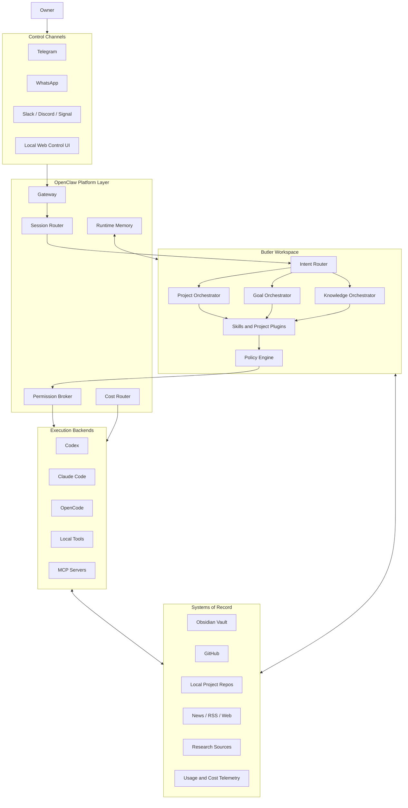

## 2. Evidence, Inference, and Design Extension

### Facts From Source

| Area | Fact | Evidence |
|---|---|---|
| Gateway | OpenClaw is intended to replace custom channel gateways and session routers. | [Source: OpenClaw-first AI Butler Architecture.md, lines 6-8] |
| Channels | Telegram and WhatsApp are priority channels; Slack, Discord, iMessage, and Signal are future channels. | [Source: OpenClaw-first AI Butler Architecture.md, lines 16-17] |
| Sessions | OpenClaw routes by user, project context, agent executor, workspace isolation, and authorization level. | [Source: OpenClaw-first AI Butler Architecture.md, lines 21-28] |
| Workspace | Butler is not a monolith; it is workspace config, skills, MCP integrations, and project manifests. | [Source: OpenClaw-first AI Butler Architecture.md, lines 32-33] |
| Workspace files | The workspace includes `openclaw.json`, `skills/`, `projects/`, `memory/`, `logs/`, and `policies/`. | [Source: OpenClaw-first AI Butler Architecture.md, lines 37-46] |
| Skills | Required skills include project management, Obsidian KB, GitHub status, coding dispatcher, research digest, usage monitoring, finance monitoring, and deployment control. | [Source: OpenClaw-first AI Butler Architecture.md, lines 50-51] |
| Project focus | The project manager skill ranks work by urgency, stalled work, recent Obsidian changes, GitHub issues and PRs, CI failures, cost anomalies, and business value. | [Source: OpenClaw-first AI Butler Architecture.md, lines 66-77] |
| Coding | Coding execution is delegated to Codex, Claude Code, OpenCode, local tools, or MCP servers rather than performed directly by the Butler orchestrator. | [Source: OpenClaw-first AI Butler Architecture.md, lines 84-98] |
| Agents | Specialized roles include Architect, Planner, Coder, Tester, Reviewer, Deployer, and Researcher. | [Source: OpenClaw-first AI Butler Architecture.md, lines 104-117] |
| Cost control | Direct API keys are fallback only, disabled by default, confirmation-gated, and capped in the source design. | [Source: OpenClaw-first AI Butler Architecture.md, lines 127-138] |
| Memory | The source separates Obsidian as canonical knowledge from OpenClaw runtime memory. | [Source: OpenClaw-first AI Butler Architecture.md, lines 140-157] |
| Security | The default security posture is deny by default, allow explicitly. | [Source: OpenClaw-first AI Butler Architecture.md, lines 159-174] |
| MVP | The proposed MVP starts with OpenClaw Gateway, Telegram, workspace setup, base skills, project manifests, Obsidian and repo integration, GitHub read-only status, coding adapters, slash commands, audit, and permission policy. | [Source: OpenClaw-first AI Butler Architecture.md, lines 176-190] |

### Inference

The best fit for the requested system is not a single "assistant app". It is a policy-gated personal automation workspace where OpenClaw owns communication and session continuity, Butler owns personal/project intelligence, Obsidian owns durable knowledge, and coding/research/news work is delegated to specialized backends. This is inferred from the source topology, workspace structure, specialized skills, and explicit separation between orchestration and execution. [Source: OpenClaw-first AI Butler Architecture.md, lines 8, 32-33, 50-51, 84-98]

### Design Extension Required By This Request

The source document says Butler connects to Obsidian in read-only mode to avoid accidental LLM damage. [Source: OpenClaw-first AI Butler Architecture.md, line 146]

Your target system requires storing daily notes, remembering tasks, and creating project documentation inside Obsidian. Therefore this architecture changes the Obsidian posture from "read-only everywhere" to "controlled write through an Obsidian Write Adapter".

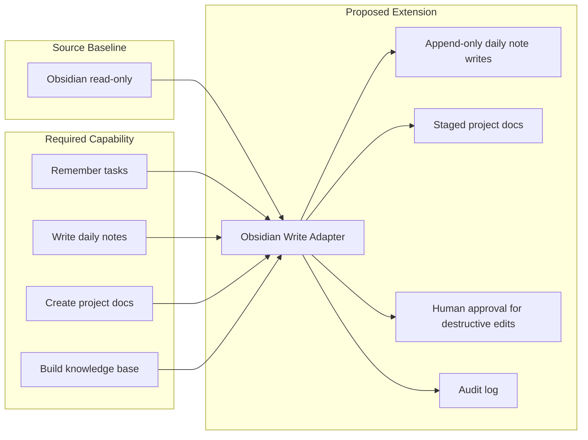

### Assumptions

| Assumption | Explanation | Evidence | Confidence | Validation path |
|---|---|---|---|---|
| The first control channel is Telegram. | The source MVP starts with Telegram, and Telegram is named as a priority channel. | [Source: OpenClaw-first AI Butler Architecture.md, lines 16-17, 181-189] | High | Confirm preferred first channel before implementation. |
| Most managed projects are software projects. | The user request says most projects are software development, and the source emphasizes GitHub, local repos, CI, coding agents, and project manifests. | User request; [Source: OpenClaw-first AI Butler Architecture.md, lines 66-77, 82, 84-98] | High | Inventory actual project folders and GitHub repositories. |
| Obsidian is the long-term human-readable store. | The source names Obsidian as canonical knowledge and Markdown-compatible storage. | [Source: OpenClaw-first AI Butler Architecture.md, lines 140-157] | High | Confirm vault path and folder conventions. |
| Proactivity should recommend before acting. | The source requires confirmation for destructive actions and uses a deny-by-default posture. | [Source: OpenClaw-first AI Butler Architecture.md, lines 159-174] | High | Define which actions can be automatic and which always require approval. |
| News and research outputs must be evidence-backed. | The source includes a researcher role and research-digest skill, but does not define a news/knowledge evidence model. | [Source: OpenClaw-first AI Butler Architecture.md, lines 50-51, 111-117] | Medium | Pick source reliability rules and citation format before enabling automated knowledge promotion. |

### Contradictions and Tensions

| Item | Type | Evidence | Resolution |
|---|---|---|---|
| Obsidian read-only baseline vs. requested Obsidian writes | Design tension | Source says Butler connects to Obsidian in read-only mode. User asks to store daily notes, tasks, project docs, and knowledge in Obsidian. [Source: OpenClaw-first AI Butler Architecture.md, line 146] | Add the Obsidian Write Adapter with append-only low-risk writes, staged documentation writes, destructive-edit confirmation, and audit. |
| Proactive life improvement vs. safety | Design tension | Source requires deny-by-default security and explicit confirmation for destructive actions. [Source: OpenClaw-first AI Butler Architecture.md, lines 159-174] | Proactivity is recommendation-first; medium/high-risk action requires approval. |
| Deep automation vs. API cost control | Design tension | Source warns about uncontrolled agent cost and defines cost-routing constraints. [Source: OpenClaw-first AI Butler Architecture.md, lines 127-138] | Schedule jobs with budgets, prefer subscriptions/local models, and require approval for direct API cost. |
| Internal contradictions inside the source document | Source contradiction | No direct contradiction was identified in the source sections reviewed. | Treat the read-only/write issue as a requirement-driven architecture change rather than a source contradiction. |

### Problems/Risks and Proposals

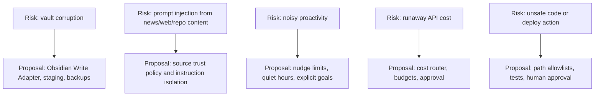

| Risk | Impact | Severity | Proposal |
|---|---|---:|---|
| Accidental Obsidian overwrite | Loss or corruption of personal/project knowledge. | High | Use append-only defaults, staged diffs, backups, path allowlists, and audit logs. |
| Prompt injection from news, research, or repo content | External content could manipulate agent behavior. | High | Treat external text as data, isolate instructions, require source trust checks, and block unsafe tool calls. |
| Proactive assistant becomes noisy | The owner stops trusting or using the system. | Medium | Add quiet hours, max nudges per day, priority thresholds, and a weekly feedback review. |
| News/research pollutes the knowledge base | Low-quality claims become long-term "knowledge". | Medium | Require source metadata, confidence labels, and human approval before KB promotion. |
| Coding agent modifies wrong project files | Project damage or security risk. | High | Enforce project manifests, path allowlists, test commands, and approval before writes. |
| Direct API costs grow unexpectedly | Budget overrun. | Medium | Prefer subscription/local execution, cap direct API usage, and ask before expensive jobs. |

## 3. Capability Architecture

The Butler is organized around seven user-facing capabilities.

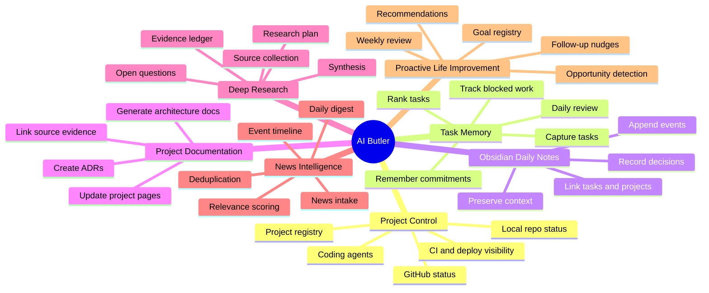

## 4. Layered System Model

```mermaid
flowchart TB
  subgraph L1["Layer 1 - Human Interface"]
    Chat["Telegram / WhatsApp / Slack"]
    LocalUI["Local Web UI"]
    VoiceFuture["Optional voice interface"]
  end

  subgraph L2["Layer 2 - OpenClaw Control Plane"]
    Gateway["Gateway"]
    Sessions["Session routing"]
    ChannelPlugins["Channel plugins"]
    Permissions["Permission prompts"]
    AuditOpenClaw["Platform audit events"]
  end

  subgraph L3["Layer 3 - Butler Orchestration"]
    Intent["Intent classification"]
    Context["Context builder"]
    TaskCore["Task manager"]
    ProjectCore["Project manager"]
    ResearchCore["Research manager"]
    NewsCore["News manager"]
    KnowledgeCore["Knowledge manager"]
    GoalCore["Goal manager"]
  end

  subgraph L4["Layer 4 - Skills and Policies"]
    Skills["OpenClaw skills"]
    Manifests["Project manifests"]
    WritePolicy["Write policy"]
    CostPolicy["Model cost policy"]
    SafetyPolicy["Risk policy"]
  end

  subgraph L5["Layer 5 - Tools and Agents"]
    Coding["Coding backends"]
    Browser["Browser automation"]
    Search["Research/search tools"]
    Git["Git/GitHub tools"]
    LocalShell["Local shell tools"]
  end

  subgraph L6["Layer 6 - Durable Data"]
    Vault["Obsidian vault"]
    Runtime["OpenClaw runtime memory"]
    Repos["Project repositories"]
    Logs["Audit logs"]
    Telemetry["Usage telemetry"]
  end

  L1 --> L2
  L2 --> L3
  L3 --> L4
  L4 --> L5
  L5 --> L6
  L3 <--> L6
```

## 5. Workspace and Vault Topology

The source workspace shape is preserved and extended. [Source: OpenClaw-first AI Butler Architecture.md, lines 37-46]

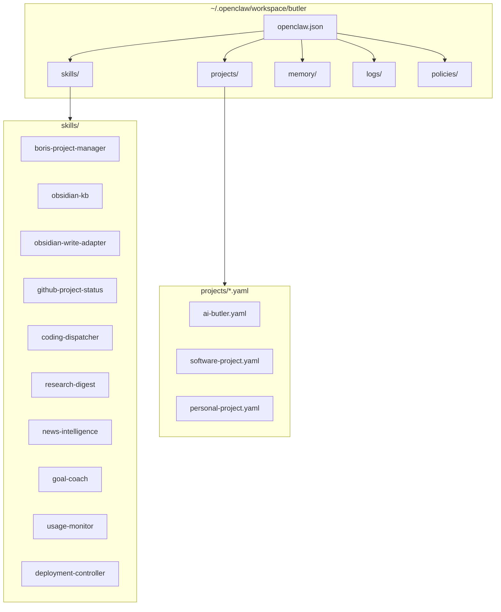

### Proposed Obsidian Vault Layout

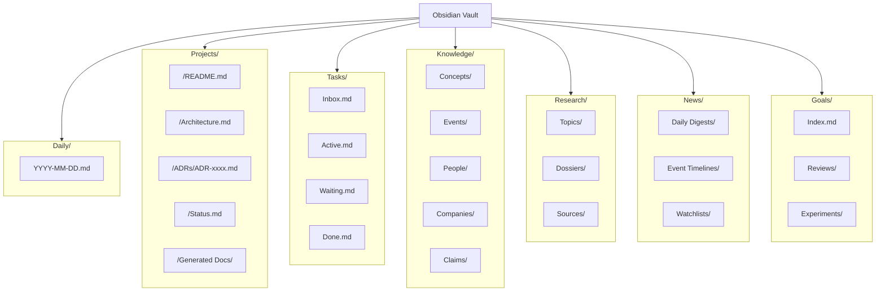

## 6. Domain Components

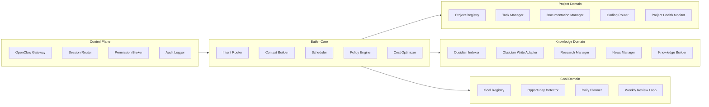

### Component Responsibilities

| Component | Responsibility | Writes allowed by default |
|---|---|---|
| OpenClaw Gateway | Channel multiplexing, session routing, control UI, permission handoff. | No Butler data writes. |
| Intent Router | Classifies commands into project, task, research, news, knowledge, goal, or coding workflows. | No. |
| Context Builder | Loads relevant project manifest, session context, Obsidian notes, GitHub status, and runtime memory. | No. |
| Task Manager | Captures, ranks, updates, and reviews tasks. | Append-only task capture; status edits require policy check. |
| Documentation Manager | Generates project docs, architecture docs, ADRs, and status pages. | Staged writes by default; confirmed writes to Obsidian project docs. |
| Research Manager | Builds research plans, collects evidence, creates dossiers, and extracts open questions. | Staged research notes; confirmed publication to Obsidian. |
| News Manager | Reads feeds, deduplicates stories, scores relevance, and produces digests. | Append digest notes; KB promotions require confirmation. |
| Knowledge Builder | Converts tasks, news, events, and research into linked durable notes. | Controlled writes through Obsidian Write Adapter. |
| Goal Manager | Maintains goals, priorities, constraints, reviews, and experiments. | Append-only goal logs; goal edits require confirmation. |
| Coding Router | Delegates implementation to Codex, Claude Code, OpenCode, or local tools. | Writes only inside allowlisted repositories and only after policy checks. |
| Policy Engine | Applies authorization, filesystem, cost, source, and human confirmation rules. | Writes audit entries only. |

## 7. Project Control Model

Project control is manifest-driven. Each project has a project manifest that binds Obsidian documentation, GitHub repository, local source directory, tasks, business value, automation permissions, and current operating mode.

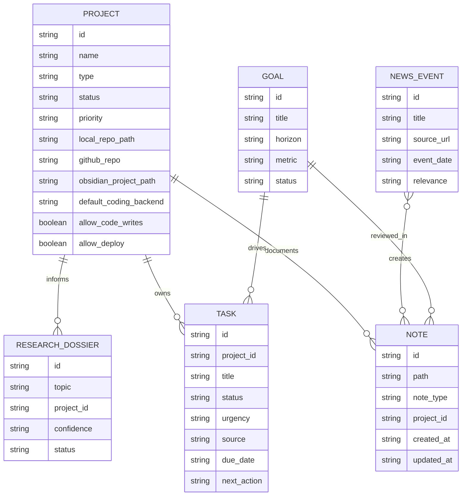

### Project Manifest Shape

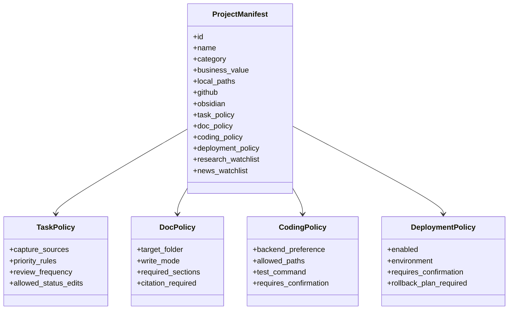

## 8. Task Memory and Daily Notes

The task system has two storage planes:

1. Obsidian is the durable human-readable task and daily-note store.
2. OpenClaw runtime memory is the searchable active-session index.

This follows the source separation between canonical Obsidian knowledge and OpenClaw runtime memory, but adds controlled writes because task memory and daily notes are explicit goals. [Source: OpenClaw-first AI Butler Architecture.md, lines 140-157]

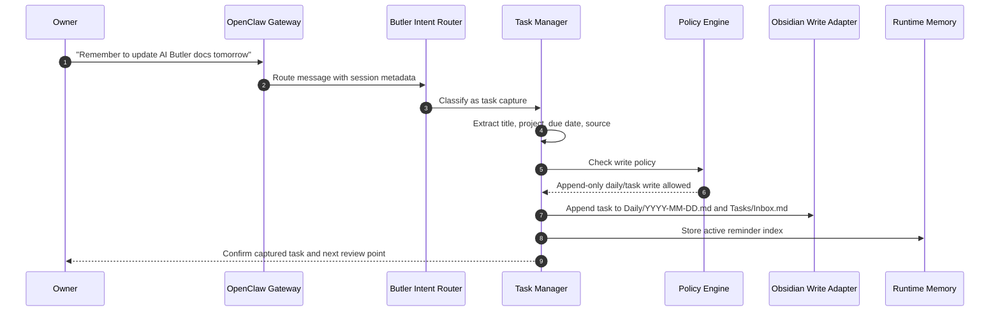

### Task Lifecycle

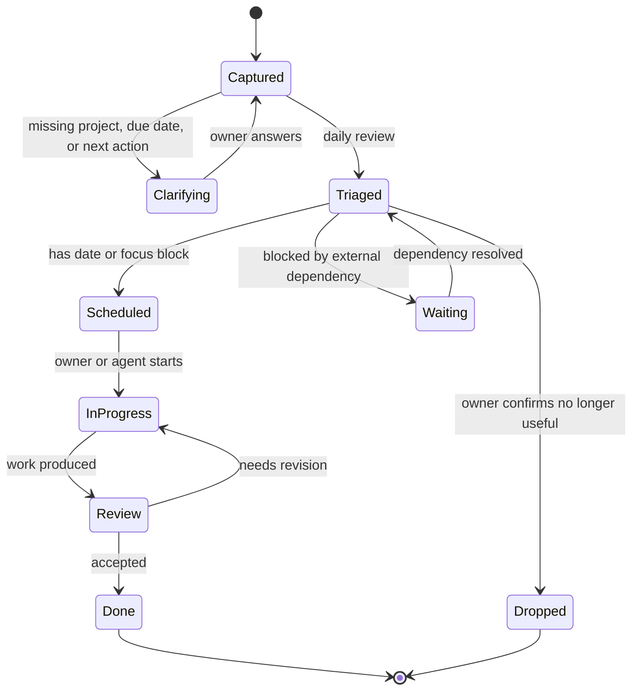

### Daily Note Write Contract

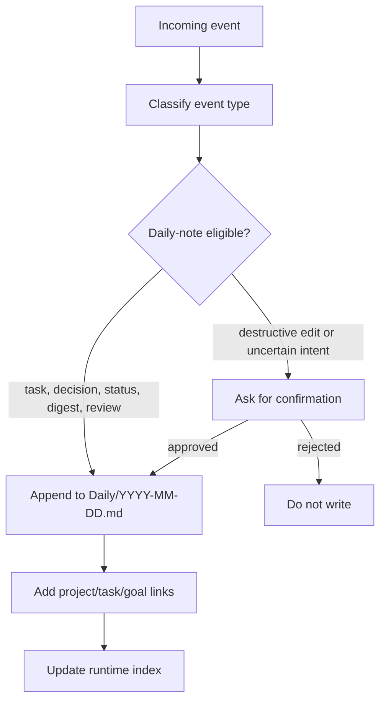

## 9. Obsidian Write Policy

The Obsidian Write Adapter is the only component allowed to write to the vault.

```mermaid
flowchart LR
  subgraph Requesters["Write Requesters"]
    Task["Task Manager"]
    Doc["Documentation Manager"]
    Research["Research Manager"]
    News["News Manager"]
    Goal["Goal Manager"]
  end

  subgraph WriteAdapter["Obsidian Write Adapter"]
    ValidatePath["Path allowlist"]
    ValidateSchema["Frontmatter/schema validation"]
    DetectRisk["Risk classifier"]
    Stage["Staging buffer"]
    Apply["Apply write"]
    Audit["Audit entry"]
  end

  subgraph Vault["Obsidian Vault"]
    Daily["Daily notes"]
    ProjectDocs["Project docs"]
    TaskNotes["Task notes"]
    ResearchNotes["Research notes"]
    NewsNotes["News notes"]
    KnowledgeNotes["Knowledge notes"]
    GoalNotes["Goal notes"]
  end

  Requesters --> ValidatePath --> ValidateSchema --> DetectRisk
  DetectRisk -->|low risk append| Apply
  DetectRisk -->|medium/high risk| Stage
  Stage -->|owner approval| Apply
  Apply --> Vault
  Apply --> Audit
```

| Write type | Default policy | Rationale |
|---|---|---|
| Append to today's daily note | Allowed after schema/path validation | Needed for daily memory with low destructive risk. |
| Add task to inbox | Allowed after schema/path validation | Needed for remembering tasks. |
| Update task status | Allowed for simple transitions; confirmation for delete/drop | Prevents accidental loss of commitments. |
| Create new project documentation | Stage first, then confirm | Generated docs can be large and should be reviewed. |
| Edit existing project documentation | Confirmation required | Existing human-authored docs are valuable. |
| Add research source note | Allowed if source URL and extraction metadata are present | Preserves traceability. |
| Promote research/news into knowledge note | Confirmation required unless rule-based watchlist allows it | Avoids polluting the knowledge base. |
| Delete, rename, or bulk rewrite | Always confirmation required | Destructive. |

## 10. Project Documentation Generation

The documentation manager creates and updates Obsidian project documentation from project manifests, repo inspection, existing notes, GitHub state, and user instructions.

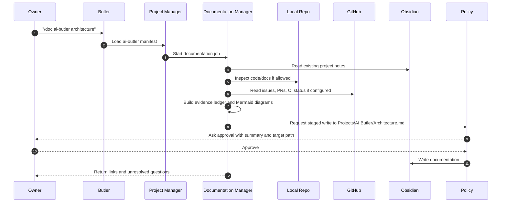

### Documentation Artifact Map

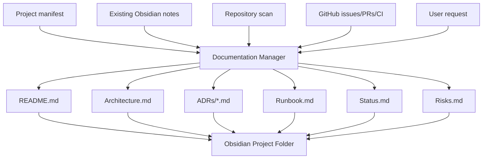

## 11. Deep Research Pipeline

Deep research should be an evidence-first workflow. It can be triggered manually by `/research <topic>` or automatically when project, news, or goal context creates a high-value question.

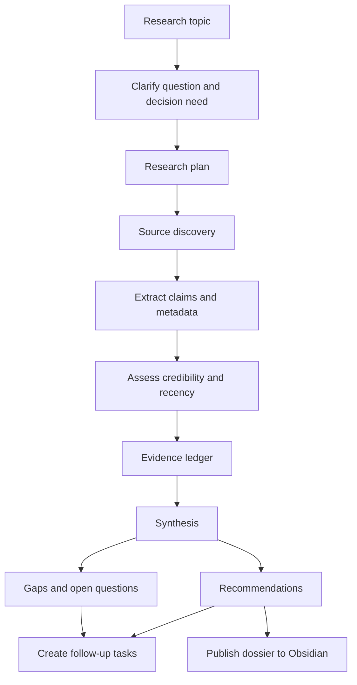

### Research Knowledge Controls

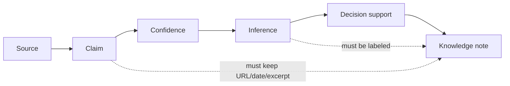

## 12. News Intelligence Pipeline

News analysis is not just a digest. It should identify events that matter to projects, goals, finances, technology choices, or personal planning.

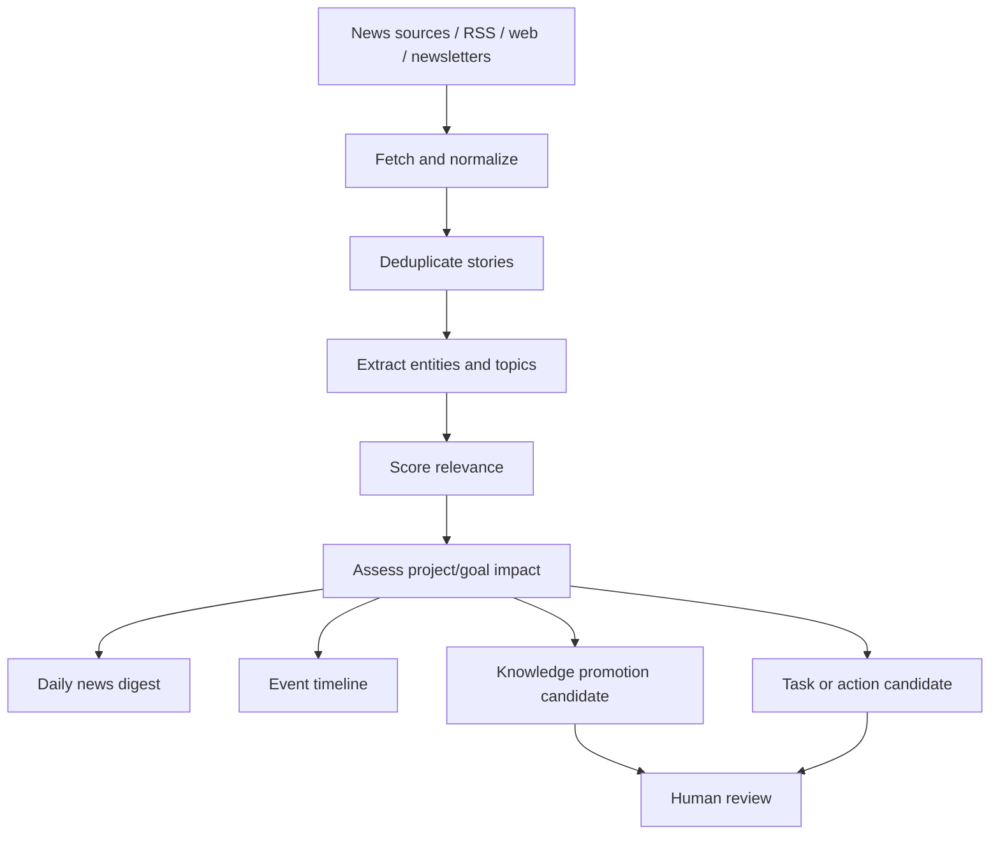

### News to Knowledge Flow

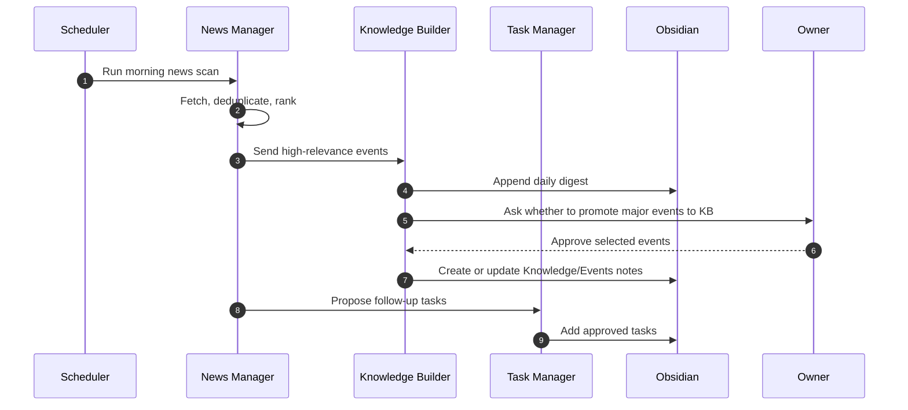

## 13. Knowledge Base Model

The knowledge base should separate facts, claims, inferences, decisions, and tasks. This prevents news or research summaries from becoming untraceable opinion.

```mermaid
erDiagram
  SOURCE {
    string id
    string url
    string title
    string publisher
    date accessed_at
    date published_at
  }

  CLAIM {
    string id
    string source_id
    string text
    string quote_or_summary
    string confidence
  }

  CONCEPT {
    string id
    string name
    string domain
  }

  EVENT {
    string id
    string title
    date event_date
    string status
  }

  INFERENCE {
    string id
    string based_on_claims
    string confidence
    string validation_path
  }

  DECISION {
    string id
    string project_id
    string decision
    date decided_at
  }

  TASK {
    string id
    string title
    string next_action
    string status
  }

  SOURCE ||--o{ CLAIM : supports
  CLAIM }o--o{ CONCEPT : mentions
  CLAIM }o--o{ EVENT : describes
  CLAIM ||--o{ INFERENCE : informs
  INFERENCE ||--o{ DECISION : supports
  DECISION ||--o{ TASK : creates
```

### Knowledge Promotion State

```mermaid
stateDiagram-v2
  [*] --> RawInput
  RawInput --> SourceNote: has source metadata
  SourceNote --> ClaimExtracted: claim extraction complete
  ClaimExtracted --> DailyDigest: daily relevance only
  ClaimExtracted --> CandidateKB: high relevance
  CandidateKB --> HumanReview
  HumanReview --> KnowledgeNote: approved
  HumanReview --> Rejected: rejected
  KnowledgeNote --> Linked: linked to projects/goals/tasks
  Linked --> [*]
  DailyDigest --> [*]
  Rejected --> [*]
```

## 14. Proactive Goal Pursuit

The Butler should be proactive, but not autonomous in high-impact actions. It should observe, reason, recommend, ask, and then execute approved changes.

```mermaid
flowchart TB
  Goals["Goal registry"]
  Context["Context signals"]
  Signals["Tasks, news, research, project status, daily notes"]
  Detect["Opportunity detector"]
  Prioritize["Priority and constraint check"]
  Suggest["Recommendation"]
  Ask["Ask owner"]
  Execute["Execute approved action"]
  Review["Review outcome"]
  Learn["Update goal model"]

  Goals --> Detect
  Context --> Signals --> Detect
  Detect --> Prioritize --> Suggest --> Ask
  Ask -->|approved| Execute
  Ask -->|defer| Review
  Ask -->|reject| Learn
  Execute --> Review --> Learn
  Learn --> Goals
```

### Proactive Daily Operating Loop

```mermaid
sequenceDiagram
  autonumber
  participant Scheduler
  participant Goal as Goal Manager
  participant Project as Project Manager
  participant News as News Manager
  participant Tasks as Task Manager
  participant Vault as Obsidian
  participant Owner

  Scheduler->>Goal: Start morning planning
  Goal->>Vault: Read goals, daily notes, recent reviews
  Goal->>Project: Ask for project health and blocked work
  Project-->>Goal: Priorities, stalled work, CI/GitHub signals
  Goal->>News: Ask for relevant events
  News-->>Goal: Relevant risks/opportunities
  Goal->>Tasks: Rank today's focus candidates
  Tasks-->>Goal: Task shortlist
  Goal->>Owner: Send daily plan with 1-3 recommended actions
  Owner-->>Goal: Accept, modify, or reject
  Goal->>Vault: Append plan and decisions to daily note
```

### Life-Improvement Guardrails

```mermaid
flowchart LR
  Recommendation["Recommendation"]
  LowRisk{"Low risk?"}
  MediumHigh{"Medium/high risk?"}
  AutoLog["Auto-log suggestion"]
  Ask["Ask for approval"]
  Execute["Execute"]
  Block["Block until explicit confirmation"]

  Recommendation --> LowRisk
  LowRisk -->|yes| AutoLog
  LowRisk -->|no| MediumHigh
  MediumHigh -->|schedule, money, files, public action| Ask
  MediumHigh -->|destructive or irreversible| Block
  Ask -->|approved| Execute
```

## 15. Coding and Project Execution

The source explicitly separates orchestration from code execution and supports MCP Bridge Mode and OpenClaw-hosted runtime mode. [Source: OpenClaw-first AI Butler Architecture.md, lines 84-98]

```mermaid
flowchart TB
  Request["Owner asks for software work"]
  Session["OpenClaw session context"]
  Project["Project manifest"]
  Router["Coding dispatcher"]
  Mode{"Execution mode"}

  Bridge["MCP Bridge Mode"]
  Hosted["OpenClaw-hosted Runtime Mode"]

  subgraph Backends["Coding Backends"]
    Codex["Codex"]
    Claude["Claude Code"]
    OpenCode["OpenCode"]
    Local["Local tools"]
  end

  subgraph Agents["Specialized Agents"]
    Architect["Architect"]
    Planner["Planner"]
    Coder["Coder"]
    Tester["Tester"]
    Reviewer["Reviewer"]
    Deployer["Deployer"]
    Researcher["Researcher"]
  end

  Request --> Session --> Project --> Router --> Mode
  Mode --> Bridge
  Mode --> Hosted
  Bridge --> Backends
  Hosted --> Backends
  Backends --> Agents
```

### Coding Permission Flow

```mermaid
sequenceDiagram
  autonumber
  participant Owner
  participant Gateway as OpenClaw Gateway
  participant Butler
  participant Policy
  participant Agent as Coding Agent
  participant Repo as Project Repo
  participant Vault as Obsidian

  Owner->>Gateway: "Implement loader in project X"
  Gateway->>Butler: Route to coding dispatcher
  Butler->>Policy: Check project manifest and write scope
  Policy-->>Butler: Allowed paths and required confirmation
  Butler->>Agent: Start coding task with context
  Agent->>Repo: Read files
  Agent->>Policy: Request file write
  Policy-->>Owner: Confirm file write summary
  Owner-->>Policy: Approve
  Agent->>Repo: Modify files and run tests
  Agent->>Vault: Append implementation note to project status
  Agent-->>Owner: Report changed files, tests, risks
```

## 16. Model and Cost Routing

The source cost policy prefers subscriptions and local models before direct API keys. Direct API keys are fallback only and require confirmation. [Source: OpenClaw-first AI Butler Architecture.md, lines 127-138]

```mermaid
flowchart TB
  Job["Incoming job"]
  Classify["Classify complexity and privacy"]
  NeedCode{"Needs coding backend?"}
  NeedResearch{"Needs deep research?"}
  Simple{"Simple summarization or formatting?"}

  ClaudeSub["Claude Code subscription"]
  CodexSub["Codex subscription"]
  OpenCodeLogin["OpenCode with existing login"]
  LocalModel["Local model"]
  DirectAPI["Direct API key"]
  Confirm["Ask owner for API cost approval"]

  Job --> Classify
  Classify --> NeedCode
  NeedCode -->|yes| ClaudeSub
  ClaudeSub -->|unavailable| CodexSub
  CodexSub -->|unavailable| OpenCodeLogin
  NeedCode -->|no| NeedResearch
  NeedResearch -->|yes| CodexSub
  NeedResearch -->|no| Simple
  Simple -->|yes| LocalModel
  Simple -->|no| DirectAPI
  DirectAPI --> Confirm
```

## 17. Security and Trust Boundaries

The source defines OpenClaw as privileged automation infrastructure and requires deny-by-default security, allowlists, secret handling, prompt-injection awareness, human confirmation, and audit logs. [Source: OpenClaw-first AI Butler Architecture.md, lines 159-174]

```mermaid
flowchart TB
  subgraph Untrusted["Untrusted / Semi-trusted Inputs"]
    UserMsg["Incoming chat messages"]
    NewsWeb["News and web pages"]
    ResearchWeb["Research sources"]
    ExternalSkills["External skills/plugins"]
    RepoContent["Repository content"]
  end

  subgraph Boundary["Security Boundary"]
    Auth["User allowlist"]
    PromptShield["Prompt injection checks"]
    SourcePolicy["Source trust policy"]
    PathPolicy["Filesystem path allowlist"]
    SecretPolicy["Secret isolation"]
    Approval["Human approval gate"]
    Audit["Audit log"]
  end

  subgraph Trusted["Trusted Operations"]
    ReadVault["Read Obsidian"]
    AppendDaily["Append daily note"]
    UpdateTasks["Update tasks"]
    WriteDocs["Write project docs"]
    CodeWrite["Modify repo files"]
    Deploy["Deploy"]
  end

  Untrusted --> Auth --> PromptShield --> SourcePolicy --> PathPolicy --> SecretPolicy --> Approval
  Approval --> Trusted
  Trusted --> Audit
```

### Action Risk Matrix

| Action | Risk | Default decision | Confirmation required |
|---|---:|---|---|
| Read Obsidian note | Low | Allow if path is allowlisted | No |
| Append to daily note | Low | Allow if schema-valid | No |
| Add task to inbox | Low | Allow if schema-valid | No |
| Create new generated doc | Medium | Stage first | Yes |
| Edit existing human-authored doc | Medium | Stage diff | Yes |
| Modify source code | Medium/High | Use project manifest write scope | Yes |
| Run tests | Medium | Allow if command is allowlisted | Sometimes |
| Install dependencies | High | Block until approval | Yes |
| Push to GitHub | High | Block until approval | Yes |
| Deploy | Critical | Block until approval and rollback plan | Yes |
| Change billing or secrets | Critical | Block until approval | Yes |

## 18. User Command Surface

```mermaid
flowchart LR
  Command["User command"]
  Daily["/daily"]
  Tasks["/tasks"]
  Remember["/remember"]
  Project["/project <id>"]
  Status["/status"]
  Doc["/doc <project> <artifact>"]
  Research["/research <topic>"]
  News["/news"]
  KB["/kb <query>"]
  Goals["/goals"]
  Review["/review"]

  Command --> Daily
  Command --> Tasks
  Command --> Remember
  Command --> Project
  Command --> Status
  Command --> Doc
  Command --> Research
  Command --> News
  Command --> KB
  Command --> Goals
  Command --> Review
```

| Command | Purpose | Primary write target |
|---|---|---|
| `/daily` | Show or create today's operating plan. | `Daily/YYYY-MM-DD.md` |
| `/remember <item>` | Capture a task, fact, commitment, or decision. | Daily note, task inbox, or knowledge inbox |
| `/tasks` | Show active, waiting, blocked, and due tasks. | Task status files |
| `/project <id>` | Load project context and status. | No default write |
| `/status` | Summarize all project health and today's focus. | Daily note if owner accepts summary |
| `/doc <project> <artifact>` | Generate or update project documentation. | Project docs after confirmation |
| `/research <topic>` | Run deep research and produce a dossier. | Research dossier after confirmation |
| `/news` | Read relevant news and generate digest. | News daily digest |
| `/kb <query>` | Search or update knowledge base. | Knowledge notes after confirmation |
| `/goals` | Review goals and next actions. | Goal notes and daily note |
| `/review` | Run daily or weekly review. | Daily note, goal review, task updates |

## 19. End-to-End Operating Flows

### Morning Project and Life Planning

```mermaid
flowchart TB
  Start["Scheduled morning run"]
  LoadGoals["Load goals"]
  LoadTasks["Load tasks"]
  LoadProjects["Load project manifests and GitHub/repo status"]
  LoadNews["Load relevant news"]
  LoadDaily["Read recent daily notes"]
  Score["Score priorities"]
  Recommend["Recommend 1-3 focus items"]
  UserChoice["Owner accepts, edits, or rejects"]
  WritePlan["Append plan to daily note"]
  Execute["Start approved task or research"]

  Start --> LoadGoals
  Start --> LoadTasks
  Start --> LoadProjects
  Start --> LoadNews
  Start --> LoadDaily
  LoadGoals --> Score
  LoadTasks --> Score
  LoadProjects --> Score
  LoadNews --> Score
  LoadDaily --> Score
  Score --> Recommend --> UserChoice --> WritePlan --> Execute
```

### News Creates a Project Task

```mermaid
flowchart LR
  NewsItem["News item"]
  Match["Matches project watchlist"]
  Impact["Impact assessment"]
  Candidate["Candidate task"]
  Approval["Owner approval"]
  Task["Task inbox"]
  ProjectNote["Project status note"]

  NewsItem --> Match --> Impact --> Candidate --> Approval
  Approval -->|approved| Task
  Approval -->|approved| ProjectNote
```

### Research Creates Knowledge

```mermaid
flowchart LR
  Question["Research question"]
  Sources["Sources"]
  Claims["Claims"]
  Dossier["Research dossier"]
  Knowledge["Knowledge notes"]
  Decisions["Project decisions"]
  Tasks["Follow-up tasks"]

  Question --> Sources --> Claims --> Dossier
  Dossier --> Knowledge
  Dossier --> Decisions
  Dossier --> Tasks
```

## 20. Implementation Roadmap

The MVP in the source starts with OpenClaw, Telegram, workspace initialization, core skills, project manifests, Obsidian, GitHub read-only status, coding adapters, commands, audit, and permissions. [Source: OpenClaw-first AI Butler Architecture.md, lines 176-190]

```mermaid
gantt
  title AI Butler Architecture Roadmap
  dateFormat  YYYY-MM-DD
  axisFormat  %m-%d

  section Phase 0 Foundation
  OpenClaw Gateway setup              :p0a, 2026-05-26, 3d
  Telegram channel and allowlist       :p0b, after p0a, 2d
  Butler workspace skeleton            :p0c, after p0b, 2d

  section Phase 1 Memory and Tasks
  Project manifest schema              :p1a, after p0c, 3d
  Obsidian read/index adapter           :p1b, after p1a, 3d
  Obsidian write adapter                :p1c, after p1b, 4d
  Task capture and daily notes          :p1d, after p1c, 4d

  section Phase 2 Project Operations
  GitHub status skill                   :p2a, after p1d, 3d
  Project status summaries              :p2b, after p2a, 3d
  Documentation generator               :p2c, after p2b, 5d
  Coding dispatcher                     :p2d, after p2c, 5d

  section Phase 3 Intelligence
  Deep research pipeline                :p3a, after p2d, 5d
  News intelligence pipeline            :p3b, after p3a, 5d
  Knowledge promotion workflow          :p3c, after p3b, 4d

  section Phase 4 Proactivity
  Goal registry                         :p4a, after p3c, 3d
  Morning planning loop                 :p4b, after p4a, 4d
  Weekly review loop                    :p4c, after p4b, 4d
```

## 21. MVP Scope

```mermaid
flowchart TB
  MVP["MVP"]
  Must["Must Have"]
  Later["Later"]

  MVP --> Must
  MVP --> Later

  Must --> M1["OpenClaw Gateway + Telegram"]
  Must --> M2["Butler workspace"]
  Must --> M3["Project manifests"]
  Must --> M4["Obsidian daily note append"]
  Must --> M5["Task capture and review"]
  Must --> M6["GitHub/project read-only status"]
  Must --> M7["Documentation generation to staging"]
  Must --> M8["Audit and confirmation policy"]

  Later --> L1["WhatsApp/Slack"]
  Later --> L2["Autonomous scheduled research"]
  Later --> L3["Full news knowledge graph"]
  Later --> L4["Deploy automation"]
  Later --> L5["Calendar/finance/health integrations"]
  Later --> L6["Voice interface"]
```

## 22. Open Questions and Gaps

| Gap | Why it matters | Proposal |
|---|---|---|
| Actual Obsidian vault path is not stated. | Write policies and folder topology need exact paths. | Add `obsidian.vault_path` to `openclaw.json` and each project manifest. |
| Task format is not defined. | Tasks must be queryable and stable across daily notes, project notes, and task files. | Standardize Markdown tasks with frontmatter-backed task IDs. |
| Project manifest schema is not defined. | The orchestrator needs reliable project routing. | Create `projects/schema.json` and validate every `projects/*.yaml`. |
| News sources are not defined. | News quality and relevance depend on curated sources. | Add watchlists per project and per goal, with source reliability tiers. |
| Deep research tooling is not selected. | Research needs search, extraction, source storage, citation, and summarization. | Start with manual `/research` workflow, then add scheduled research only after evidence quality is validated. |
| Proactive boundaries are not defined. | A proactive assistant can become noisy or unsafe. | Define quiet hours, max nudges per day, and action classes requiring approval. |
| OpenClaw capabilities in the source were not re-verified during this document creation. | External platform details may change. | Before implementation, verify current OpenClaw Gateway, skills, memory, MCP, and ACP docs. |
| Calendar, email, finance, and health sources are not specified. | "Improve my life" may require broader context than projects and news. | Treat these as optional Phase 5 integrations with explicit privacy and confirmation policies. |

## 23. Main Architectural Decisions

```mermaid
flowchart TB
  D1["ADR-001: OpenClaw-first, no custom channel backend"]
  D2["ADR-002: Butler as workspace skills and policies"]
  D3["ADR-003: Obsidian as durable knowledge store"]
  D4["ADR-004: Controlled Obsidian writes through adapter"]
  D5["ADR-005: Project manifests are routing source"]
  D6["ADR-006: Coding delegated to specialized backends"]
  D7["ADR-007: Research/news must preserve evidence"]
  D8["ADR-008: Proactivity is recommendation-first"]
  D9["ADR-009: Deny by default with audit"]
  D10["ADR-010: Cost routing prefers subscriptions/local models"]

  D1 --> D2 --> D3 --> D4
  D2 --> D5 --> D6
  D3 --> D7 --> D8
  D2 --> D9
  D6 --> D10
```

| Decision | Rationale | Source support |
|---|---|---|
| Use OpenClaw as gateway and session control plane. | Avoid duplicating channel/session infrastructure. | [Source: OpenClaw-first AI Butler Architecture.md, lines 6-8] |
| Implement Butler as workspace skills, manifests, memory, logs, and policies. | Keeps system modular and aligned with source architecture. | [Source: OpenClaw-first AI Butler Architecture.md, lines 32-46] |
| Use Obsidian as canonical knowledge base. | Human-readable Markdown is durable and inspectable. | [Source: OpenClaw-first AI Butler Architecture.md, lines 140-157] |
| Add controlled Obsidian writes. | Required for daily notes, tasks, generated docs, news, research, and KB. | Extension from user requirements; source baseline is read-only at line 146. |
| Delegate coding to Codex, Claude Code, OpenCode, and MCP tools. | Keeps orchestration separate from execution. | [Source: OpenClaw-first AI Butler Architecture.md, lines 84-98] |
| Require confirmation for destructive or high-impact work. | Matches the source security model. | [Source: OpenClaw-first AI Butler Architecture.md, lines 159-174] |

## 24. Target Result

When complete, the Butler should operate like this:

```mermaid
journey
  title Daily Butler Experience
  section Morning
    Reads goals, tasks, projects, news: 5: Butler
    Recommends focus plan: 5: Butler
    Owner approves or edits plan: 4: Owner
  section Workday
    Captures new tasks and decisions: 5: Butler
    Routes coding work to agents: 4: Butler
    Writes project notes with approval: 4: Butler
  section Research
    Runs deep research when needed: 4: Butler
    Stores evidence and synthesis: 5: Butler
    Creates follow-up actions: 4: Butler
  section Evening
    Summarizes progress: 5: Butler
    Updates daily note and task state: 5: Butler
    Prepares tomorrow's candidates: 4: Butler
```

The core principle is simple: OpenClaw controls communication and sessions; Butler controls goals, projects, tasks, knowledge, research, and proactivity; Obsidian remains the durable human-readable memory; high-impact actions require explicit human approval.
