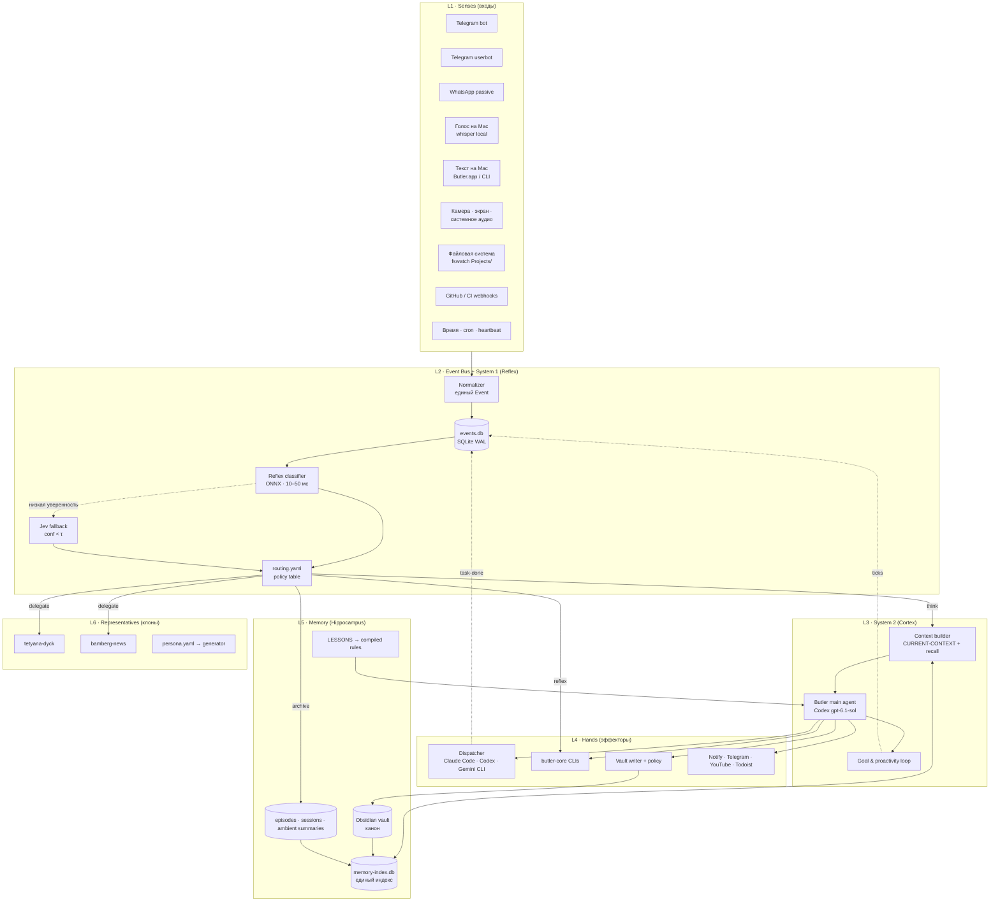
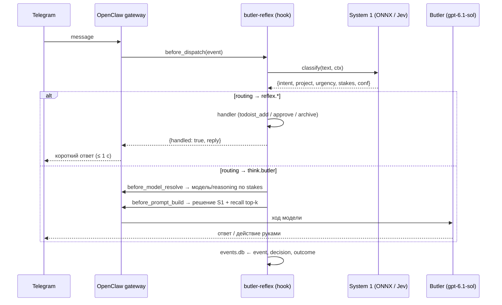
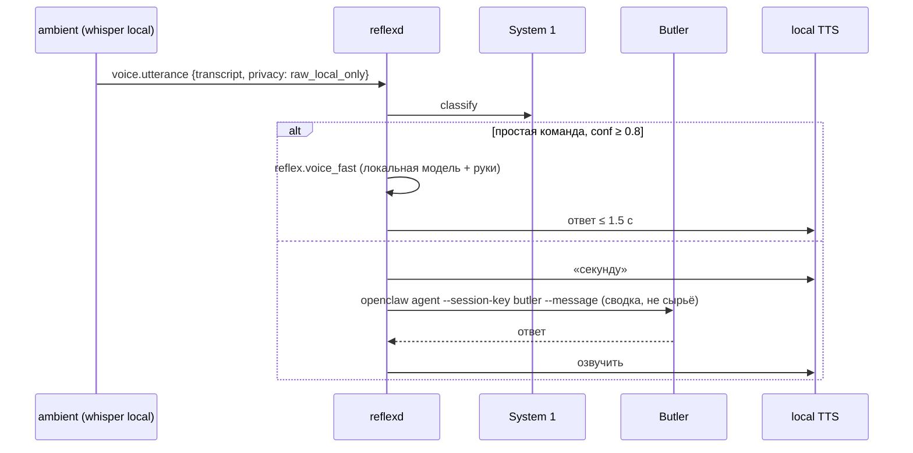

# Butler v2 — единая архитектура персонального ИИ-ассистента

**Статус:** предложено, ожидает ревью Бориса · **Дата:** 2026-10-23 · **Заменяет:** `docs/AI-Butler-Architecture.md` (май 2026, «proposed», не обновлялся), `OpenClaw-first AI Butler Architecture.md`
**Основа:** аудит репозитория, живого workspace `~/.openclaw/workspace-butler`, установки OpenClaw и клонов (2026-10-23); исследование System One моделей (TypeSafe Jev, Decision Models s1-llm-auto-router, Laya).

Решения, принятые Борисом 2026-10-23 и зашитые в этот документ:

| Вопрос | Решение |
|---|---|
| System 1 (быстрый слой) | гибрид: локальные ONNX-модели + собственные головы; при низкой уверенности — облачный Jev (TypeSafe) |
| System 2 (главный мозг) | остаётся Codex `gpt-6.1-sol` через ACP |
| OpenClaw | обновить с 2026.5.26/27 до 2026.10.x как Phase 0, после бэкапа и ревизии ручных патчей |
| Клоны | отдельные агенты OpenClaw + общий пакет `butler-core` + генератор workspace из `persona.yaml` |
| Life-capture | сырые данные (аудио, видео, экран, чужие сообщения) обрабатываются только локально; во внешние модели уходят только структурированные сводки |
| Язык документа | русский, идентификаторы и имена компонентов — английские |

---

## 0. Резюме

Butler сегодня — это один большой LLM-ход на каждое событие: сообщение, крон, пробуждение. 40 КБ `AGENTS.md` читается заново каждый раз, решение «что это и что с этим делать» принимает самая дорогая и медленная часть системы. Быстрого слоя нет, память разбита на пять хранилищ, модели выбираются в трёх несвязанных местах, клоны — ручные копии workspace, а ambient-сервис с камерой и микрофоном живёт отдельным мозгом и в контекст Butler не попадает.

Целевая архитектура строится вокруг одной идеи: **двухсистемный мозг** (по Канеману). **System 1 (Reflex)** — локальные типизированные decision-модели, которые за 10–50 мс отвечают на фиксированные вопросы о каждом входящем событии: что это, насколько срочно, какой проект, нужны ли инструменты, кто должен обработать. **System 2 (Cortex)** — Codex `gpt-6.1-sol` как главный рассуждающий агент, который получает только то, что System 1 не смог решить сам, и получает это уже с готовой разметкой. Между ними — **единая шина событий** и **таблица маршрутизации** в YAML, которую можно менять без правки промптов.

Всё остальное — следствия: единый компилируемый источник «мозга» вместо двух расходящихся файлов, одна библиотека `butler-core` вместо трёх копий, один индекс памяти вместо пяти, реестр проектов вместо ручного манифеста, клоны как сгенерированные персоны, ambient-данные как ещё один вход в ту же шину.

Миграция разбита на 8 фаз (раздел 14). Phase 0 — гигиена и апгрейд OpenClaw — не меняет поведение, только снимает подтверждённые поломки.

---

## 1. Что есть сейчас (аудит 2026-10-23)

### 1.1 Компоненты и где они живут

| Слой | Сейчас | Файлы |
|---|---|---|
| Платформа | OpenClaw gateway 2026.5.27 (`/opt/homebrew/lib/node_modules/openclaw`) на nvm Node 22.22.3, порт 18789, launchd `ai.openclaw.gateway`. На PATH — другая установка 2026.5.26 (nvm). Актуальная версия upstream — 2026.10.6 | `~/.openclaw/openclaw.json` + 28 резервных копий без VCS |
| Главный агент | `butler`: Codex `gpt-6.1-sol`, runtime ACP (acpx, persistent). Heartbeat выключен (`HEARTBEAT.md` пуст). Все 20 кронов — изолированные сессии | `~/.openclaw/workspace-butler/AGENTS.md` (411 строк) + `CLAUDE.md` (405 строк, расхождение 51 строка) |
| Руки | 34 CLI в `bin/`, 26 модулей в `lib/` (≈12 тыс. строк). `dispatch.py` вызывает Claude Code и Codex CLI по подписке (ключи вырезаны из env). Gemini — только Veo. Ollama — только `embeddinggemma` | `lib/dispatch.py:89-113` (ROUTES), `bin/butler-*` |
| Память | Obsidian vault `~/Documents/KnowledgeDB` (канон, запись только через `lib/vault.py` + `policies/write.yaml`); `state/memory-index.db` (139 МБ, 25 тыс. чанков, embeddinggemma); `memory/*.md` (фактически лог ошибок реиндекса); SQLite ambient-сервиса; зеркало Todoist | `lib/memory.py`, `lib/embeddings.py`, `lib/vault.py` |
| Входы | Telegram-бот `@MacStudioButler_bot` (allowlist 253483520); Telethon-юзербот (буферит все диалоги: 22 071 сообщение, 16 МБ); WhatsApp passive-ingest (патч вендорного dist, 13 номеров); голосовые → OpenAI whisper-1; ambient (камера, микрофон, экран, системное аудио; 22 154 файла, 4,8 ГБ raw); CI-webhook через ngrok | `bin/tg-userbot`, `~/.openclaw/extensions/whatsapp`, `implementation/ambient-awareness` |
| Выходы | `butler-notify` (Telegram), `delivery.announce` кронов, vault-записи, YouTube (`butler-youtube`, allowlist канала), HTML-доска задач | |
| Клоны | `tetyana-dyck` (Claude Sonnet 5, ACP) — пайплайн FamilyBuilder.io для Тани; `bamberg-news` (Claude Sonnet 5) — новостное видео для родителей, без Telegram-привязки. `news_video.py` (178 КБ) продублирован байт-в-байт; Bamberg вызывает `butler-youtube` из чужого workspace | `~/.openclaw/workspace-tetyana-dyck`, `~/.openclaw/workspace-bamberg-news` |
| Проактивность | 20 кронов (новости 2×, видео 2×, research curate + execute, inbox classify 2×, project digest, daily analysis 2×, lessons, reindex, dreaming); wake-цепочка после dispatch | `~/.openclaw/cron/jobs.json` |

### 1.2 Подтверждённые поломки (на 2026-10-23)

| # | Проблема | Корень | Статус |
|---|---|---|---|
| B1 | Wake-путь диспетчера падал SIGABRT с 10.10 — 247 потерянных пробуждений; автономное продолжение задач не работало | `brew upgrade simdjson` (33 → 34) сломал Homebrew `node@24`, который `dispatch.py` и `butler-notify` подставляли в PATH | **исправлено 2026-10-23**: оба переведены на nvm Node 22.22.3 (тот же Node, на котором работает gateway); бэкапы `*.bak-node24-simdjson-2026-10-23` |
| B2 | Bamberg-кроны в `error`: выпуски отрендерены, но не опубликованы (8 из 83) | лимит claude-cli 8 МиБ / 20 000 строк на ход (`claude-live-session-*.js:782`) против правила «всё в одном ходе»; `reliability.outputLimits` не задан | план, Phase 0 |
| B3 | `lessons-weekly-decay` — 21 неделя ошибок молча | крон зовёт `butler-lesson --help`, а `lib/lessons.py` его не поддерживает; у кронов нет уведомления о сбое | план, Phase 0 |
| B4 | Default-агент = `tetyana-dyck` (первый в `agents.list`); «Memory Dreaming» (`agentId: null`) ежедневно запускается на Тане и делает no-op | порядок списка агентов | план, Phase 0 |
| B5 | `edge-tts` 403 две недели, все выпуски на fallback-голосе Milena; `AGENTS.md`, worker-prompt и cron payload Bamberg противоречат друг другу по TTS | три источника правды | план, Phase 1 |
| B6 | Codex remote compaction 404 (`/codex/responses/compact`) — длинные сессии Butler не сжимаются | upstream Codex backend | мониторинг; апгрейд OpenClaw |
| B7 | `mcporter` выключен → Butler не может вызвать ambient MCP; ambient работает отдельным мозгом | конфиг | план, Phase 5 |
| B8 | `HEALTH.json` от 27.05, `health.py` ждёт модели, которых нет; `cost.py` считает все текущие модели по $0 | устарело | план, Phase 0/1 |
| B9 | ngrok открывает весь gateway (`allowInsecureAuth: true`) ради одного CI-вебхука; ACP Codex доверяет `/`; `acpx.permissionMode: approve-all` | безопасность | план, Phase 8 |
| B10 | Рост без ротации: сессии Butler 697 МБ / 8 470 файлов, `runs/` 8,9 ГБ, `.openclaw-cli-images` Тани 1,4 ГБ, raw ambient 4,8 ГБ в сутки, dead-letters доставки не разбираются | нет janitor | план, Phase 0 |

### 1.3 Структурные разрывы относительно цели

1. **Нет System 1.** Каждое событие — полный LLM-ход. Единственный «быстрый» фильтр — подстрочные ключевые слова в `lib/ingest.py` (давали ложные срабатывания типа «Ukr**ai**ne»).
2. **Мозг размазан по четырём местам:** `AGENTS.md`/`CLAUDE.md`, `lib/dispatch.py ROUTES`, `config/model-catalog.json` ambient-сервиса, тексты 20 крон-промптов (`state/*-worker-prompt.txt`). Урок L-2026-07-19 «три места» — симптом этого.
3. **Пять хранилищ памяти без единого recall**; ambient-наблюдения и сводки Telegram-буфера в индекс не попадают.
4. **Знание проектов — ручной манифест**, которого нет (`projects/` отсутствует, `butler-status` мёртв). Вопрос «какие из ~70 директорий — управляемые проекты» не отвечен с мая.
5. **Клоны — копии.** Нет шаблона, нет общего пакета, нет API знаний; «изоляция» Bamberg нарушается прямыми вызовами в workspace Butler.
6. **Голос и текст на Mac** существуют только внутри ambient-приложения с собственной эфемерной памятью (REQ-020 «общие знания и инструменты Butler» не реализован).
7. **Проактивность = cron.** Нет цикла «заметил → оценил → решил, стоит ли беспокоить».

---

## 2. Принципы целевой архитектуры

1. **Два режима мышления, одна шина.** Любое событие сначала проходит System 1 (типизированное решение за миллисекунды), и только по его решению — System 2 (LLM). Шина событий одна для всех входов: Telegram, WhatsApp, голос, камера, экран, cron, webhook, файловая система.
2. **Решения — данные, а не проза.** Что делать с событием класса X — строка в `brain/routing.yaml`, а не абзац в `AGENTS.md`. Промпт описывает *как* думать, таблица — *куда* направить.
3. **Один источник, много артефактов.** `brain/` компилируется в `AGENTS.md`, `CLAUDE.md`, фрагмент `openclaw.json`, крон-промпты, каталог моделей ambient. Руками правится только источник.
4. **Один пакет кода.** `butler-core` (Python) устанавливается во все workspace; клон не содержит копий библиотек.
5. **Канон знаний — Obsidian vault**, единый индекс — над всем (vault, буферы, сводки ambient, документация проектов, summaries сессий). Запись в канон — только через policy-слой с grounding (урок L-2026-05-30-6: никаких инференсов в канон без источника).
6. **Сырое — локально, сводки — куда угодно.** Аудио, видео, экран, тексты третьих лиц никогда не покидают Mac Studio в сыром виде.
7. **Platform-first.** Всё, что OpenClaw умеет нативно (bindings, typed-хуки, cron, media pipeline, nodes), используем как есть; патчи вендорного dist — только через проверяемые скрипты с автопроверкой после апгрейда.
8. **Наблюдаемость обязательна.** Каждый демон, крон, канал имеет watchdog и путь уведомления о сбое. Молчаливых ошибок (B3: 21 неделя) быть не должно.
9. **Минимальные необратимые действия.** Deploy, push, delete, траты сверх порога, публикация — только с явного «да» (сохраняем текущие HARD LIMITS).

---

## 3. Целевая архитектура — слои



### L0 · Платформа
- **Одна установка OpenClaw** (2026.10.x) под одним Node (nvm 22.x, тем же, что в launchd). Вторая установка (nvm 2026.5.26) удаляется; `plugin-skills` символические ссылки переводятся на рабочую.
- **Все ручные патчи dist — в `deploy/patches/`** как идемпотентные скрипты с тестом (`whatsapp-ghost`, `whatsapp-passive`, `claude-cli-allowed-tools`). После каждого апгрейда запускается `butler-doctor --patches`, который проверяет наличие патчей и падает громко.
- **launchd-демоны:** gateway, tg-userbot, ambient, ollama, reflexd (новый), watchdog (новый). У каждого — stderr в файл, не в `/dev/null`.

### L1 · Senses (входы)
Все входы приводятся к одному типу события (раздел 4.1). Новые по сравнению с сегодня:
- **Текст на Mac**: `butler say "..."` (CLI) и поле ввода в панели Butler.app → HTTP POST в `reflexd` → шина. Ответ возвращается в панель и/или Telegram.
- **Голос на Mac**: уже существующий путь ambient (wake → whisper large-v3-turbo локально) перестаёт отвечать своим Gemma-мозгом и публикует событие `voice.utterance` в шину. Ответ формирует Butler (или reflex-handler, если System 1 уверен, что это простая команда), озвучка — локальный TTS ambient.
- **Файловая система**: `fswatch` над `~/Projects`, `~/github.com` → события `fs.project_changed` (для реестра проектов и подсказок «ты давно не коммитил в X»).
- **Голосовые в Telegram/WhatsApp**: транскрипция переводится с OpenAI whisper-1 на тот же локальный `whisper-server`, что у ambient (один стек ASR вместо двух, и сырое аудио не уходит в облако — согласно решению о приватности).

### L2 · Event Bus + System 1 (Reflex) — раздел 4

### L3 · System 2 (Cortex)
- **Главный агент** — `butler` на Codex `gpt-6.1-sol` (решение Бориса). ACP persistent, как сейчас.
- **Системный промпт компилируется** из `brain/` (раздел 6): идентичность, правила, таблица маршрутов в человекочитаемом виде, список рук. Цель — ≤ 15 КБ вместо 40 КБ: всё, что стало таблицей или кодом, из промпта уходит.
- **Context builder** перед каждым ходом собирает: решение System 1 (класс, срочность, проект, уверенность), `CURRENT-CONTEXT.md` (обновляется не раз в сутки, а при каждом значимом событии через reflex-handler), top-k из единого индекса по тексту события, активные задачи проекта из Todoist.
- **Goal & proactivity loop** — раздел 9.

### L4 · Hands (эффекторы)
- **Dispatcher** (`butler-core.dispatch`) остаётся способом звать внешние coding-агенты по подписке: Claude Code (`claude -p`), Codex (`codex exec`), и добавляется **Gemini CLI** (`gemini -p`, уже установлен 0.64.0) как третья рука для задач, где нужен миллионный контекст или Google-экосистема. Маршрут задача → рука живёт в `brain/models.yaml`, а не в коде.
- **Все CLI** из `bin/` переезжают в `butler-core` как entry-points (`butler task`, `butler recall`, …) с сохранением старых имён как shim на время миграции.
- **Vault writer** — без изменений по сути (`vault.py` + `write.yaml`), но получает `grounding_required: true` для `People/`, `Projects/`, `Knowledge/`: запись должна содержать ссылку на событие-источник в `events.db`.

### L5 · Memory (Hippocampus) — раздел 7

### L6 · Representatives (клоны) — раздел 10

### L7 · Observability & Safety — раздел 11

---

## 4. System 1 (Reflex) — детально

### 4.1 Единый формат события

```yaml
Event:
  id: ulid
  ts: 2026-10-23T14:02:11-05:00
  source: telegram.bot | telegram.userbot | whatsapp | voice.mac | text.mac | ambient.vision | ambient.audio | fs | github | cron | dispatch.done | heartbeat
  actor: { kind: owner | known_person | contact | system, id: "253483520", name: "Boris" }
  channel_ctx: { account: butler, chat_id: ..., thread: ... }
  payload: { text: "...", media: [...], transcript: "...", meta: {...} }
  privacy: raw_local_only | summary_ok | public      # выставляет Normalizer по источнику
  decision: null                                     # заполняет Reflex
```

Хранение — SQLite `state/events.db` (WAL), таблица `events` + `decisions` + `outcomes`. Это же — обучающая выборка для собственных голов System 1 (раздел 4.4) и журнал для grounding записей в vault.

### 4.2 Что решает System 1

Фиксированный набор типизированных вопросов (в терминах TypeSafe: choice / score / noul). Ответ — распределение вероятностей + confidence.

| Вопрос | Тип | Варианты | Источник модели |
|---|---|---|---|
| `category` | choice | coding · agentic · math · knowledge · long_context · tool_use · design · summarisation · general | `s1-llm-auto-router` (готовая голова) |
| `difficulty` | score 1–5 | trivial → frontier | `s1-llm-auto-router` |
| `stakes` | score 1–4 | negligible → high | `s1-llm-auto-router` |
| `needs_tools`, `needs_vision`, `needs_long_context`, `follow_up` | noul | — | `s1-llm-auto-router` |
| `intent` | choice | command · question · task_capture · fyi · news_item · project_signal · personal · noise · greeting · approval_reply | **своя голова** (mmBERT-small, обучена на `events.db`) |
| `project` | choice | ∅ · familybuilder · bamberg · broker-fabric · astroweb · … (из реестра проектов) | своя голова + правила (chat_id → проект) |
| `urgency` | score 1–4 | can_wait → now | своя голова |
| `owner_action_required` | noul | — | своя голова |
| `is_about_owner` (для чужих сообщений) | noul | — | своя голова |
| `sensitive` | noul | содержит данные третьих лиц / здоровье / финансы | своя голова + правила |

Правила (детерминированные, до модели): известные chat_id → проект; команды `/…`; сообщения от Butler-ботов → `system`; квiet hours; дедуп по `source_id` (урок L-2026-05-30-5).

### 4.3 Политика маршрутизации

`brain/routing.yaml` — упорядоченный список правил. Первое совпавшее побеждает. Пример:

```yaml
rules:
  - when: { source: telegram.bot, actor.kind: owner, intent: approval_reply }
    do: reflex.approve_pending            # детерминированный handler, без LLM
  - when: { intent: task_capture, confidence: ">=0.85" }
    do: reflex.todoist_add               # создать задачу, подтвердить одной строкой
  - when: { intent: noise }
    do: archive
  - when: { source: telegram.userbot, intent: news_item, project: null }
    do: pipeline.research_capture        # как сейчас ingest → research queue
  - when: { source: telegram.userbot, intent: project_signal }
    do: buffer.project                   # как сейчас project-buffers
  - when: { source: [whatsapp, telegram.userbot], is_about_owner: false, owner_action_required: false }
    do: archive.summarize_daily          # не будить System 2
  - when: { project: familybuilder, actor.id: "1090472826" }
    do: delegate.tetyana-dyck
  - when: { source: voice.mac, intent: command, difficulty: "<=2", confidence: ">=0.8" }
    do: reflex.voice_fast                # локальный быстрый ответ + TTS
  - when: { stakes: ">=3" }
    do: think.butler { model: gpt-6.1-sol, reasoning: high }
  - default:
    do: think.butler
```

Действия (`do`): `reflex.*` (Python-handlers в `butler-core.reflex`), `archive`, `buffer.*`, `pipeline.*`, `delegate.<agent>`, `think.butler {model, reasoning}`, `dispatch.<hand>`.

### 4.4 Модели System 1 и их размещение

| Компонент | Что | Где работает | Латентность | Лицензия |
|---|---|---|---|---|
| `s1-llm-auto-router` | mmBERT-small, 11 слоёв, 7 голов, ONNX int8 183 МБ | CPU Mac Studio, `onnxruntime 1.24` (уже установлен) | ~14 мс p50 на 4 ядрах EPYC; на M2 Ultra ожидаемо ≤ 20 мс (замерить) | MIT |
| Собственные головы | дообученный `mmBERT-small` (или тот же backbone с новыми головами) на разметке `events.db` | CPU, ONNX | те же порядки | свои |
| `laya` (опционально) | 322M multilingual decision encoder, `pip install laya`, `laya-serve` в формате Jev | CPU | 6–33 мс | открытая |
| **Jev** (TypeSafe AI) | hosted System One модель, `POST /v1/systemone`, вопросы choice/score/noul, калиброванные вероятности | облако | 70–500 мс | платно |

**Гибридная логика (решение Бориса):** локальные модели отвечают всегда; если `confidence < τ` (стартово τ = 0.70, подбирается по `events.db`) **и** `privacy != raw_local_only`, тот же набор вопросов отправляется в Jev; если и Jev не уверен — событие уходит в System 2 с пометкой `uncertain`. События с `privacy: raw_local_only` (ambient, чужие сообщения) в Jev не уходят никогда — только локально или в System 2 в виде сводки.

**Обучение собственных голов (bootstrap):** 22 071 сообщение из `state/inbox/buffer.jsonl` + 313 захватов research + исторические решения классификатора размечаются один раз Opus 4.8 по схеме 4.2 (стоимость оценочно $15–30), затем ручная проверка 300 примеров Борисом через Telegram-опрос («это задача? да/нет»). Переобучение — еженедельно по накопленным `outcomes` (что System 2 на самом деле сделал с событием — естественная разметка).

**Калибровка и порог:** калибровка держится на группах, не на единичных ответах (предупреждение TypeSafe). Порог τ выбирается по кривой precision/recall на отложенной выборке, отдельно для действий с необратимыми последствиями (`reflex.todoist_add` → τ ≥ 0.9).

### 4.5 Где System 1 живёт в OpenClaw

Два места исполнения одного и того же кода `butler-core.reflex`:

1. **Плагин OpenClaw `butler-reflex`** на typed-хуках (они уже есть в установленной версии: `before_dispatch`, `before_agent_reply`, `before_model_resolve`, `before_prompt_build`, `message_received`, `heartbeat_prompt_contribution`):
   - `before_dispatch` / `before_agent_reply`: для событий из каналов OpenClaw (Telegram-бот, WhatsApp) — классифицировать, и если `routing.yaml` даёт `reflex.*`/`archive`, ответить без хода модели (`{handled: true, reply}`) или промолчать.
   - `before_model_resolve`: по `difficulty`/`stakes` переопределить модель и reasoning (Sonnet для тривиального, `gpt-6.1-sol high` для ставок ≥ 3).
   - `before_prompt_build`: вложить решение System 1 и top-k recall в контекст хода.
   - `heartbeat_prompt_contribution`: подсказки для проактивного цикла (раздел 9).
   Важно проверить после Phase 0, что хуки срабатывают для агентов с `runtime.type: acp` (документация говорит о dispatch kinds `agent` и `acp`; подтвердить тестом).
2. **Демон `reflexd`** (launchd) — для входов вне OpenClaw: юзербот, ambient, fswatch, текст/голос с Mac. Тот же классификатор, та же `routing.yaml`; в OpenClaw попадает уже решённое событие через `openclaw agent --session-key … --message` (как сегодня wake) либо через webhook-маршрут плагина.

Бюджет латентности для голоса на Mac: ASR ≈ 1 с (whisper turbo) → Reflex ≤ 50 мс → либо локальный ответ (≤ 1,5 с до первого звука, как сейчас 2,3–2,6 с в ambient), либо System 2 (5–30 с) с голосовой «заглушкой» («секунду, думаю»).

---

## 5. Модели и их настройка

Единый файл `brain/models.yaml` — источник для `openclaw.json` (`agents.defaults.models`, `agents.list[*].model`), для `dispatch` ROUTES, для `cost.py` PRICING и для каталога ambient. Правятся только здесь.

| Роль | Модель (октябрь 2026) | Провайдер / авторизация | Fallback | Заметки |
|---|---|---|---|---|
| **System 1 reflex** | `s1-llm-auto-router` + свои головы (ONNX) | локально, CPU | Jev (TypeSafe, API-ключ) при conf < τ и privacy ≠ raw | без генерации текста |
| **System 2 main** | `openai/gpt-6.1-sol` | Codex-подписка (OAuth), ACP | `anthropic/claude-opus-4-8` (claude-cli) | решение Бориса |
| Быстрый диалог (voice fast, простые вопросы) | `anthropic/claude-sonnet-5` → претендент `claude-haiku-5-5` | Claude-подписка | локальная Ollama-модель | hook `before_model_resolve` |
| Код / реализация | Claude Code (`claude-opus-4-8` / `sonnet-5`) | подписка | Codex `gpt-6.1-sol` | как сейчас в ROUTES |
| Архитектура / документация / research-синтез | Codex `gpt-6.1-sol` | подписка | Opus 4.8 | как сейчас |
| Длинный контекст (≥ 500K), Google-экосистема | **Gemini CLI** (`gemini -p`) | Google-аккаунт | Opus 4.8 (1M) | новая рука |
| Ревью / тесты / видео-пайплайн | `claude-sonnet-5` | подписка | — | как сейчас |
| Классификация inbox (пока System 1 не обучен) | Opus 4.8 → после Phase 2 — System 1 | | | удешевление ×100+ |
| ASR | whisper large-v3-turbo (локально, `whisper-server`) | локально | OpenAI whisper-1 только для не-приватных источников | один стек вместо двух |
| TTS | ambient Qwen3-TTS / macOS (локально) для голоса на Mac; edge-tts для видео | локально / бесплатно | OpenAI TTS с approve-строкой | B5: edge 403 — починить или сменить |
| Зрение (ambient) | `gemma3:4b` локально → претендент более сильная локальная VLM (128 ГБ RAM позволяют 27–70B) | Ollama | — | сырое — только локально |
| Эмбеддинги | `embeddinggemma` 768d | Ollama | — | без изменений |
| Видео-генерация | Veo (Gemini API) | ключ, approve-gated | — | без изменений |

Правила:
- **Подписки прежде API-ключей** (сохраняется). Прямые ключи — только для System 1 fallback (Jev), эмбеддингов в облаке (не используются), Perplexity, Veo.
- `cost.py` получает PRICING из `models.yaml`; «$0.00 для всех актуальных моделей» (B8) исчезает.
- Каждая смена модели — одна правка в `models.yaml` + `butler brain compile` + `openclaw config patch` сгенерированным фрагментом. Урок L-2026-10-16 (retired gpt-5.5 убил 15 кронов) закрывается проверкой `butler-doctor --models`: все модели из `models.yaml` должны быть в каталоге провайдера.

---

## 6. Единый источник «мозга» (`brain/`)

```
brain/
  identity.md          # кто такой Butler, тон, язык, Telegram-формат (≤600 символов, без таблиц)
  rules.md             # HARD LIMITS, красные линии, grounding, PATH-инварианты
  hands.md             # что умеет (генерируется из entry-points butler-core + описаний)
  routing.yaml         # System 1 → действие (раздел 4.3)
  models.yaml          # раздел 5
  personas/            # раздел 10: butler.yaml, tetyana-dyck.yaml, bamberg-news.yaml
  crons.yaml           # все плановые задачи: расписание, агент, промпт-шаблон, delivery, on_failure
  compile.py           # → AGENTS.md, CLAUDE.md, TOOLS.md, openclaw.patch.json5, cron prompts, ambient model-catalog
```

- `AGENTS.md` и `CLAUDE.md` становятся **генерируемыми и идентичными** (разница только в заголовке). Урок «edit BOTH» теряет смысл.
- Крон-промпты генерируются из `crons.yaml` + `routing.yaml`: правило «ничего не фонить, всё в одном ходе» становится параметром шаблона, а не абзацем, переписанным в 20 местах.
- `CURRENT-CONTEXT.md` остаётся, но обновляется reflex-handler'ом `reflex.refresh_context` при событиях `task.changed`, `project.changed`, `dispatch.done`, а не только ночью.
- `LESSONS.md` остаётся журналом, но «подтверждённые» уроки компилируются в `rules.md` краткими правилами (ограничение: ≤ 40 правил, остальное — в recall).
- Размер скомпилированного промпта контролируется: `compile.py` падает, если `AGENTS.md` > 20 КБ (защита от bootstrap-обрезания, уроки L-2026-06-02-1, L-2026-06-04-1).

---

## 7. Память — единая модель

| Тип | Что | Хранилище | Кто пишет | Кто читает |
|---|---|---|---|---|
| **Семантическая (канон)** | People, Projects, Knowledge, Research, News, Goals | Obsidian vault | только `vault.py` с policy + grounding | Борис, Butler через recall, клоны через Knowledge API |
| **Эпизодическая** | события, решения System 1, результаты System 2, сводки дня, сводки ambient (без сырья), сводки чатов | `events.db` + vault `Daily Notes/` | Reflex, Butler, nightly consolidation | recall, обучение System 1 |
| **Процедурная** | LESSONS → правила, gotchas рендерера, политики | `brain/rules.md`, `LESSONS.md`, `policies/*.yaml` | Борис + Butler (с подтверждением) | компилятор промпта |
| **Рабочая** | CURRENT-CONTEXT, активные задачи, открытые цепочки dispatch, pending approvals | `state/` | reflex-handlers | context builder |
| **Задачи** | Todoist (master) + зеркало `Tasks/` | Todoist API | `butler task` | recall (закрыть L-2026-09-11-2: inbox-задачи в recall) |

**Единый индекс** `state/memory-index.db` расширяется с vault на: сводки `events.db` (не сырые чужие сообщения дословно, а их дневные сводки), сводки ambient, `README`/`CLAUDE.md`/`AGENTS.md` каждого проекта из реестра (раздел 8), summaries сессий агентов. Один `butler recall` — одна точка входа для Butler, клонов (с фильтром по persona-scope) и Butler.app.

**Консолидация («dreaming»)** — ночной процесс на локальных моделях + Codex для синтеза: дневные события → сводка дня в vault; повторяющиеся сущности → кандидаты в People/Knowledge (staging, не канон); устаревшие Research → архив (существующий механизм дедупа); обновление `CURRENT-CONTEXT.md`. Заменяет бесполезный сейчас крон «Memory Dreaming Promotion» (B4).

**Гигиена iCloud/TCC** (уроки L-2026-09-11-1, L-2026-10-13-1): индексатор и vault-writer проверяют dataless-статус файла перед чтением; `retry-locked-writes.log` разбирается reflex-handler'ом; janitor держит `runs/` ≤ 2 ГБ, сессии ≤ 30 дней.

---

## 8. Знание проектов и файловой структуры

```
projects/registry.yaml      # генерируется: butler projects scan
  - id: familybuilder
    path: /Users/boris/github.com/tetyana-dyck-web
    remote: t-boris/Tetyana-Dyck-Web
    kind: web-app · firebase
    owner_persona: tetyana-dyck
    chats: [telegram:-100…]      # для System 1 project-головы
    docs: [CLAUDE.md, README.md, docs/]
    status_sources: [github-actions, firebase]
    last_commit: …
```

- `butler projects scan` обходит `~/Projects`, `~/github.com`, `~/.openclaw/workspace-*`, читает `git remote`, `CLAUDE.md`/`AGENTS.md`/`README.md`, классифицирует (`kind`), предлагает кандидатов; Борис подтверждает один раз (ответ на вопрос «какие из ~70 директорий — проекты», открытый с мая).
- `fswatch` → `fs.project_changed` → Reflex обновляет `last_activity`; `github_status.py` переходит с мёртвого `projects/*.yaml` на реестр.
- Документация каждого проекта индексируется в единый индекс → Butler отвечает «что в проекте X» без открытия файлов.
- Реестр — источник вариантов для головы `project` в System 1 и для `delegate.<persona>` в routing.

---

## 9. Проактивность: от кронов к циклу восприятие → оценка → действие

Крон остаётся для периодических производств (новости, видео, research), но «всегда включён, всегда анализирует» реализуется иначе:

1. **Ticks** — Reflex генерирует внутренние события: `heartbeat.morning`, `heartbeat.idle_detected` (ambient: Борис за столом, не в созвоне, 15 мин без ввода), `deadline.approaching` (Todoist), `interest.new_info` (research/news совпало с `Interests/`), `project.stale` (нет коммитов N дней), `daemon.down` (watchdog).
2. **Оценка** — System 1 решает `stakes`/`urgency`/`owner_action_required`; `routing.yaml` решает: молча записать, положить в утренний бриф, или разбудить System 2.
3. **Бюджет внимания** — не более N проактивных сообщений в день (сейчас в ambient ≤ 3), quiet hours 22:00–08:00 (сохраняется), приоритет по `stakes`. Всё остальное копится в один утренний и один вечерний бриф (замена `daily-analysis-*`).
4. **Heartbeat OpenClaw** включается с коротким `HEARTBEAT.md` (компилируется из `brain/`), а `heartbeat_prompt_contribution` подкладывает текущие ticks — System 2 просыпается только когда есть что оценивать, а не по таймеру.
5. **Цепочки dispatch** (task-done → следующий шаг, cap 20) сохраняются; с восстановленным wake-путём (B1) они снова работают.

Критерий: доля событий, дошедших до System 2, ≤ 20 % от всех входящих (сейчас 100 %).

---

## 10. Клоны (представители Butler)

```yaml
# brain/personas/tetyana-dyck.yaml
id: tetyana-dyck
display_name: TetyanaDyck
purpose: FamilyBuilder.io pipeline for a non-technical user
users: { owner: 253483520, primary: 1090472826 }
channels: { telegram: { account: tetyana-dyck, dm: allowlist, groups: allowlist } }
model: { primary: anthropic/claude-sonnet-5, runtime: acp.claude }
knowledge_scope: [Projects/FamilyBuilder, Research/FamilyBuilder]   # фильтр для Knowledge API
hands: [pipeline.*, deploy.firebase, github.*]                        # entry-points butler-core, разрешённые персоне
invariants: tetyana/invariants.md                                     # 7 HARD INVARIANTS
crons: tetyana/crons.yaml
```

- `butler persona build tetyana-dyck` генерирует workspace (AGENTS.md, SOUL/IDENTITY/USER/TOOLS, skills, bindings-фрагмент, крон-фрагмент) и ставит `butler-core` в его venv. Ручных копий `lib/` больше нет (`news_video.py` живёт в одном месте).
- **Изоляция:** каждая персона — отдельный агент OpenClaw (своя сессия, своя память, свои права). Доступ к знаниям Butler — только через `butler recall --scope <persona>` (Knowledge API с фильтром `knowledge_scope`), не через чтение чужого workspace и не через вызов чужих `bin/`.
- **Входы персон** — свой Telegram-аккаунт (как сейчас) плюс события шины с `routing: delegate.<persona>`. Bamberg наконец получает свой бот (сейчас заявлен в AGENTS.md, но не существует).
- Default-агент в `agents.list` — всегда `butler` (B4).

---

## 11. Наблюдаемость, безопасность, приватность

- **Watchdog** (`butler-watchdog`, launchd, каждые 5 мин): gateway отвечает; каждый канал `running`; юзербот, ambient, ollama, reflexd живы; у кронов нет `consecutiveErrors ≥ 2` без уведомления; dead-letter очередь пуста. Любой сбой → `butler-notify` + авто-восстановление по белому списку (`openclaw gateway restart` при канале `stopped`, урок L-2026-07-16-1).
- **Крон-сбои** — `on_failure: notify` в `crons.yaml` для всех (сейчас у Bamberg `not-requested`).
- **Логи** — stderr всех демонов в `~/Library/Logs/butler/`, ротация 14 дней; `events.db` — аудит решений.
- **Стоимость** — единый ledger (`logs/cost.jsonl`) с ценами из `models.yaml`; дневной отчёт в вечернем брифе; бюджеты из `policies/cost.yaml` реально проверяются dispatcher'ом.
- **Сеть** — ngrok заменяется на Tailscale Funnel или Cloudflare Tunnel только для `/plugins/webhooks/*`; `controlUi.allowInsecureAuth: false`.
- **ACP/Codex** — trust только на перечисленные проекты из реестра, не `/`; `permissionMode` — `approve-all` только для персон с явным разрешением.
- **Секреты** — `~/.openclaw/.env` и `secrets/`; Perplexity-ключ выносится из `openclaw.json` в env (сейчас в открытом виде в конфиге).
- **Приватность (решение Бориса):** `privacy: raw_local_only` для ambient, WhatsApp, юзербота; такие события обрабатываются только локальными моделями; во внешние модели и в Jev уходят только сводки; сырой ambient-архив — 24 ч (как сейчас), сводки — бессрочно в vault с пометкой источника.

---

## 12. Целевая структура репозитория и workspace

Репозиторий `MacStudioButler` становится **git-репозиторием** (сейчас не является) и единственным источником кода и конфигурации; workspace — развёрнутые из него артефакты.

```
MacStudioButler/
  brain/                      # раздел 6
  butler_core/                # пакет Python (бывшие lib/ + bin/ всех workspace)
    reflex/                   # System 1: модели, правила, handlers
    hands/                    # dispatch, vault, todoist, notify, youtube, news_video, …
    memory/                   # index, recall, consolidation
    projects/                 # registry, scan, github_status
  plugins/butler-reflex/      # плагин OpenClaw на typed-хуках
  daemons/                    # reflexd, watchdog, tg-userbot, ambient (launchd plists)
  deploy/
    patches/                  # идемпотентные патчи dist с тестами
    openclaw/                 # генерируемые patch.json5 (не хранить 28 бэкапов руками)
  personas/                   # сгенерированные workspace-артефакты (в .gitignore, кроме тестовых снимков)
  models/s1/                  # ONNX-файлы и обучающие скрипты System 1
  docs/                       # этот документ, ADR, runbooks
  tasks/                      # todo.md, lessons.md
  tests/
```

Старые документы (`AI-Butler-Architecture.md`, `OpenClaw-first…`, пайплайн-док, `openclaw.patch-*.json5`) переезжают в `docs/archive/` с пометкой даты.

---

## 13. Ключевые потоки (диаграммы)

### 13.1 Входящее сообщение в Telegram-бот



### 13.2 Событие ambient (голос на Mac)



### 13.3 Завершение фоновой задачи (dispatch → wake)

Как сейчас (`lib/dispatch.py:_wake_butler`), но событие `dispatch.done` сначала проходит System 1: если результат — «успех, ничего не требует решения» → `archive` + одна строка в вечерний бриф; если «ошибка» или «нужен выбор» → `think.butler`. Это снимает лишние ходы Codex на каждое завершение.

---

## 14. План миграции

Каждая фаза — независимо откатываемая, с критерием приёмки. Поведение для Бориса не ухудшается ни на одной фазе.

### Phase 0 — Гигиена и апгрейд платформы (1–2 дня)
- [x] B1: wake-путь — `dispatch.py` и `butler-notify` на nvm Node 22 (сделано 2026-10-23, проверено отправкой уведомления)
- [ ] Инвентаризация ручных патчей dist → `deploy/patches/*.sh` с проверкой (`whatsapp-ghost`, `whatsapp-passive`, `claude-cli-allowed-tools`, `bundled codex` версия)
- [ ] Бэкап `~/.openclaw` (конфиг, cron, agents/*/agent, extensions) + `git init` репозитория
- [ ] Апгрейд OpenClaw до 2026.10.x в **одну** установку; удалить вторую; перевязать `plugin-skills`; `butler-doctor --patches` и `--models` зелёные; проверить typed-хуки на ACP-агенте тестовым плагином-заглушкой
- [ ] B2: `agents.defaults.cliBackends.claude-cli.reliability.outputLimits` ↑ (до 64 МиБ / 100k строк) и дорендерить/опубликовать 2 застрявших выпуска Bamberg
- [ ] B3: `butler-lesson --help` или правка крон-промпта; `on_failure: notify` всем кронам
- [ ] B4: `butler` первым в `agents.list`; удалить/перенацелить «Memory Dreaming Promotion»; удалить 3 мёртвых retry-крона
- [ ] B8: `health.py` и `cost.py` на актуальные модели; `butler-selfcheck` зелёный
- [ ] B10: janitor (`runs/` ≤ 2 ГБ, сессии 30 дней, `.openclaw-cli-images`, dead-letters) как крон с отчётом
- Приёмка: все кроны `ok` 3 дня подряд; wake-цепочка research дренирует ≤ 10 тем за день; `butler-doctor` без ошибок.

### Phase 1 — Единый источник мозга и `butler-core` (3–5 дней)
- [ ] `brain/` + `compile.py`; `AGENTS.md`/`CLAUDE.md` генерируются и идентичны; размер ≤ 20 КБ
- [ ] `butler_core` пакет из `lib/` + `bin/`; старые имена — shim; установка во все три workspace; `news_video.py` в одном экземпляре
- [ ] `models.yaml` → генерация фрагмента `openclaw.json`, ROUTES, PRICING, ambient catalog; B5: TTS Bamberg — одно решение в одном месте
- [ ] `crons.yaml` → генерация 20 крон-промптов
- Приёмка: `diff` сгенерированного `AGENTS.md` с рукописным — только удалённые дубли; тесты `butler_core` зелёные; Bamberg публикует выпуск с одним согласованным TTS.

### Phase 2 — Шина событий и System 1 (1–2 недели)
- [ ] `events.db` + Normalizer; юзербот, WhatsApp-ingest, dispatch-done пишут события (параллельно со старыми буферами)
- [ ] `s1-llm-auto-router` ONNX локально; бенчмарк латентности на M2 Ultra; `laya` как опция
- [ ] Разметка 22k сообщений буфера (Opus, однократно) + 300 ручных проверок; обучение собственных голов; калибровка, выбор τ
- [ ] Клиент Jev (TypeSafe) с правилом «только `privacy != raw_local_only` и conf < τ»
- [ ] `routing.yaml` v1 (воспроизводит текущее поведение: всё → think.butler, кроме `noise`/`archive`) → постепенно включаются `reflex.*`
- [ ] Плагин `butler-reflex` (хуки) + демон `reflexd`
- Приёмка: ≥ 95 % событий классифицированы ≤ 50 мс локально; доля событий до System 2 ≤ 40 % (цель 20 % к Phase 7); ноль пропущенных команд владельца (проверка на отложенной выборке).

### Phase 3 — Единая память (1 неделя)
- [ ] Индекс покрывает vault + сводки событий + сводки ambient + документацию проектов + summaries сессий
- [ ] `butler recall` — единая точка с `--scope`; Todoist Inbox в recall
- [ ] Ночная консолидация (замена Dreaming): сводка дня, staging кандидатов People/Knowledge, архив research, обновление CURRENT-CONTEXT
- [ ] Grounding: записи в People/Projects/Knowledge содержат `source: event:<ulid>`
- Приёмка: вопрос «что было вчера в чате X / что сказал Y на созвоне» отвечается через recall; ни одной записи в канон без источника.

### Phase 4 — Реестр проектов (3 дня)
- [ ] `butler projects scan` → `registry.yaml`; подтверждение Борисом; `fswatch`; `github_status` на реестре; документация проектов в индексе
- Приёмка: Butler отвечает про любой из подтверждённых проектов (путь, remote, последний коммит, статус CI, что в README).

### Phase 5 — Ambient как вход шины (1 неделя)
- [ ] ambient публикует `voice.utterance`, `vision.event`, `activity.summary` в `reflexd`; собственный Gemma-диалог отключается, ответы формирует Butler (REQ-020 закрывается)
- [ ] Текстовый ввод в Butler.app и `butler say`
- [ ] Голосовые Telegram/WhatsApp → локальный whisper-server
- [ ] BUG-002 (анализ отменяется паузами идентификации) решается на уровне шины: анализ — отдельный consumer, не зависящий от voice-loop
- Приёмка: голосовая команда «добавь задачу …» создаёт задачу в Todoist ≤ 2 с; вопрос по проекту голосом получает ответ Butler с его памятью; в облако не ушло ни одного сырого аудио (проверка по журналу).

### Phase 6 — Генератор персон (3–4 дня)
- [ ] `personas/*.yaml`; `butler persona build`; пересборка Tetyana и Bamberg из шаблона с диффом против текущих workspace
- [ ] Knowledge API со scope; удаление перекрёстных вызовов в `workspace-butler`
- [ ] Telegram-бот для Bamberg
- Приёмка: оба клона собраны из шаблона, проходят свои пайплайны (Таня: спека → PR → деплой; Bamberg: выпуск → YouTube); нет ссылок на чужой workspace.

### Phase 7 — Проактивный цикл (1 неделя)
- [ ] Ticks, бюджет внимания, утренний/вечерний бриф как единые сборки; `HEARTBEAT.md` + `heartbeat_prompt_contribution`
- [ ] `dispatch.done` через System 1
- Приёмка: ≤ N проактивных сообщений в день, все релевантные (Борис оценивает неделю); доля событий до System 2 ≤ 20 %.

### Phase 8 — Безопасность (2–3 дня)
- [ ] ngrok → Tailscale Funnel / Cloudflare Tunnel только для webhooks; `allowInsecureAuth: false`
- [ ] ACP trust по реестру; Perplexity-ключ в env; аудит `exec-approvals`
- Приёмка: внешний сканер видит только путь вебхука; `butler-doctor --security` зелёный.

### Риски и смягчения
| Риск | Смягчение |
|---|---|
| Апгрейд OpenClaw ломает ручные патчи / bundled codex | Phase 0: патчи как скрипты с проверкой; бэкап; откат = `npm i -g openclaw@2026.5.27` + restore |
| Typed-хуки не срабатывают для ACP-агентов | проверка плагином-заглушкой в Phase 0 до начала Phase 2; fallback — весь System 1 в `reflexd` + `before_channel_ingress` |
| System 1 пропускает команду владельца | правило: `actor.kind == owner` ∧ `source == telegram.bot` никогда не `archive`; τ для необратимых действий ≥ 0.9 |
| Разметка 22k сообщений содержит чужие данные | разметка локально-приемлемой моделью или с маскированием имён/номеров; хранить только метки, не копии текста |
| Jev — английский основной | русские сообщения сначала локально; Jev только как арбитр при низкой уверенности; метрики по языкам отдельно |
| Кадровый: один человек | фазы ≤ 2 недель, каждая самостоятельно полезна; документ и `todo.md` — единственный план |

---

## 15. Открытые вопросы (для Бориса)

1. Какой N проактивных сообщений в день приемлем (сейчас ambient ≤ 3)?
2. Нужен ли Butler.app как отдельное приложение, или достаточно меню-бара + Telegram? (влияет на Phase 5)
3. Какие проекты из ~70 директорий считать управляемыми — ответ даст `butler projects scan` в Phase 4, но список нужно будет подтвердить.
4. Готовы ли вы разметить ~300 примеров для калибровки System 1 (≈ 20 минут в Telegram-опросе)?
5. Tailscale или Cloudflare Tunnel для вебхуков?

---

## 16. Источники

- Аудит: `tasks/todo.md`, `tasks/lessons.md`, `~/.openclaw/workspace-butler/{AGENTS.md,LESSONS.md,lib/dispatch.py}`, `~/.openclaw/openclaw.json`, `~/.openclaw/cron/jobs.json`, `~/.openclaw/wrappers/locks/notify-failures.log`
- TypeSafe AI — System One / Jev: https://docs.typesafe.ai/concepts/system-one.md , https://docs.typesafe.ai (primitives Choice / Score / Noul, калиброванные вероятности, батчинг вопросов)
- Decision Models (ex-System1 Models) — `s1-llm-auto-router`: https://huggingface.co/system1models/s1-llm-auto-router (mmBERT-small, 7 голов, ONNX int8, ~14 мс p50, MIT); https://decisionmodels.io
- Laya / Ollaya (локальные decision-модели): https://pypi.org/project/laya/ , https://yuv.ai/blog/decision-models-jev-hands-on
- OpenClaw plugin hooks: https://docs.openclaw.ai/plugins/hooks , https://docs.openclaw.ai/plugins/hooks/reference
- DPT-Agent (dual-process language agent, ACL 2025): https://arxiv.org/html/2502.11882v1
- Kahneman D. *Thinking, Fast and Slow* (2011) — терминология System 1 / System 2
